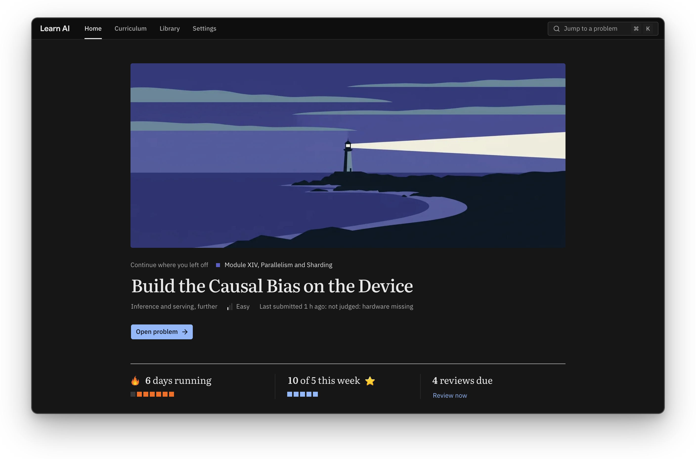
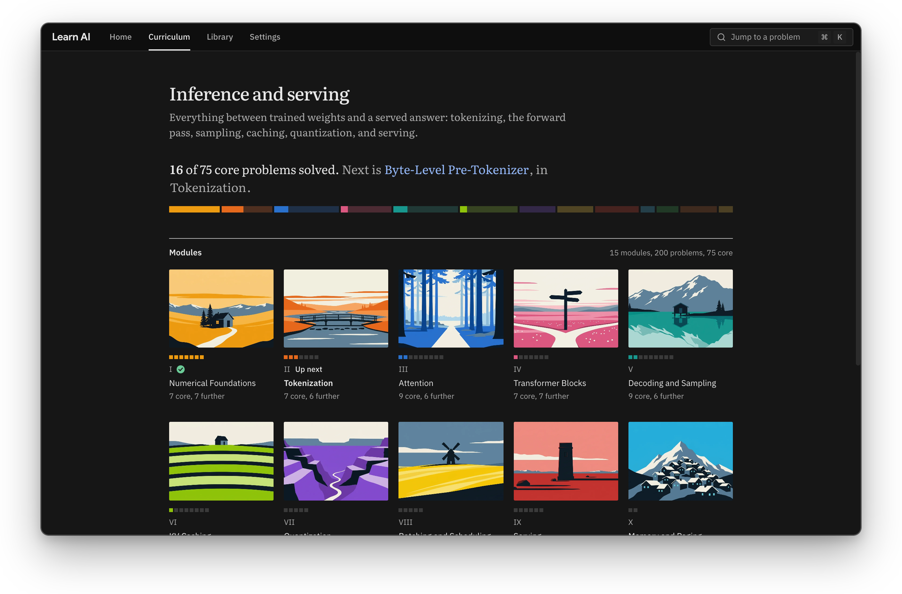
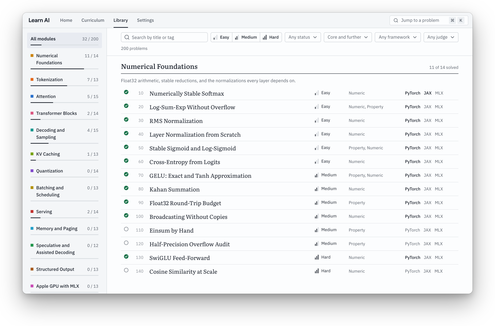
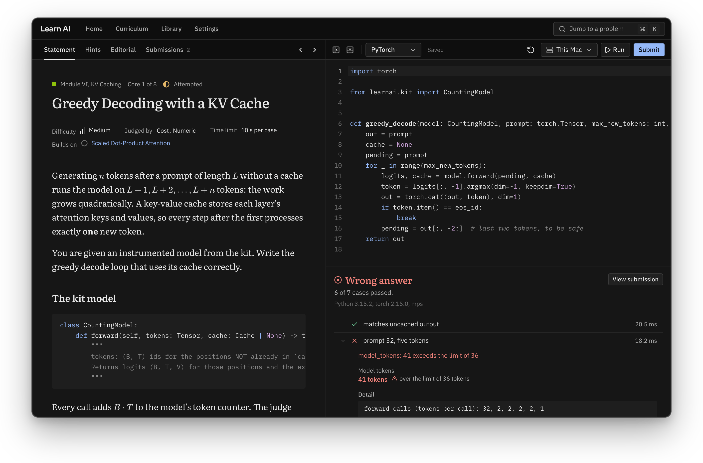
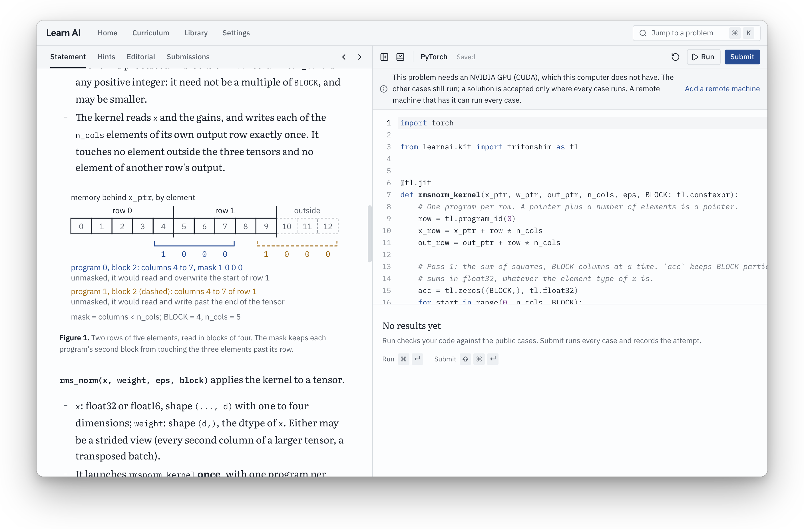
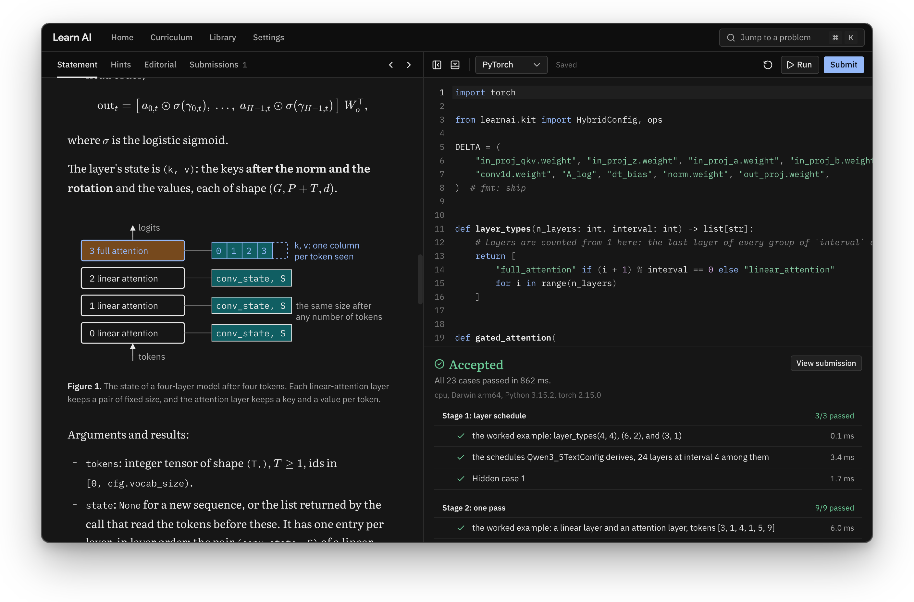

<p align="center">
  
</p>

<h1 align="center">Learn AI</h1>

Learn AI is a native desktop app for mastering LLM inference and serving through
LeetCode-style practice problems. You write solutions in PyTorch, JAX, MLX, or plain
Python, and a local judge runs them against public and hidden tests.

The catalog has 237 problems in 20 tracks, from stable softmax to capstones such as a
continuous-batching engine and a complete runtime for a real model, with a core list of
problems in each module. Catalog and cores: `docs/CURRICULUM.md`. Writing problems:
`docs/PROBLEM_AUTHORING.md`. Producing and verifying a batch of problems:
`docs/PROBLEM_PROCESS.md`.

Architecture and contracts: `docs/ARCHITECTURE.md`. Dependency versions: `docs/VERSIONS.md`.

## Screenshots

<p align="center">
  
</p>

<p align="center">
  
  
  <br>
  <sub>Curriculum and library</sub>
</p>

<p align="center">
  
  
  <br>
  <sub>An accepted submission, and the cost judge counting model tokens</sub>
</p>

<p align="center">
  
  
  <br>
  <sub>A Triton kernel for RMSNorm, and a hybrid decoder from Model architectures</sub>
</p>

The last two screenshots show the catalog; the others show the sample data that `pnpm dev` serves.

## Prerequisites

- macOS 14 or later on Apple silicon (required by the MLX and PyTorch wheels)
- Node.js 25 and pnpm 10
- Rust (stable, 1.100 or later) with the Xcode Command Line Tools
- uv 0.9.26 or later (it uses Python 3.15, pinned in `python/.python-version`)

## Development

```sh
# Front end and desktop shell
pnpm install
pnpm dev                                  # Vite dev server with sample data, http://localhost:1420
pnpm dev:real                             # the real core and judge in a browser: devbridge + Vite
pnpm dev:bridge                           # only the devbridge (learnai-core over HTTP on 127.0.0.1:1421)
pnpm dev:http                             # only Vite, pointed at a running devbridge
pnpm tauri dev                            # desktop app with hot reload
pnpm build                                # type-check and build the front end
pnpm tauri build --debug                  # build and bundle the app (target/debug/learnai)

# Rust workspace (src-tauri, crates/core, crates/devbridge)
cargo check --workspace
cargo test --workspace                    # the real-ty editor test skips itself when ty is not installed
cargo clippy --workspace --all-targets
cargo run -p learnai-devbridge

# Python (always pass the full set of extras; a bare `uv sync` removes them)
# (`editor` is the ty language server behind the app's completion and hover)
uv sync --project python --extra jax --extra mlx --extra models --extra editor
uv run --project python --extra jax --extra mlx --extra models --extra editor learnai
uv run --project python --extra jax --extra mlx --extra models --extra editor learnai validate --all   # the catalog's quality gate
uv run --project python --extra jax --extra mlx --extra models --extra editor pytest python/tests
uv run --project python ruff check python
```

The desktop app logs to stderr and to `~/Library/Logs/dev.learnai.app/learnai.log`:
the content root, catalog problems that were skipped and why, and every finished run.
Set `LEARNAI_LOG=debug` to also log each command the window invokes. Builds made by
the Tauri CLI leave the sample data out of the bundle.

## Layout

```
src/              React + TypeScript front end (shadcn/ui components in src/components/ui)
src-tauri/        Tauri shell (thin command layer)
crates/core/      learnai-core: application logic
crates/devbridge/ dev-only HTTP bridge
python/           uv project: the learnai package and the learnai CLI
problems/         problem catalog
workspace/        your solutions (gitignored, created on demand)
```
