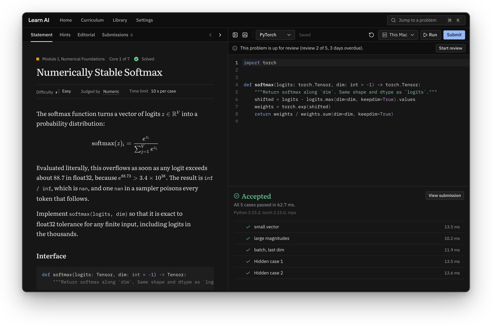

<p align="center">
  
</p>

<h1 align="center">Learn AI</h1>

Learn AI is a native desktop app for mastering LLM inference and serving through
LeetCode-style practice problems. You write solutions in PyTorch, JAX, MLX, or plain
Python, and a local judge runs them against public and hidden tests.

The catalog has 237 problems in 20 tracks, from stable softmax to capstones such as a
continuous-batching engine and a complete runtime for a real model, with a core list of
problems in each module. Catalog and cores: `docs/CURRICULUM.md`. Writing problems:
`docs/PROBLEM_AUTHORING.md`. Producing and verifying a batch of problems:
`docs/PROBLEM_PROCESS.md`.

Architecture and contracts: `docs/ARCHITECTURE.md`. Dependency versions: `docs/VERSIONS.md`.

## Screenshots

<p align="center">
  
</p>

<p align="center">
  
  
  <br>
  <sub>Curriculum and library</sub>
</p>

<p align="center">
  
  
  <br>
  <sub>An accepted submission, and the cost judge counting model tokens</sub>
</p>

<p align="center">
  
  
  <br>
  <sub>A Triton kernel for RMSNorm, and a hybrid decoder from Model architectures</sub>
</p>

## Install

macOS and Linux:

```sh
curl -fsSL https://raw.githubusercontent.com/BlueBlazin/learnai/master/install.sh | sh
```

Windows, in PowerShell:

```powershell
irm https://raw.githubusercontent.com/BlueBlazin/learnai/master/install.ps1 | iex
```

The installer downloads the app, the problems, and its own copy of uv, which then
downloads Python 3.15 and the libraries (PyTorch, JAX, and MLX on Apple silicon). Installed, that is about 3 GB on macOS, 2 GB on
Windows, and 6 GB on Linux, where PyTorch brings its CUDA libraries.
Nothing has to be installed first. The one exception is Linux, where the window needs
the system library WebKitGTK 4.1; the installer names the package if it is missing.

Everything goes into `~/.learnai` (`%USERPROFILE%\.learnai` on Windows). Outside that
folder there is only:

- what the system starts the app from: the app in `~/Applications` on macOS, a
  `.desktop` file on Linux, a Start Menu shortcut on Windows
- the folders the system keeps for any app (settings, logs, web cache)

The installer uses no `sudo`, changes neither `PATH` nor a shell profile nor the
registry, and neither uses nor changes a Python or uv you already have.

- **Update:** run the installer again. Your solutions and progress are kept.
- **Uninstall:** `sh ~/.learnai/uninstall.sh`, or `%USERPROFILE%\.learnai\uninstall.cmd`
  on Windows. It removes all of the above and asks before deleting your solutions and
  progress.

Learn AI runs on:

- macOS 14 or later on Apple silicon
- Linux on x86_64 or arm64
- Windows on x64

Intel Macs and Windows on ARM are not supported: PyTorch publishes no wheel for them.
CI builds the app and runs the tests and the catalog's quality gate on macOS, Ubuntu
24.04 (x86_64 and arm64), and Windows Server 2025 on every push, and runs the installer
on each of them whenever it changes. Day-to-day use so far has been on macOS only.

MLX is installed only on Apple silicon. On Linux and Windows the 18 MLX-only problems
cannot be run, and every other problem is solved in PyTorch, JAX, or plain Python.

## Prerequisites

To build from source instead, on every platform:

- Node.js 25 and pnpm 10
- Rust (stable, 1.100 or later)
- uv 0.9.26 or later (it uses Python 3.15, pinned in `python/.python-version`)

And for the desktop shell:

- macOS: the Xcode Command Line Tools
- Linux: WebKitGTK 4.1 and the other Tauri system packages. On Debian or Ubuntu:

  ```sh
  sudo apt-get install libwebkit2gtk-4.1-dev build-essential curl wget file \
    libxdo-dev libssl-dev libayatana-appindicator3-dev librsvg2-dev
  ```

- Windows: the Microsoft C++ Build Tools with "Desktop development with C++", and the
  WebView2 runtime (Windows 11 includes it)

## Development

```sh
# Front end and desktop shell
pnpm install
pnpm dev                                  # Vite dev server with sample data, http://localhost:1420
pnpm dev:real                             # the real core and judge in a browser: devbridge + Vite
pnpm dev:bridge                           # only the devbridge (learnai-core over HTTP on 127.0.0.1:1421)
pnpm dev:http                             # only Vite, pointed at a running devbridge
pnpm tauri dev                            # desktop app with hot reload
pnpm build                                # type-check and build the front end
pnpm tauri build --debug                  # build and bundle the app (target/debug/learnai)

# Rust workspace (src-tauri, crates/core, crates/devbridge)
cargo check --workspace
cargo test --workspace                    # the real-ty editor test skips itself when ty is not installed
cargo clippy --workspace --all-targets
cargo run -p learnai-devbridge

# Python (always pass the full set of extras; a bare `uv sync` removes them)
# (`editor` is the ty language server behind the app's completion and hover)
uv sync --project python --extra jax --extra mlx --extra models --extra editor
uv run --project python --extra jax --extra mlx --extra models --extra editor learnai
uv run --project python --extra jax --extra mlx --extra models --extra editor learnai validate --all   # the catalog's quality gate
uv run --project python --extra jax --extra mlx --extra models --extra editor pytest python/tests
uv run --project python ruff check python
```

The commands are the same on every platform, including `--extra mlx`, which installs
nothing off Apple silicon. There `learnai validate` skips MLX solutions and reports them
as not validated. Two scripts need a POSIX shell: on Windows, instead of `pnpm dev:real`
or `pnpm dev:http`, run `pnpm dev:bridge` in one terminal and this in another:

```powershell
$env:VITE_BACKEND = "http"; pnpm dev
```

The desktop app logs to stderr and to `learnai.log` in the platform's log directory:

- macOS: `~/Library/Logs/dev.learnai.app/`
- Linux: `~/.local/share/dev.learnai.app/logs/`
- Windows: `%LOCALAPPDATA%\dev.learnai.app\logs\`

It logs the content root, catalog problems that were skipped and why, and every finished
run. Set `LEARNAI_LOG=debug` to also log each command the window invokes. Builds made by
the Tauri CLI leave the sample data out of the bundle.

## Layout

```
src/              React + TypeScript front end (shadcn/ui components in src/components/ui)
src-tauri/        Tauri shell (thin command layer)
crates/core/      learnai-core: application logic
crates/devbridge/ dev-only HTTP bridge
python/           uv project: the learnai package and the learnai CLI
problems/         problem catalog
workspace/        your solutions (gitignored, created on demand)
```
