Implement a mixture-of-experts layer whose routed experts run at a reduced width while the router and the shared expert stay at full width. The layer projects each token down once, runs and mixes the selected experts in the narrower latent space, normalizes the mixture, projects back up, and adds the shared expert output. Every expert call and processed row is counted.



## Specification

```python
def latent_moe(x, w_router, w_down, w_up, norm_gain, experts, shared_w, k): ...
def expert_params(hidden, latent, inter, n_experts): ...  # -> (with_latent, without_latent)
```

Let $N$ be the number of tokens, $D$ the model width, $L < D$ the latent width, and $E$ the number of routed experts. All linear weight matrices (`w_router`, `w_down`, `w_up`, and the matrices in `shared_w`) use `(out, in)` layout and are applied to row vectors as `x @ w.T`.

For **each token** $x \in \mathbb{R}^D$ independently, `latent_moe` performs five steps:

1. **Route at full width.** Compute sigmoid routing scores $s = \sigma(W_{\text{router}}\, x) \in \mathbb{R}^E$, where $\sigma$ is the elementwise sigmoid and $W_{\text{router}}$ is `w_router`. Select the set $S$ of the $k$ experts with the largest scores. Break ties by expert index, lowest first. Normalize the selected scores into weights:

$$
w_e = \frac{s_e}{\sum_{j \in S} s_j + 10^{-20}} \qquad (e \in S) .
$$

   This matches the router in `sigmoid-router-shared-expert` with no bias and a routing scale of 1.

2. **Project down once.** Map the token into the latent space with $W_{\text{down}}$ (`w_down`):

$$
z = W_{\text{down}}\, x \in \mathbb{R}^L .
$$

3. **Run and mix the selected experts at latent width.** Evaluate each chosen expert $e \in S$ on $z$ and combine their outputs:

$$
m = \sum_{e \in S} w_e\, f_e(z) ,
$$

   where $f_e$ is the function applied by `experts(e, ·)` to a single latent row.

4. **Normalize the mixture.** Apply RMS normalization across the $L$ channels of $m$ using `norm_gain` ($g$) and $\epsilon = 10^{-5}$, where $\odot$ is elementwise multiplication:

$$
n = g \odot \frac{m}{\sqrt{\tfrac{1}{L}\sum_{i=1}^{L} m_i^2 + 10^{-5}}} .
$$

   This is `ops.rms_norm(m, norm_gain, eps=1e-5)` from `learnai.kit`.

5. **Project up and add the shared expert.** Map $n$ back to width $D$ with $W_{\text{up}}$ (`w_up`) and add the shared SwiGLU expert evaluated on the original full-width input $x$:

$$
y = W_{\text{up}}\, n + \texttt{ops.swiglu}(x, \texttt{*shared\_w}) ,
$$

   where `ops.swiglu` is from `learnai.kit` and `shared_w` is the tuple `(w_gate, w_up, w_down)` of inner width $H_s$.

**Expert interface and work accounting.** `experts` is a [`CountingExperts`](../../../python/src/learnai/kit/moe.py) object of width $L$ with `experts.n_experts == E`. Calling `experts(e, rows)` runs expert `e` (a Python `int`) on a float32 tensor of shape `(n, L)` and returns `(n, L)` row for row. It is the only way to evaluate a routed expert. Each call increments `expert_calls` by 1 and `expert_rows` by `n`, and raises `ValueError` if `rows` does not have width $L$.

Each expert chosen by at least one token must be called **exactly once**, passing the latent rows of only the tokens that selected it (in any order). An expert chosen by no token must not be called at all, not even with zero rows. Consequently, `expert_rows` must equal $k \cdot N$, and `expert_calls` must equal the number of distinct experts selected by at least one token.

**`expert_params(hidden, latent, inter, n_experts)`** returns a tuple `(with_latent, without_latent)` of two Python `int` values counting the routed expert parameters with and without the latent projection. Each routed expert at width $w$ is a bias-free SwiGLU MLP with three matrices: gate and up of shape `(inter, w)`, and down of shape `(w, inter)`.

- `with_latent`: `n_experts` experts at width `latent`, plus the shared projection matrices $W_{\text{down}}$ and $W_{\text{up}}$.
- `without_latent`: `n_experts` experts at width `hidden`.

Exclude the router, the shared expert, and `norm_gain` from both counts.

## Shapes

| name | shape | dtype |
|---|---|---|
| `x` | `(N, D)` | float32 |
| `w_router` | `(E, D)` | float32 |
| `w_down` | `(L, D)` | float32 |
| `w_up` | `(D, L)` | float32 |
| `norm_gain` | `(L,)` | float32 |
| `rows` passed to `experts(e, rows)` | `(n, L)` | float32 |
| `shared_w` (`w_gate`, `w_up`, `w_down`) | `(H_s, D)`, `(H_s, D)`, `(D, H_s)` | float32 |
| `k` | Python `int` ($2 \le k \le E$) | int |
| result of `latent_moe` | `(N, D)` | float32 |
| result of `expert_params` | `(int, int)` | Python `int` |

## Example

Consider the routed expert dimensions of Kimi K3.1: model width 7168, latent width 3584, expert inner width 3072, and 896 experts.

```python
expert_params(7168, 3584, 3072, 896)  # (29646389248, 59190018048)
```

Without the latent projection, each expert has $3 \cdot 7168 \cdot 3072 = 66{,}060{,}288$ parameters, so 896 experts total 59.19 billion. At latent width, each expert has $3 \cdot 3584 \cdot 3072 = 33{,}030{,}144$ parameters (29.60 billion across 896 experts), and the two shared projections add $2 \cdot 7168 \cdot 3584 = 51{,}380{,}224$ once, for a total of 29.65 billion.

For a small example, `expert_params(4, 2, 3, 5)` returns `(106, 180)`, computed from $5 \cdot 3 \cdot 2 \cdot 3 + 2 \cdot 4 \cdot 2 = 106$ and $5 \cdot 3 \cdot 4 \cdot 3 = 180$.

For `latent_moe` with $N = 12$ tokens, $k = 2$, and $E = 8$ experts, a correct implementation makes at most 8 expert calls with 24 rows of width $L$ in total. Evaluating every expert on every token would instead make 8 calls with 96 rows.

## Constraints

- $1 \le N \le 12$, $D = 16$, $L = 8$, $2 \le E \le 8$, $2 \le k \le E$.
- The output of `latent_moe` is compared against dense evaluation of the formulas above with relative tolerance `1e-4` and absolute tolerance `1e-5`. An expert's output for a row does not depend on which other rows are batched with it, up to floating-point rounding.
- **Cost (checked on every test):** `expert_rows` must equal $k \cdot N$, and `expert_calls` must be at most the number of experts chosen by at least one token.
- In every test, the $k$-th and $(k+1)$-th largest scores of a token are either exactly equal (from small integer inputs) or differ by more than $10^{-3}$.
- `expert_params` is checked for exact equality and must return Python `int` values.
- A Python loop over experts is expected. No loop over tokens is needed.

## Why this matters

Routed experts hold most of the parameters in a large mixture-of-experts model. At width 7168, 896 SwiGLU experts take 59 billion parameters per layer. Running those experts at half width cuts that count roughly in half for the cost of two shared projection matrices.

Subtle implementation bugs in this layer fail silently because every intermediate tensor still has a valid shape. Normalizing each expert's output before mixing instead of normalizing the mixture, or omitting the norm because another model's latent MoE omits it, runs without error and feeds a mis-scaled update into the residual stream at every layer.
