Implement attention where a single cached tensor per token serves as both the key and
the value. Because rotary position embeddings (RoPE) are applied to a slice of this
shared tensor, the values also carry absolute position rotations, so the attention
output must be rotated back by the query position.



## Specification

```python
def shared_kv_attention(q, kv, pos_q, pos_k, mask, rope_dim, base): ...
```

The input `q` holds queries for `H` heads across `T` query tokens, each of head width
`d`. The input `kv` holds `S` cached rows of width `d`, shared across all `H` heads.
Query head `h` at token index `t` is `q[h, t]`, and cached token `s` is `kv[s]`.

The **trailing** `rope_dim` channels of each `d`-dimensional vector form the rotary
slice, where `rope_dim` is an even Python integer with $2 \le \texttt{rope\_dim} \le d$.
The leading $c = d - \texttt{rope\_dim}$ channels remain unrotated. The parameter
`base` is a Python float greater than 1 (`rope_theta` in model configurations).

The position vectors `pos_q` (length `T`) and `pos_k` (length `S`) contain non-negative
integer positions. They do not need to start at 0 or be contiguous. The boolean tensor
`mask` has shape `(T, S)`, and every row has at least one `True` entry.

**Rotation.** For a vector $x \in \mathbb{R}^d$ and an integer position $p$ (which may
be negative), $\operatorname{rot}(x, p)$ leaves the first $c = d - \texttt{rope\_dim}$
channels unchanged and rotates the trailing `rope_dim` channels in adjacent pairs
$(a, b) = (x_{c + 2i},\ x_{c + 2i + 1})$ for $0 \le i < \texttt{rope\_dim}/2$. Each pair
turns counterclockwise by $p\,\theta_i$ to $(a', b')$:

$$
\theta_i = \texttt{base}^{-2i/\texttt{rope\_dim}}, \qquad
\begin{bmatrix} a' \\ b' \end{bmatrix}
=
\begin{bmatrix}
\cos p\theta_i & -\sin p\theta_i \\
\sin p\theta_i & \phantom{-}\cos p\theta_i
\end{bmatrix}
\begin{bmatrix} a \\ b \end{bmatrix} .
$$

This uses the interleaved pair layout from `rope`, with frequencies computed for width
`rope_dim` rather than `d`.

**Attention.** Rotate each query by its query position to form
$\tilde q_{h,t} = \operatorname{rot}(q_{h,t},\ \texttt{pos\_q}[t])$, and rotate each
cached row by its key position to form
$\tilde k_s = \operatorname{rot}(\texttt{kv}_s,\ \texttt{pos\_k}[s])$. Compute scaled
dot-product attention using the rotated rows $\tilde k_s$ as both keys and values, then
rotate the result back by $-\texttt{pos\_q}[t]$:

$$
a_{h,t,\cdot} = \operatorname{softmax}_{s\,:\,\texttt{mask}[t, s]}\ \frac{\tilde q_{h,t} \cdot \tilde k_s}{\sqrt{d}},
\qquad
o_{h,t} = \sum_{s} a_{h,t,s}\, \tilde k_s ,
\qquad
\texttt{out}_{h,t} = \operatorname{rot}\!\big(o_{h,t},\ -\texttt{pos\_q}[t]\big) .
$$

The softmax runs only over cached indices `s` where `mask[t, s]` is `True`. Any entry
where `mask[t, s]` is `False` must receive weight exactly 0, regardless of how large
its raw score is.

You may use your framework's `softmax`.

## Shapes

| name | shape | dtype |
|---|---|---|
| `q` | `(H, T, d)` | float32 |
| `kv` | `(S, d)` | float32 |
| `pos_q` | `(T,)` | integer |
| `pos_k` | `(S,)` | integer |
| `mask` | `(T, S)` | bool |
| result | `(H, T, d)` | float32 |

## Example

Consider one head and two tokens at positions 3 and 4 with a causal mask, $d = 4$,
`rope_dim = 2`, and `base = 100`. The rotary slice is a single pair (channels 2 and 3)
with $\theta_0 = 1$.

```python
q = [[[1.0, 0.0, 2.0, 0.0], [0.0, 1.0, 0.0, 2.0]]]  # shape (1, 2, 4)
kv = [[1.0, 2.0, 1.0, 0.0], [2.0, -1.0, 0.0, 1.0]]  # shape (2, 4)
mask = [[True, False], [True, True]]

shared_kv_attention(q, kv, [3, 4], [3, 4], mask, 2, 100.0)
# [[[1.000000, 2.000000, 1.000000, 0.000000],
#   [1.584548, 0.246357, 0.224470, 0.234957]]]
```

Token 0 attends only to itself with weight 1. Its rotary slice turns by $+3$ radians on
the way in and by $-3$ radians on the way out, so the output is `kv[0]`.

Token 1 sits at position 4 and attends to both rows. Before dividing by $\sqrt{4} = 2$,
the plain channels score $[0, 1] \cdot [1, 2] = 2$ and $[0, 1] \cdot [2, -1] = -1$. In
the rotary pair, the query $(0, 2)$ meets row 0 at relative offset $-1$, contributing
$(0, 2) \cdot (\cos 1, -\sin 1) = -1.6829$, and meets row 1 at offset $0$, contributing
$2$. Dividing by 2 gives scores $0.3171 / 2$ and $1 / 2$, which yield softmax weights
$0.415452$ and $0.584548$.

| channels of `out[0, 1]` | value |
|---|---|
| plain: $0.415452 \cdot (1, 2) + 0.584548 \cdot (2, -1)$ | $(1.584548,\ 0.246357)$ |
| rotary: $0.415452 \cdot \operatorname{rot}((1, 0), -1) + 0.584548 \cdot \operatorname{rot}((0, 1), 0)$ | $(0.224470,\ 0.234957)$ |

Each cached row arrives rotated by its distance to the query. Shifting all positions to
`[103, 104]` produces the exact same output.


## Constraints

- $1 \le H \le 8$, $1 \le T, S \le 8$, $d$ is even with $4 \le d \le 512$, and
  $10 \le \texttt{base} \le 10^4$.
- Positions are non-negative and below 2048. Attention scores
  $\tilde q \cdot \tilde k / \sqrt{d}$ are below 1000 in magnitude.
- Outputs are compared against the reference and, for DeepSeek-V4 dimensions, against
  Hugging Face Transformers. When every position is below 64, the relative tolerance is
  `1e-4` and the absolute tolerance is `1e-4`. For larger positions, the relative
  tolerance is `1e-3` and the absolute tolerance is `2e-3`.
- Adding the same constant to every entry of `pos_q` and `pos_k` must leave the output
  unchanged within tolerance `1e-3`.
- No Python loops over heads, tokens, or pairs are needed.

## Why this matters

DeepSeek-V4 uses a single key-value head of width 512 that is read as both key and
value by 128 query heads, with its last 64 channels rotated. Sharing one tensor halves
the KV cache size, but it also makes the stored values depend on absolute position.

Without the inverse rotation on the output, a model only reads its cache properly near
positions it saw frequently during training. Substituting unrotated values avoids
position drift, yet it is still silently wrong because the model expects each value to
arrive rotated by its relative distance from the query.
