Implement attention in which one tensor per token is both the key and the value. The
tensor carries rotary positions on a slice of its channels, so the values are rotated
too, and the output has to be rotated back by the query position.


## Specification

```python
def shared_kv_attention(q, kv, pos_q, pos_k, mask, rope_dim, base): ...
```

`q[h, t]` is the query of head $h$ for the token at sequence index `t`, and `kv[s]` is
the row of cached token `s`, shared by all $H$ heads. Head width is $d$; the
**trailing** `rope_dim` channels are the rotary slice.

**Rotation.** $\operatorname{rot}(x, p)$ rotates the rotary slice of
$x \in \mathbb{R}^d$ for the position $p$, which may be negative, and returns the other
channels unchanged. With $c = d - \texttt{rope\_dim}$, pair $i$ is the adjacent
channels $(x_{c + 2i},\ x_{c + 2i + 1})$ for $0 \le i < \texttt{rope\_dim}/2$, turned
counterclockwise by $p\,\theta_i$:

$$
\theta_i = \texttt{base}^{-2i/\texttt{rope\_dim}}, \qquad
\begin{bmatrix} a' \\ b' \end{bmatrix}
=
\begin{bmatrix}
\cos p\theta_i & -\sin p\theta_i \\
\sin p\theta_i & \phantom{-}\cos p\theta_i
\end{bmatrix}
\begin{bmatrix} a \\ b \end{bmatrix} .
$$

This is the interleaved layout of the `rope` problem on the slice, with the
frequencies of a head of width `rope_dim`.

**Attention.** With $\tilde q_{h,t} = \operatorname{rot}(q_{h,t},\ \texttt{pos\_q}[t])$
and $\tilde k_s = \operatorname{rot}(\texttt{kv}_s,\ \texttt{pos\_k}[s])$:

$$
a_{h,t,\cdot} = \operatorname{softmax}_{s\,:\,\texttt{mask}[t, s]}\ \frac{\tilde q_{h,t} \cdot \tilde k_s}{\sqrt{d}},
\qquad
o_{h,t} = \sum_{s} a_{h,t,s}\, \tilde k_s ,
\qquad
\texttt{out}_{h,t} = \operatorname{rot}\!\big(o_{h,t},\ -\texttt{pos\_q}[t]\big) .
$$

The softmax runs over the rows `s` with `mask[t, s]` true. A row with `mask[t, s]`
false has weight exactly 0, however large its score. The values are the rotated rows
$\tilde k_s$.

- `q`: float32, shape `(H, T, d)`. `kv`: float32, shape `(S, d)`.
- `pos_q`: integer tensor, shape `(T,)`; `pos_k`: integer tensor, shape `(S,)`.
  Absolute positions, $\ge 0$, not necessarily starting at 0 or contiguous.
- `mask`: bool tensor, shape `(T, S)`; every row has at least one true entry.
- `rope_dim`: an even Python int, $2 \le \texttt{rope\_dim} \le d$.
- `base`: a Python float greater than 1 (`rope_theta` in configurations).
- Returns float32, shape `(H, T, d)`.

You may use your framework's `softmax`.

## Shapes

| name | shape | dtype |
|---|---|---|
| `q` | `(H, T, d)` | float32 |
| `kv` | `(S, d)` | float32 |
| `pos_q` | `(T,)` | integer |
| `pos_k` | `(S,)` | integer |
| `mask` | `(T, S)` | bool |
| result | `(H, T, d)` | float32 |

## Example

One head, two tokens at positions 3 and 4 with a causal mask, $d = 4$, `rope_dim = 2`,
and `base = 100`. The slice is one pair, channels 2 and 3, with $\theta_0 = 1$.

```python
q = [[[1.0, 0.0, 2.0, 0.0], [0.0, 1.0, 0.0, 2.0]]]  # shape (1, 2, 4)
kv = [[1.0, 2.0, 1.0, 0.0], [2.0, -1.0, 0.0, 1.0]]  # shape (2, 4)
mask = [[True, False], [True, True]]

shared_kv_attention(q, kv, [3, 4], [3, 4], mask, 2, 100.0)
# [[[1.000000, 2.000000, 1.000000, 0.000000],
#   [1.584548, 0.246357, 0.224470, 0.234957]]]
```

Token 0 sees only its own row, with weight 1: the row is turned by 3 radians on the
way in and by $-3$ on the way out, so the output is `kv[0]`.

Token 1, at position 4, sees both rows. Before the division by $\sqrt{4}$, the plain
channels score $[0, 1] \cdot [1, 2] = 2$ and $[0, 1] \cdot [2, -1] = -1$. In the rotary
pair, the query $(0, 2)$ meets the row $(1, 0)$ one position back, which contributes
$(0, 2) \cdot (\cos 1, -\sin 1) = -1.6829$, and the row $(0, 1)$ at its own position,
which contributes 2. The scores are $0.3171 / 2$ and $1 / 2$; the weights are
$0.415452$ and $0.584548$.

| channels of `out[0, 1]` | value |
|---|---|
| plain: $0.415452 \cdot (1, 2) + 0.584548 \cdot (2, -1)$ | $(1.584548,\ 0.246357)$ |
| rotary: $0.415452 \cdot \operatorname{turn}_{-1}(1, 0) + 0.584548 \cdot \operatorname{turn}_{0}(0, 1)$ | $(0.224470,\ 0.234957)$ |

Each row arrives turned by its distance to the query. With positions `[103, 104]` the
result is the same.



## Constraints

- $1 \le H \le 8$; $1 \le T, S \le 8$; $d$ is even, $4 \le d \le 512$;
  $10 \le \texttt{base} \le 10^4$; positions are below 2048; scores
  $\tilde q \cdot \tilde k / \sqrt{d}$ are below 1000 in magnitude.
- Results are compared with the reference and, for the sizes of DeepSeek-V4, with
  outputs of the attention code of Hugging Face Transformers. When every position is
  below 64: relative tolerance `1e-4`, absolute tolerance `1e-4`. With larger
  positions: relative tolerance `1e-3`, absolute tolerance `2e-3`.
- Adding the same constant to every entry of `pos_q` and `pos_k` must leave the
  output unchanged (tolerance `1e-3`).
- No Python loops over heads, tokens, or pairs are needed.

## Why this matters

DeepSeek-V4 attends this way: one key-value head of width 512, read as key and as
value by 128 query heads, with the last 64 channels rotated. Sharing the tensor halves
the cache, and it makes the value depend on absolute position, which separate keys and
values never did. Without the second rotation a model reads its cache correctly only
near the positions it saw most in training. Handing back unrotated values instead is
stable and still wrong: the model was trained to receive each value turned by its
distance.
