Implement the Mixture-of-Experts (MoE) router used in DeepSeek-V3 and its successors,
along with the full MoE layer. Each token scores experts independently, selects the top
`k` experts using biased scores, weights them using unbiased scores, and adds the
output of a shared expert that runs on every token.



## Specification

```python
def route(x, w_router, bias, k, scale, score_fn="sigmoid"): ...  # -> (indices, weights)
def moe_shared(x, w_router, bias, experts_w, shared_w, k, scale, score_fn="sigmoid"): ...
```

The input `x` has shape `(N, D)` with one row per token. There are `E` routed experts,
parameterized in the router by `w_router` of shape `(E, D)` in `(out, in)` layout and a
per-expert `bias` vector of shape `(E,)` whose entries may be negative. The parameter
`k` is a Python int with $1 \le k \le E$, and `scale` is a Python float greater than 0.

For **each token** $x \in \mathbb{R}^D$ independently, `route` runs three steps:

1. **Score.** Project $x$ through `w_router` with no linear bias to produce logits
   $r \in \mathbb{R}^E$, then map each logit independently to a score $s_e$:

$$
r = W_{\text{router}}\, x \in \mathbb{R}^E, \qquad
s_e = \begin{cases}
\sigma(r_e) = \dfrac{1}{1 + e^{-r_e}} & \texttt{score\_fn} = \texttt{"sigmoid"}, \\[2ex]
\sqrt{\operatorname{softplus}(r_e)} = \sqrt{\ln(1 + e^{r_e})} & \texttt{score\_fn} = \texttt{"sqrtsoftplus"} .
\end{cases}
$$

2. **Select.** Choose the $k$ experts $e_1, \dots, e_k$ with the largest **biased**
   scores $s_e + b_e$, where $b$ is `bias`, ordered from largest to smallest. Break
   ties in biased score by expert index, lowest first.

3. **Weight.** Compute routing weights from the **unbiased** scores of the chosen
   experts, normalized by their sum (plus $10^{-20}$) and then multiplied by `scale`:

$$
w_j = \frac{s_{e_j}}{\displaystyle\sum_{i=1}^{k} s_{e_i} + 10^{-20}} \cdot \texttt{scale} .
$$

`route` returns `(indices, weights)`, giving $e_1, \dots, e_k$ and $w_1, \dots, w_k$
for every token.

**`moe_shared`** implements the full layer. `experts_w` is a tuple
`(w_gate, w_up, w_down)` holding the SwiGLU weights of all `E` routed experts (hidden
width `H`), and `shared_w` is a tuple of SwiGLU weights for the single shared expert
(hidden width `H_s`). Each routed expert $f_e$ and the shared expert $f_{\text{shared}}$
are SwiGLU MLPs (`ops.swiglu` from the kit, as in `moe-router-forward`):

$$
y = \sum_{j=1}^{k} w_j\, f_{e_j}(x) \;+\; f_{\text{shared}}(x) .
$$

The shared expert always has weight 1. It is not selected by the router, not
normalized, and not multiplied by `scale`.

Both functions must raise `ValueError` if `score_fn` is anything other than `"sigmoid"`
or `"sqrtsoftplus"`.

Dense evaluation (running every expert on every token) is fine here. You may use your
framework's `sigmoid`, `softplus`, and sorting functions, as well as the kit's
`ops.swiglu`.

## Shapes

| name | shape | dtype |
|---|---|---|
| `x` | `(N, D)` | float32 |
| `w_router` | `(E, D)` | float32 |
| `bias` | `(E,)` | float32 |
| `indices` | `(N, k)` | integer |
| `weights` | `(N, k)` | float32 |
| `experts_w` | `(E, H, D)`, `(E, H, D)`, `(E, D, H)` | float32 |
| `shared_w` | `(H_s, D)`, `(H_s, D)`, `(D, H_s)` | float32 |
| result of `moe_shared` | `(N, D)` | float32 |

## Example

Consider two tokens with $D = 2$, four experts, $k = 2$, `scale = 2.5`, and a positive
bias on expert 2:

```python
x = [[2.0, 0.0], [1.0, 1.0]]
w_router = [[1.0, 0.0], [0.5, 0.0], [0.0, 1.0], [-1.0, 0.0]]
bias = [0.0, 0.0, 0.3, 0.0]

route(x, w_router, bias, 2, 2.5)
# indices [[0, 2], [2, 0]]
# weights [[1.594726, 0.905274], [1.25, 1.25]]
```

| | token 0: $x = [2, 0]$ | token 1: $x = [1, 1]$ |
|---|---|---|
| logits $r$ | $[2, 1, 0, -2]$ | $[1, 0.5, 1, -1]$ |
| scores $s = \sigma(r)$ | $[0.8808, 0.7311, 0.5, 0.1192]$ | $[0.7311, 0.6225, 0.7311, 0.2689]$ |
| biased $s + b$ | $[0.8808, 0.7311, 0.8, 0.1192]$ | $[0.7311, 0.6225, 1.0311, 0.2689]$ |
| chosen, best first | 0, 2 | 2, 0 |
| weights | $1.5947,\ 0.9053$ | $1.25,\ 1.25$ |

For token 0, the bias lifts expert 2 above expert 1, yet expert 2's weight still uses
its unbiased score, $2.5 \cdot 0.5 / (0.8808 + 0.5) = 0.9053$. With
`score_fn="sqrtsoftplus"`, token 0's scores are $[1.4584, 1.1460, 0.8326, 0.3563]$. The
bias no longer lifts expert 2 past expert 1, so `route` returns indices
`[[0, 1], [2, 0]]` and weights `[[1.399951, 1.100049], [1.25, 1.25]]`.

Now apply the full layer, where `I` is the $2 \times 2$ identity matrix and the shared
expert has hidden width 1:

```python
I = [[1.0, 0.0], [0.0, 1.0]]
w_gate = [I, [[2.0, 0.0], [0.0, 2.0]], [[0.0, 1.0], [1.0, 0.0]], [[-1.0, 0.0], [0.0, -1.0]]]
w_up = [I, I, I, I]
w_down = [I, I, [[1.0, 1.0], [0.0, 1.0]], I]
shared_w = ([[1.0, 1.0]], [[1.0, -1.0]], [[1.0], [2.0]])

moe_shared(x, w_router, bias, (w_gate, w_up, w_down), shared_w, 2, 2.5)
# [[9.141706, 7.046376],
#  [2.741470, 1.827646]]
```

For token 0, $f_0(x) = [3.5232, 0]$, $f_2(x) = [0, 0]$, and
$f_{\text{shared}}(x) = [3.5232, 7.0464]$, giving
$y = 1.5947 \cdot [3.5232, 0] + [3.5232, 7.0464]$. For token 1,
$f_2(x) = [1.4621, 0.7311]$, $f_0(x) = [0.7311, 0.7311]$, and $f_{\text{shared}}(x) = [0, 0]$,
giving $y = 1.25 \cdot [2.1932, 1.4621]$.

## Constraints

- $1 \le N \le 8$, $2 \le D \le 16$, $1 \le E \le 384$, $1 \le k \le \min(E, 8)$, and
  $0.5 \le \texttt{scale} \le 2.5$.
- `indices` are compared exactly. `weights` and the output of `moe_shared` are compared
  with a relative tolerance of `1e-4` and an absolute tolerance of `1e-5`. For the
  routing parameters of GLM-5.3 and DeepSeek-V4, the weights are also compared against
  the router modules in Hugging Face Transformers.
- Standard tests keep router logits within $|r_e| \le 12$ for `"sigmoid"` and
  $|r_e| \le 5$ for `"sqrtsoftplus"`, because float32 `softplus` implementations
  disagree on very negative inputs. Two additional test cases go beyond those bounds:
  `"sigmoid"` with logits between $-32$ and $-30$, and logits of $-120$ where both
  score functions return exactly 0 in float32 and the weights must be 0.
- In every test, two biased scores for a token are either exactly equal (for inputs
  built from small integers, halves, and constant rows) or more than $10^{-3}$ apart
  among the $k + 1$ largest. The exception is the test with logits between $-32$ and
  $-30$, where the bias is zero and the scores (near $10^{-13}$) differ from one
  another by more than 20 percent.

## Why this matters

GLM-5.3 routes each token to 8 of 256 experts this way with a scale of 2.5, and
DeepSeek-V4 routes to 6 of 384 with `sqrtsoftplus` scores. Both add one shared expert.

Small porting mistakes fail silently in these layers. Applying `scale` before
normalization causes it to cancel out, so every routed expert contributes 2.5 times too
little relative to the shared expert while the model still outputs fluent text.
Dropping the bias, or leaking it into the weights, changes which experts run or how
much they contribute without raising any error.
