Convert a JSON Schema into a regular expression that matches exactly the compact JSON documents conforming to that schema. This is the first stage of schema-constrained generation, where the resulting pattern is compiled into a DFA that masks invalid tokens during decoding.



## Specification

```python
def schema_to_regex(schema: dict) -> str: ...
```

`schema` is a JSON Schema represented as a Python `dict`, restricted to the subset defined below. `schema_to_regex` returns a regex pattern `p` such that, for every string `d`, `re.fullmatch(p, d)` (with no flags) matches if and only if `d` is a **compact** JSON document conforming to `schema`.

**Compact** means there is no whitespace anywhere outside of string literals. There are no spaces after `:` or `,`, none inside brackets or braces, and none before or after the document. This matches the output format of `json.dumps(value, separators=(",", ":"))`.

### The schema subset and its documents

| schema | documents |
|---|---|
| `{"type": "null"}` | `null` |
| `{"type": "boolean"}` | `true` or `false` |
| `{"type": "integer"}` | an optional `-`, then `0` or a digit `1`–`9` followed by any digits `0`–`9` |
| `{"type": "number"}` | an integer as above, then optionally `.` and one or more digits, then optionally `e` or `E`, an optional `+` or `-`, and one or more digits |
| `{"type": "string"}` | `"`, any number of string items, `"` |
| `{"enum": [v1, v2, ...]}` | exactly `json.dumps(v)` for one of the listed values |
| `{"type": "array", "items": S}` | `[`, values of `S` separated by `,`, `]`; possibly `[]` |
| `{"type": "object", "properties": {...}, "required": [...]}` | `{`, members separated by `,`, `}` |

- **Digits.** Digits are ASCII `0`–`9` only. `-0` is a valid integer, whereas `01`, `+1`, `1.`, `.5`, and `1e` are not valid numbers.
- **String items.** A string item is one of the following:
  - Any single character other than `"`, `\`, and the control characters U+0000 to U+001F. All other characters, ASCII or non-ASCII (including U+007F), represent themselves.
  - `\` followed by one of `"`, `\`, `/`, `b`, `f`, `n`, `r`, or `t`.
  - `\u` followed by exactly four hexadecimal digits (`0`–`9`, `a`–`f`, `A`–`F`).
- **`minLength` and `maxLength`.** These optional non-negative integers on a string schema (`minLength <= maxLength`) bound the number of **string items**. Each escape sequence counts as one item. When omitted, any number of items is allowed.
- **`enum`.** Enum values are printable ASCII strings, ints, `True`, `False`, or `None`. A document matches if it equals the exact `json.dumps` output for one of those values (such as `"red"` with quotes, `3`, `true`, or `null`, with `"` or `\` inside a string escaped as `\"` or `\\`). If a schema contains `enum`, ignore all other keys.
- **Arrays.** `items` is always present and is a schema from this subset. Optional keys `minItems` (default `0`) and `maxItems` (default unlimited) bound the number of elements, with `minItems <= maxItems`.
- **Objects.** `properties` (default empty) maps property names to schemas, and `required` (default empty) lists the names that must appear. Each member has the form `"name":value`, where `"name"` is `json.dumps(name)` (names are printable ASCII without `"` or `\`) and `value` conforms to that property's schema.
  - Members must appear in the order declared in `properties` (dict insertion order).
  - Every required property appears exactly once, and every optional property appears at most once.
  - No unlisted properties are allowed.
  - Members are separated by single commas. There is no leading comma after `{`, no trailing comma before `}`, and no consecutive commas, regardless of which optional properties are absent. An object with no members is `{}`.
- **Nesting and errors.** Schemas may nest to any depth through `items` and `properties`, and any schema type may appear at the top level (for example, a bare number). Raise `ValueError` if a schema (at the top level or nested) has no `enum` and its `type` is missing or not one of the seven supported strings (such as a list of types or `"date"`). Tests do not use any keys other than those listed above.

### The pattern

The returned pattern is meant for a DFA compiler rather than a backtracking regex engine. It must be valid for Python's `re` and stay within the regex subset of [`regex-to-dfa`](../regex-to-dfa/statement.md) that `CharDFA.from_regex` compiles: literals, escapes, character classes, `.`, `|`, groups, and the quantifiers `*`, `+`, `?`, `{m}`, `{m,}`, and `{m,n}` with bounds up to 100. Do not use anchors (`^`, `$`), lookaround, backreferences, lazy quantifiers, or `\uXXXX` and `\b` regex escapes.

Because tests run `re.fullmatch` without flags, `\d` would match non-ASCII decimal digits such as `٣`, which are not valid JSON. Use `[0-9]` instead.

Property names and enum values are data, not regex syntax. A name like `a.b` or a value like `c++` must be escaped so it matches only itself.

## Example

```python
schema = {
    "type": "object",
    "properties": {
        "name": {"type": "string"},
        "age": {"type": "integer"},
        "email": {"type": "string"},
    },
    "required": ["name", "age"],
}
```

| document | conforms | why |
|---|---|---|
| `{"name":"Ada","age":36}` | yes | `email` is optional |
| `{"name":"Ada","age":36,"email":"ada@example.com"}` | yes | |
| `{"name": "Ada", "age": 36}` | no | not compact |
| `{"age":36,"name":"Ada"}` | no | members out of order |
| `{"name":"Ada"}` | no | `age` is required |
| `{"name":"Ada","age":36,}` | no | a comma without a member |
| `{"name":"Ada","age":036}` | no | leading zero |
| `{"name":"Ada","age":36,"x":1}` | no | `x` is not a property |

Let `STR` stand for the string pattern `"([^"\\\x00-\x1f]|\\["\\/bfnrt]|\\u[0-9a-fA-F]{4})*"`. One valid pattern for this schema is:

```
\{"name":STR,"age":-?(0|[1-9][0-9]*)(,"email":STR)?\}
```

Here, the optional member carries its own leading comma inside `(...)?`. That works because a required member always comes before it. If all three properties were optional, there would be no guaranteed earlier member. In that case, `{"email":"a"}` has no comma while `{"name":"n","email":"a"}` has one, so the pattern must account for which member comes first.

Any pattern that matches the exact same language is accepted. Tests never inspect the pattern text directly.

## Constraints

- At most 12 properties per object and 4 levels of nesting. Both `maxLength` and `maxItems` are at most 100.
- Document conformance is checked by a direct validator implementing the rules above, not by comparing against another regex. Tests use hand-written documents, generated valid instances, and corrupted copies of them.
- The returned pattern must compile with `re` and, on test schemas with small bounds, with `CharDFA.from_regex`.
- The Python standard library is allowed, including `json` and `re.escape`.

## Why this matters

In engines following the Outlines approach, "JSON mode with a schema" runs `schema_to_regex`, then `regex-to-dfa`, and then `dfa-token-index`. Because the model can only emit strings the regex allows, errors cut both ways without raising any runtime exception. A pattern that is too loose lets through invalid JSON that breaks the caller's parser (such as a trailing comma, `01`, or a raw newline inside a string). A pattern that is too strict blocks valid outputs the model needs (such as an escaped quote or an unsigned exponent), forcing the model into an unintended completion.

Object serialization is where conversions most often break, because optionality is not local in a comma-separated list. Whether a member needs a leading comma depends on whether any earlier member was emitted.
