Compile a regular expression into a minimal byte-level deterministic finite automaton (DFA) for constrained decoding. Because LLM tokens are raw byte strings, the automaton reads one byte at a time, enforces valid multi-byte UTF-8 characters, and minimizes its state count to keep per-state token masking fast.


## Specification

```python
def compile_regex(pattern: str) -> tuple[dict[int, dict[int, int]], int, set[int]]: ...
```

`compile_regex(pattern)` returns `(transitions, start, accepting)`:

- `transitions` is a dict with one entry per state. Each `transitions[state]` is a dict mapping a byte (`int` in `[0, 256)`) to the next state. A missing byte entry means rejection, so no valid string starts with that prefix. A state with no outgoing transitions maps to an empty dict `{}`.
- `start` is the start state (`int`).
- `accepting` is the `set` of accepting states (`set[int]`).
- State IDs are integers. You may number them however you like.

This return format matches the kit's [`CharDFA`](../../../python/src/learnai/kit/dfa.py) constructor, `CharDFA(transitions, start, accepting)`.

A byte string is **accepted** when starting at `start` and stepping through each byte never hits a missing entry and ends in an accepting state. The automaton must accept the exact set of byte strings matched by the full pattern (like `re.fullmatch`, not `re.search`). It must also be **minimal**:

1. Every state is reachable from `start`.
2. At least one accepting state is reachable from every state. There are no dead states, so omit any transition that would lead to one.
3. No two states are equivalent. Two states are equivalent if the exact same set of remaining byte strings is accepted from both.

Together, these three properties uniquely determine the automaton up to state numbering and guarantee the smallest possible state count.

### The regex subset

```
regex       = branch ( "|" branch )*
branch      = piece*                               (an empty branch matches "")
piece       = atom quantifier?
quantifier  = "*" | "+" | "?" | "{" m "}" | "{" m ",}" | "{" m "," n "}"
atom        = literal | "." | escape | class | "(" regex ")" | "(?:" regex ")"
class       = "[" "^"? item+ "]"
item        = member | member "-" member | "\d" | "\w" | "\s"
member      = any character except \ ] [ ^ -   |   single-escape
escape      = single-escape | "\d" | "\w" | "\s" | "\D" | "\W" | "\S"
single-escape = "\n" | "\t" | "\r" | "\f" | "\v" | "\0" | "\x" hex hex | "\" punctuation
```

- **Precedence.** A quantifier applies to the single atom immediately before it. Concatenation binds tighter than `|`, so `ab|cd*` parses as `(ab)|(c(d*))`.
- **Literals.** A `literal` is any character other than the metacharacters `. ^ $ * + ? { } [ ] ( ) | \`, and it matches itself. Escape a metacharacter with a backslash to match it literally (for example, `\.`, `\{`, `\\`). A backslash followed by any ASCII punctuation character (any ASCII character that is not a letter or a digit) matches that character.
- **Quantifiers.** `*` matches zero or more, `+` matches one or more, and `?` matches zero or one. `{m}` matches exactly `m` times, `{m,}` matches at least `m` times, and `{m,n}` matches from `m` to `n` times inclusive. Both `m` and `n` are decimal integers satisfying $0 \le m \le n \le 100$.
- **Escapes.** `\d` is `[0-9]`, `\w` is `[A-Za-z0-9_]`, and `\s` is space plus `\t`, `\n`, `\r`, `\f`, `\v`. The single escapes `\n`, `\t`, `\r`, `\f`, `\v`, and `\0` represent the bytes `0A`, `09`, `0D`, `0C`, `0B`, and `00`. `\xHH` represents the byte with hex value `HH` from `00` to `7F`.
- **Classes.** `[...]` matches one of its members. A range `a-z` matches every byte from `a` to `z` inclusive. `\d`, `\w`, and `\s` add their corresponding byte sets. A leading `^` negates the class. Inside a class, the characters `\ ] [ ^ -` are literal only when escaped, while other metacharacters (such as `.`, `*`, and `(`) are ordinary members.
- **Groups.** `(...)` and `(?:...)` only control grouping. There are no capture groups to report.

### Bytes and characters

Patterns consist of ASCII characters, while the matched text is UTF-8. Three constructs match "any character except ...". For these constructs, a **character** is one of the following byte sequences:

| bytes | first byte | then |
|---|---|---|
| 1 | `00`–`7F` | |
| 2 | `C2`–`DF` | one byte in `80`–`BF` |
| 3 | `E0`–`EF` | two bytes in `80`–`BF` |
| 4 | `F0`–`F4` | three bytes in `80`–`BF` |

- `.` matches any one character other than the newline byte `0A`.
- A negated class `[^...]` matches any one character that is not among the listed members. It does match a newline unless `\n` is listed.
- `\D`, `\W`, and `\S` match any one character that is not in `\d`, `\w`, or `\s`, respectively. They are not allowed inside a class.

All other constructs (literals, single escapes, `\d`, `\w`, `\s`, and non-negated classes) match a single ASCII byte. As a result, `.` matches `é` (bytes `C3 A9`) as a complete two-byte sequence, while rejecting `C3` alone and `A9` alone. Any byte that cannot start or continue a valid character at the current state has no transition.

Under these rules, the automaton accepts `s.encode("utf-8")` for any string `s` if and only if `re.fullmatch(pattern, s, re.ASCII)` matches.

### Invalid patterns

`compile_regex` must raise `ValueError` for any of the following:

- Unbalanced or unclosed brackets, including `(`, `a)`, `(a|b`, `[a`, or a stray `]`, `{`, or `}`.
- A quantifier with nothing to repeat (`*a`, `a|*`, `(*a)`) or stacked onto another quantifier, including lazy and possessive forms (`a**`, `a*?`, `a+?`, `a{2}{3}`).
- A malformed repetition bound or a bound outside $0 \le m \le n \le 100$ (`a{2`, `a{}`, `a{,3}`, `a{x}`, `a{3,2}`, `a{101}`).
- Anchors `^` or `$` outside a character class.
- A group starting with `(?` other than `(?:`, such as lookarounds, named groups, or flags.
- A backslash followed by an unsupported letter or digit (`\b`, `\A`, `\1`, `\p`, `\u0041`), `\x` without two hex digits, or a trailing backslash at the end of the pattern.
- A reversed range (`[z-a]`), a range using `\d`, `\w`, or `\s` as an endpoint, or any of `\D`, `\W`, or `\S` inside a class.

Tests only pass patterns from the supported subset and invalid patterns from this list.

Do not use the kit's regex compiler (`CharDFA.from_regex` or any private helper in `learnai.kit.dfa`). The harness rejects them. Python's `re` module cannot export an automaton and is not useful here.

## Example

The JSON integer pattern `-?(0|[1-9]\d*)` compiles to four minimal states. Numbering them in discovery order from the start state gives:

| state | on `-` (`2D`) | on `0` (`30`) | on `1`–`9` (`31`–`39`) | accepting |
|---|---|---|---|---|
| 0 (start) | 1 | 2 | 3 | no |
| 1 (after the sign) | | 2 | 3 | no |
| 2 (a lone zero) | | | | yes |
| 3 (digits) | | 3 | 3 | yes |

```python
transitions = {
    0: {0x2D: 1, 0x30: 2, 0x31: 3, ..., 0x39: 3},
    1: {0x30: 2, 0x31: 3, ..., 0x39: 3},
    2: {},
    3: {0x30: 3, 0x31: 3, ..., 0x39: 3},
}
start, accepting = 0, {2, 3}
```

- `"-7"` follows states `0 -> 1 -> 3` and is accepted.
- `"007"` is rejected because state `2` has no transition on `0`.
- `"-"` ends in state `1`, which is not accepting. However, state `1` is still live because digits can follow it to reach an accepting state. Token masking relies on that distinction.

Before minimization, the subset construction produces five states for this pattern. It separates "after the first digit `1`–`9`" from "after further digits" because they correspond to different sets of positions in the pattern, even though both are accepting and loop on every digit. Merging equivalent states leaves four states. A textbook complete DFA would also add a fifth dead sink state for missing transitions, which must be omitted here.



## Constraints

- Patterns have at most 200 characters, and the minimal automaton has at most 500 states. No test pattern takes the reference more than 0.1 s, and the time limit is 5 s per case.
- The accepted language is checked **exactly** against the reference automaton (reporting the shortest string on which they differ) and against `re.fullmatch(pattern, text, re.ASCII)` on generated texts.
- The state count must equal the minimal count. For example, `(a|b)*abb` has 4 states, `[a-z]{0,100}` has 101 states, and `(a|b)*a(a|b){6}` has 128 states.
- The Python standard library is allowed.

## Why this matters

Structured output starts with regex compilation. A JSON schema or tool signature is converted into a regular expression, compiled into this byte-level DFA, and combined with the model vocabulary to build the per-state token masks of `dfa-token-mask` and `dfa-token-index`.

Every downstream stage inherits mistakes made here. A precedence bug or an off-by-one bound silently enforces the wrong format. Treating `[^"]` as "any byte" allows the model to stop mid-character and emit invalid UTF-8. Finally, state count directly determines cost. Because the token index is built per state, failing to minimize multiplies both the time to first token and the index memory footprint on every new schema.
