Compile a regular expression to the deterministic automaton a constrained decoder
runs: a table that reads one **byte** at a time and says, after every byte, whether
the output can still become a match. The pieces are classical (a parser, an automaton
with choices, the subset construction, minimization); what makes it an inference
problem is that tokens are byte strings, so the automaton must be right about
multi-byte characters, and that its size is what the decoder pays for.



## Specification

```python
def compile_regex(pattern: str) -> tuple[dict[int, dict[int, int]], int, set[int]]: ...
```

`compile_regex(pattern)` returns `(transitions, start, accepting)`:

- `transitions` is a dict with one entry per state: `transitions[state]` is a dict
  from a byte (an int in `[0, 256)`) to the next state. A byte without an entry is
  rejected: no string with that prefix is in the language. A state without outgoing
  transitions has an empty dict.
- `start` is the start state and `accepting` the **set** of accepting states.
- States are ints; which ints is up to you.

This is exactly what the kit's [`CharDFA`](../../../python/src/learnai/kit/dfa.py)
takes: `CharDFA(transitions, start, accepting)`.

A byte string is **accepted** when reading its bytes from `start` never hits a
missing entry and ends in an accepting state. The automaton must accept exactly the
byte strings the pattern matches, as a whole (as `re.fullmatch` does, not as
`re.search`), and it must be **minimal**:

1. every state is reachable from `start`;
2. from every state some accepting state is reachable (no dead states: where a
   textbook automaton would move to a dead state, the entry is left out);
3. no two states are equivalent, where two states are equivalent if exactly the same
   byte strings are accepted from both.

The automaton with these three properties is unique up to the numbering of its
states, and its number of states is the smallest possible.

### The regex subset

```
regex       = branch ( "|" branch )*
branch      = piece*                               (an empty branch matches "")
piece       = atom quantifier?
quantifier  = "*" | "+" | "?" | "{" m "}" | "{" m ",}" | "{" m "," n "}"
atom        = literal | "." | escape | class | "(" regex ")" | "(?:" regex ")"
class       = "[" "^"? item+ "]"
item        = member | member "-" member | "\d" | "\w" | "\s"
member      = any character except \ ] [ ^ -   |   single-escape
escape      = single-escape | "\d" | "\w" | "\s" | "\D" | "\W" | "\S"
single-escape = "\n" | "\t" | "\r" | "\f" | "\v" | "\0" | "\x" hex hex | "\" punctuation
```

- **Precedence.** A quantifier applies to the one atom before it, concatenation binds
  tighter than `|`, and `|` is loosest: `ab|cd*` is `(ab)|(c(d*))`.
- **`literal`** is any character other than the metacharacters
  `. ^ $ * + ? { } [ ] ( ) | \`; it matches itself. To match a metacharacter, escape
  it: `\.`, `\{`, `\\`. `"\" punctuation` is a backslash followed by any ASCII
  character that is not a letter or a digit, and matches that character.
- **Quantifiers.** `*` is zero or more, `+` one or more, `?` zero or one, `{m}`
  exactly `m`, `{m,}` at least `m`, `{m,n}` from `m` to `n` inclusive. `m` and `n`
  are decimal numbers with $0 \le m \le n \le 100$.
- **Escapes.** `\d` is `[0-9]`, `\w` is `[A-Za-z0-9_]`, `\s` is space, `\t`, `\n`,
  `\r`, `\f`, `\v`. `\n \t \r \f \v \0` are the bytes `0A 09 0D 0C 0B 00`, and `\xHH`
  is the byte with hex value `HH` (`00` to `7F`).
- **Classes.** `[...]` matches one of its members; `a-z` is every byte from `a` to
  `z` inclusive; `\d`, `\w`, `\s` add their sets. A leading `^` negates the class.
  Inside a class, the characters `\ ] [ ^ -` are literal only when escaped; the
  other metacharacters (`.`, `*`, `(`, ...) are ordinary members.
- Groups only group. There are no captures to report.

### Bytes and characters

The pattern consists of ASCII characters, but the text it matches is UTF-8, and
three constructs match "any character except ...". For those, a **character** is one
of these byte sequences:

| bytes | first byte | then |
|---|---|---|
| 1 | `00`–`7F` | |
| 2 | `C2`–`DF` | one byte in `80`–`BF` |
| 3 | `E0`–`EF` | two bytes in `80`–`BF` |
| 4 | `F0`–`F4` | three bytes in `80`–`BF` |

- `.` matches one character other than the newline byte `0A`.
- A negated class `[^...]` matches one character that is not among the listed
  members. (It does match a newline unless one is listed.)
- `\D`, `\W`, `\S` match one character that is not in `\d`, `\w`, `\s`. They are not
  allowed inside a class.

Everything else (literals, single escapes, `\d \w \s`, classes that are not negated)
matches exactly one ASCII byte. So `.` matches `é` (bytes `C3 A9`) as a whole, and
neither `C3` alone nor `A9` alone; a byte that cannot start or continue a character
at that point has no transition.

With these rules, on any text `s` the automaton accepts `s.encode("utf-8")` exactly
when `re.fullmatch(pattern, s, re.ASCII)` matches.

### Invalid patterns

`compile_regex` raises `ValueError` for:

- unbalanced or unclosed brackets: `(`, `a)`, `(a|b`, `[a`, and a stray `]`, `{`, or
  `}`;
- a quantifier with nothing to repeat (`*a`, `a|*`, `(*a)`) or applied to a
  quantifier, which includes the lazy and possessive forms (`a**`, `a*?`, `a+?`,
  `a{2}{3}`);
- a malformed bound, or one outside $0 \le m \le n \le 100$: `a{2`, `a{}`, `a{,3}`,
  `a{x}`, `a{3,2}`, `a{101}`;
- the anchors `^` and `$` outside a class;
- a group that starts with `(?` other than `(?:` (lookaround, named groups, flags);
- a backslash followed by a letter or digit that is not listed above (`\b`, `\A`,
  `\1`, `\p`, `\u0041`), `\x` without two hex digits, and a backslash at the end of
  the pattern;
- in a class: a range whose end is below its start (`[z-a]`), a range with `\d`,
  `\w`, or `\s` as an endpoint, and `\D`, `\W`, or `\S`.

Tests use only patterns of the subset and patterns from this list.

Do not use the kit's regex compiler (`CharDFA.from_regex` and the private helpers of
`learnai.kit.dfa`); the harness rejects them. Python's `re` cannot produce an
automaton and is of no use here.

## Example

`-?(0|[1-9]\d*)`, a JSON integer, compiles to four states. With the states numbered
in order of discovery from the start:

| state | on `-` (`2D`) | on `0` (`30`) | on `1`–`9` (`31`–`39`) | accepting |
|---|---|---|---|---|
| 0 (start) | 1 | 2 | 3 | no |
| 1 (after the sign) | | 2 | 3 | no |
| 2 (a lone zero) | | | | yes |
| 3 (digits) | | 3 | 3 | yes |

```python
transitions = {
    0: {0x2D: 1, 0x30: 2, 0x31: 3, ..., 0x39: 3},
    1: {0x30: 2, 0x31: 3, ..., 0x39: 3},
    2: {},
    3: {0x30: 3, 0x31: 3, ..., 0x39: 3},
}
start, accepting = 0, {2, 3}
```

`"-7"` is accepted (0, 1, 3). `"007"` is rejected: state 2 has no transition on `0`.
`"-"` is rejected: it ends in state 1, which is not accepting, but it is not dead
either, and that difference is what a token mask is built from.

The subset construction applied to this pattern yields five states: "after the
first digit `1`–`9`" and "after further digits" are found as two different sets of
positions in the pattern, although both are accepting and both loop on every digit.
Merging equivalent states leaves four. A complete textbook table would add one more,
a dead state that every missing entry leads to; here it must not exist.


## Constraints

- Patterns have at most 200 characters, and the minimal automaton has at most 500
  states. No pattern in the tests takes the reference more than 0.1 s; the limit is
  5 s per case.
- The language is compared **exactly** with the reference automaton (the shortest
  string on which the two differ is reported), and on generated texts with
  `re.fullmatch(pattern, text, re.ASCII)`.
- The number of states must equal the minimal number. For example, `(a|b)*abb` has 4
  states, `[a-z]{0,100}` has 101, and `(a|b)*a(a|b){6}` has 128.
- The standard library is allowed.

## Why this matters

Structured output starts here. A JSON schema or a tool signature is turned into a
regular expression, the expression into this automaton, and the automaton, together
with the vocabulary, into the per-state token masks of `dfa-token-mask` and
`dfa-token-index`. Each stage inherits the mistakes of the one before. A precedence
bug or an off-by-one bound makes the decoder enforce a different format than the
one requested, silently. An automaton that treats `[^"]` as "any byte" lets the
model stop in the middle of a character and emit invalid UTF-8. And size is cost:
the token index is built per state, so an automaton that is not minimized
multiplies the time to the first constrained token and the memory of the index by
its redundancy, on every new schema.
