Implement `build_mask` to construct an additive attention mask for a batch of padded sequences. The mask prevents every token from attending to future positions and prevents real tokens from attending to padding positions.



## Background

Sequences in a batch often have different lengths, so shorter sequences are filled with padding tokens to reach a common length `T`. Training usually pads on the right, placing real tokens at the start of each row and padding at the end.

Batched generation usually pads on the left. During generation, the model predicts the next token from the output at the last real token and appends that new token as a new column at the end of the batch. With right padding, a short row's new token would land after its padding and leave a gap in the middle of its text. With left padding, every row ends in real tokens, so each new token directly follows the text and every row's next-token prediction sits in the last column.

## Specification

```python
def build_mask(lengths, T, padding_side): ...
```

A batch contains `B` sequences padded to a common length `T`, where `T` is a positive Python `int`. Row `b` has `lengths[b]` real tokens, and the remaining positions are padding. The `padding_side` argument is either `"left"` or `"right"` (no other value is passed). Position `j` of row `b` is **real** when:

- `padding_side == "right"`: $j < \text{lengths}[b]$ (real tokens first, padding after).
- `padding_side == "left"`: $j \ge T - \text{lengths}[b]$ (padding first, real tokens last).

In attention, position `i` (the **query**) attends to position `j` (the **key**). Query `i` of row `b` may attend to key `j` when either of the following holds:

1. Key `j` is not in the future ($j \le i$) and key `j` of row `b` is a real token.
2. Query `i` attends to itself ($j = i$), even when position `i` is padding.

Rule 2 prevents empty rows for padding queries. With left padding, every key at or before a padding query is also padding, so rule 1 alone would hide the entire row. Taking a softmax over a row of all $-\infty$ entries produces `0 / 0` (`NaN`). For real queries, rule 2 adds nothing because $j = i$ is already allowed by rule 1.

Return the **additive** mask `M` of shape `(B, 1, T, T)`:

$$
M[b, 0, i, j] = \begin{cases}
0 & \text{if query } i \text{ of row } b \text{ may attend to key } j, \\
-\infty & \text{otherwise.}
\end{cases}
$$

In attention, this mask is added to a score tensor of shape `(B, H, T, T)` before the softmax over the last axis, where `H` is the number of attention heads. The size-1 axis broadcasts across all `H` heads.

Every entry of the returned tensor must be exactly `0.0` or `-inf`. A large finite number such as `-1e9` is not accepted in place of `-inf`.

## Shapes

| name | shape | dtype |
|---|---|---|
| `lengths` | `(B,)` | integer |
| result | `(B, 1, T, T)` | float32 |

## Example

Consider two rows padded to `T = 4`, where row 0 is full and row 1 has two real tokens. Writing `-` for `-inf`, with queries as rows and keys as columns:

```python
build_mask(lengths=[4, 2], T=4, padding_side="right")

# row 0 (no padding)      row 1 (real: 0, 1; padding: 2, 3)
# [[0, -, -, -],          [[0, -, -, -],
#  [0, 0, -, -],           [0, 0, -, -],
#  [0, 0, 0, -],           [0, 0, 0, -],     <- padding query 2: keys 0, 1, and itself
#  [0, 0, 0, 0]]           [0, 0, -, 0]]     <- padding query 3: key 2 is padding
```

```python
build_mask(lengths=[4, 2], T=4, padding_side="left")

# row 0 (no padding)      row 1 (padding: 0, 1; real: 2, 3)
# [[0, -, -, -],          [[0, -, -, -],     <- padding query 0: itself only
#  [0, 0, -, -],           [-, 0, -, -],     <- padding query 1: itself only
#  [0, 0, 0, -],           [-, -, 0, -],     <- real query 2: not the padding before it
#  [0, 0, 0, 0]]           [-, -, 0, 0]]
```



Row 0 is the standard causal mask in both cases. In row 1 with left padding, the columns for padding keys 0 and 1 are hidden from real queries 2 and 3. Without rule 2, queries 0 and 1 would have no `0` entries at all. Both outputs have shape `(2, 1, 4, 4)`.

## Constraints

- The result is compared with the reference exactly, so every entry must be `0.0` or `-inf`.
- $1 \le B \le 16$, $1 \le T \le 16$, and $1 \le \text{lengths}[b] \le T$.
- No Python loops over batch items or positions are needed.

## Why this matters

Serving systems batch requests of different lengths into one tensor, and this mask is what stops padding tokens from changing the outputs. Each mistake here has a clear failure mode in production. Applying the padding mask to queries instead of keys, or padding on the wrong side, lets real tokens read padding embeddings. As a result, the same prompt produces different text depending on what else is in its batch.

A row of all `-inf` entries turns into `NaN` in the softmax. That `NaN` starts in a padding position and spreads to real tokens in the next layer's attention. A finite stand-in for `-inf` looks safe until two masks are added together or the model runs in half precision. Left padding, which batched generation relies on, is the exact case where entire rows would be hidden without the diagonal rule.
