Implement `split_heads` and `merge_heads`, the two tensor transformations that reshape features for multi-head attention. `split_heads` divides the feature axis into separate heads and moves the head axis next to the batch axis, while `merge_heads` reverses that transformation.



## Specification

```python
def split_heads(x, n_heads): ...
def merge_heads(x): ...
```

A batch of token sequences has shape `(B, T, D)`, where `B` is the batch size, `T` is the sequence length (number of tokens), and `D` is the feature width. With `H = n_heads` heads, each head receives a contiguous block of $d = D / H$ features. Head 0 owns features $0, \dots, d - 1$, head 1 owns features $d, \dots, 2d - 1$, and so on.

**`split_heads(x, n_heads)`** takes a float32 tensor `x` of shape `(B, T, D)` and a positive Python int `n_heads` (`H`) that divides `D`. It returns a float32 tensor `y` of shape `(B, H, T, d)` satisfying

$$
y[b, h, t, i] = x[b, t, h \cdot d + i]
$$

for every batch index $b$, head index $h$, token index $t$, and within-head feature index $i \in \{0, \dots, d - 1\}$. Under this layout, `y[b, h]` is the sequence of `T` vectors of width `d` as head `h` sees it.

**`merge_heads(x)`** takes a float32 tensor `x` of shape `(B, H, T, d)` and returns a float32 tensor `y` of shape `(B, T, H * d)` satisfying

$$
y[b, t, h \cdot d + i] = x[b, h, t, i] .
$$

For every token, this concatenates the vectors from head 0, head 1, ..., head `H - 1` back into a single vector of width $H \cdot d$.

- Both functions move the existing values without modifying them. Whether the result shares memory with the input does not matter.
- The two functions are exact inverses. `merge_heads(split_heads(x, H))` equals `x`, and `split_heads(merge_heads(y), H)` equals `y`.
- Both functions must work on any tensor of the right shape regardless of its memory layout, including freshly created tensors and non-contiguous tensors produced by a transpose (such as passing the output of `split_heads` directly into `merge_heads`).

## Shapes

| name | shape | dtype |
|---|---|---|
| `x` of `split_heads` | `(B, T, D)` | float32 |
| result of `split_heads` | `(B, H, T, D / H)` | float32 |
| `x` of `merge_heads` | `(B, H, T, d)` | float32 |
| result of `merge_heads` | `(B, T, H * d)` | float32 |

## Example

Consider one sequence of three tokens of width 4, split into two heads of width 2:

```python
x = [[[0.0, 1.0,  2.0,  3.0],    # token 0
      [4.0, 5.0,  6.0,  7.0],    # token 1
      [8.0, 9.0, 10.0, 11.0]]]   # token 2        shape (1, 3, 4)

split_heads(x, 2)
# [[[[0.0, 1.0], [4.0, 5.0], [ 8.0,  9.0]],      head 0: features 0-1 of each token
#   [[2.0, 3.0], [6.0, 7.0], [10.0, 11.0]]]]     head 1: features 2-3 of each token
#                                                 shape (1, 2, 3, 2)
```

Passing that output into `merge_heads` recovers `x`.



Contrast this with reshaping `x` directly to `(1, 2, 3, 2)`. That produces the right shape, but the wrong contents:

```python
# [[[[0.0, 1.0], [2.0, 3.0], [ 4.0,  5.0]],
#   [[6.0, 7.0], [8.0, 9.0], [10.0, 11.0]]]]
```

In this broken result, "head 0" holds all of token 0 and half of token 1. A reshape never changes element order in memory. It only redraws axis boundaries. Moving the head axis in front of the sequence axis reorders the elements, which requires a transpose.

## Constraints

- Results are compared with the reference exactly, because no arithmetic is performed.
- $1 \le B, T \le 16$, $1 \le H \le 16$, and $1 \le D / H \le 16$. `D` is always a multiple of `H`, and both `H = 1` and `H = D` occur.
- No Python loops over batch items, tokens, or heads are needed.

## Why this matters

Multi-head attention runs single-head attention on `H` slices in parallel. Models apply `split_heads` right after the query, key, and value projections, and apply `merge_heads` right before the output projection.

A checkpoint's projection matrices assume this exact head-major layout, so the feature order is part of the weights' contract. Every common bug here still produces a tensor of the expected shape. If a reshape replaces the transpose, each head attends over a scrambled mixture of positions and features without raising an error. The model then outputs fluent-looking nonsense, or subtly degraded text when the bug only hits one code path such as cached decoding.
