Implement `softmax` and `log_softmax` along an axis so they return accurate results for
any float32 logits, including extreme values like `1e4` or `-1e4` where the textbook
formula overflows or underflows.



## Specification

```python
def softmax(x, axis=-1): ...
def log_softmax(x, axis=-1): ...
```

For a 1-D vector $x \in \mathbb{R}^n$, `softmax` converts logits into probabilities that
sum to 1, and `log_softmax` computes their natural logarithms:

$$
\operatorname{softmax}(x)_i = \frac{e^{x_i}}{\sum_{j=1}^{n} e^{x_j}},
\qquad
\operatorname{log\_softmax}(x)_i = x_i - \log \sum_{j=1}^{n} e^{x_j}.
$$

For a multi-dimensional tensor `x`, apply the function independently to every 1-D slice
along `axis`. All other axes are treated as batch axes. Negative values of `axis` count
from the end, as usual.

Entries of `x` may be `-inf` to represent masked-out tokens. A `-inf` entry must produce
probability `0` in `softmax` and log-probability `-inf` in `log_softmax`. Every slice
along `axis` contains at least one finite value, and `+inf` and `NaN` never appear in the
input.

Write the arithmetic yourself using elementwise operations (`exp`, `log`) and reductions
(`max`, `sum`). Do not call your framework's built-in `softmax`, `log_softmax`, or
`logsumexp`.

## Shapes

| name | shape | dtype |
|---|---|---|
| `x` | `(d_1, ..., d_k)`, $1 \le k \le 4$ | float32 |
| result | `(d_1, ..., d_k)` | float32 |

## Example

```python
softmax([1.0, 2.0, 3.0])  # [0.0900, 0.2447, 0.6652]
log_softmax([1.0, 2.0, 3.0])  # [-2.4076, -1.4076, -0.4076]

# Shifting every logit by the same amount must not change the answer:
softmax([1001.0, 1002.0, 1003.0])  # [0.0900, 0.2447, 0.6652]
log_softmax([1001.0, 1002.0, 1003.0])  # [-2.4076, -1.4076, -0.4076]
```

The second pair breaks the textbook formula. In float32, $e^{x}$ overflows to `inf` once
$x > 88.7$, so $e^{1001}$ becomes `inf` and `inf / inf` produces `NaN`. In the opposite
direction, $e^{x}$ underflows to `0` below about $-103$, so `[-1001.0, -1002.0, -1003.0]`
evaluates to `0 / 0`.

`log_softmax` has a separate failure mode. For `x = [0.0, -200.0]`, the exact answer is
`[-1.4e-87, -200.0]`, which rounds to `[0.0, -200.0]` in float32. Computing
`log(softmax(x))` instead gives `[0.0, -inf]` because $e^{-200}$ underflows to `0` in
float32 even though its logarithm is representable.

## Constraints

- Results are compared with the reference to a relative tolerance of `1e-4` and an
  absolute tolerance of `1e-6`. Infinities must match exactly, and a `NaN` is always
  wrong.
- Finite logits lie in $[-10^4, 10^4]$.
- `x` has at most 100,000 elements. No Python loops over elements are needed.

## Why this matters

Every token an LLM emits passes through `softmax` or `log_softmax`. The final layer
produces logits, and sampling, top-p filtering, beam scores, and perplexity all depend on
normalizing them. Real logits routinely span tens to hundreds after dividing by a small
temperature, adding a logit bias, or masking tokens with large negative values.

An unstable implementation fails silently. It produces a `NaN` that turns into token ID 0,
or a `-inf` log-probability that corrupts a beam score several steps later. Inference
engines avoid both failures by working in log space with the shifted formulation.
