Implement prefill and single-token decoding for a decoder that shares keys and values across its upper layers. Layers below `share_from` maintain their own KV caches, while every layer from `share_from` up computes its own queries, attends over the keys and values stored by layer `share_from - 1`, and stores no cache of its own.

## Specification

```python
def prefill_shared(lm, prompt, share_from): ...  # -> (logits, cache)
def decode_step(lm, token, cache, share_from): ...  # -> (logits, cache)
```

`lm` is a [`LayeredLM`](../../../python/src/learnai/kit/layeredlm.py), a decoder with $L =$ `lm.n_layers` layers and hidden dimension $d =$ `lm.d_model`. Its layer stack can be run one contiguous slice at a time on a hidden-state tensor `h` of $T$ token positions:

```python
h = lm.embed(tokens, offset=n)  # (T, d_model): tokens at positions n, n + 1, ...
h, cache = lm.layers(h, a, b, cache)  # layers a .. b - 1, each storing its own K and V
h, cache = lm.layers(h, a, b, cache, kv_from=j)  # layers a .. b - 1 reading K and V from layer j
logits = lm.head(lm.norm(h))  # (T, vocab_size)
```

- `lm.layers(h, a, b, cache)` runs layers `a` through `b - 1` on `h` and returns `(h_out, new_cache)` without modifying `cache` in place. Each layer in this range appends the new keys and values to its own cache. Omitting `cache` (`lm.layers(h, a, b)`) starts from an empty cache.
- Passing `kv_from=j` (for a layer `j < a`) runs layers `a` through `b - 1` as **readers**. Each reader computes queries from its input, attends over the keys and values already cached by layer `j`, and stores nothing of its own. The $T$ rows of `h` correspond to the **last** $T$ positions cached in layer `j`, so layer `j` must already hold those positions in the `cache` passed in.
- `cache.lengths` is a tuple giving the number of cached tokens per layer, and `cache.length` is the maximum across layers. Because `lm` uses learned positional embeddings, any token continuing a cached sequence must be embedded with `offset=` equal to its position index.
- `lm.counters` tracks `layer_calls` (one per layer per call to `lm.layers`, regardless of $T$) and `layer_tokens` (number of layers times $T$). Calls to `embed`, `norm`, and `head` are free.

**The sharing model.** Let $s =$ `share_from`. Layers $0, \dots, s - 1$ are ordinary cached layers, and layers $s, \dots, L - 1$ are readers of layer $s - 1$. The next-token logits at any position are `lm.head(lm.norm(...))` applied to that position's output from layer $L - 1$. Note that this defines a different function from the standard unshared model `lm(tokens)`, since a model must be trained for one architecture or the other.

**`prefill_shared(lm, prompt, share_from)`** processes a prompt of $P \ge 1$ tokens and returns:

- `logits`, the sharing model's next-token logits after the prompt, and
- `cache`, a `LayerCache` where layers $0, \dots, s - 1$ hold $P$ tokens and layers $s, \dots, L - 1$ hold `0` tokens.

**`decode_step(lm, token, cache, share_from)`** processes one additional token at position `cache.length`. It returns the next-token logits after that token and a new cache extended by one token in layers $0, \dots, s - 1$ only, leaving the input `cache` unmodified.

**Cost limits.** Because reader layers store no keys and values, no later position ever attends to their outputs. At every prompt position except the last, their outputs are never read as logits either, so only the final prompt position needs to pass through layers $s, \dots, L - 1$.

| call | `layer_tokens` | `layer_calls` | reason |
|---|---|---|---|
| `prefill_shared` | $s \cdot P + (L - s)$ | $L$ | lower layers run on all $P$ prompt tokens in one call; upper layers run on the last position only |
| `decode_step` | $L$ | $L$ | every layer runs on the single new token |

**Stored KV.** After $n$ total tokens, the returned cache stores keys and values for $s$ layers, totaling $2 \cdot s \cdot n \cdot d$ float32 values ($8\,s\,n\,d$ bytes). An ordinary model stores $8\,L\,n\,d$ bytes.

## Shapes

| name | shape | dtype |
|---|---|---|
| `prompt` | list of $P$ ints | Python `int` |
| `token` | scalar | Python `int` |
| hidden states `h` | `(T, d_model)` | float32 |
| `logits` (returned) | `(vocab_size,)` | float32 |
| `cache` | `LayerCache` returned by `lm.layers` | |

## Example

`LayeredLM(seed=3)` has $L = 4$ layers. With `share_from = 2`, layers 2 and 3 read from layer 1:

```python
logits, cache = prefill_shared(lm, [0, 17, 42, 5], 2)
int(logits.argmax())  # 48
cache.lengths  # (4, 4, 0, 0)
# layer_tokens: 2 * 4 + 2 = 10        layer_calls: 4

logits, cache = decode_step(lm, 48, cache, 2)
int(logits.argmax())  # 30
cache.lengths  # (5, 5, 0, 0)
# layer_tokens: 4                     layer_calls: 4
```



| | positions run by layers 0, 1 | positions run by layers 2, 3 | layer-tokens |
|---|---|---|---|
| `prefill_shared` | 0, 1, 2, 3 | 3 | $2 \cdot 4 + 2 \cdot 1 = 10$ |
| `decode_step` | 4 | 4 | $2 + 2 = 4$ |
| ordinary model, prefill | 0, 1, 2, 3 | 0, 1, 2, 3 | $4 \cdot 4 = 16$ |

During prefill, layers 2 and 3 run only on position 3, yet their attention still covers the entire prompt because layer 1 cached positions 0 through 3. On a 1,000-token prompt with sharing from the midpoint, prefill uses 2,002 layer-tokens instead of 4,000. For comparison, the unshared model `lm(tokens)` predicts token 28 after this prompt rather than 48.

## Constraints

- $2 \le L \le 6$, $1 \le s < L$, and $1 \le P$. Total sequence length never exceeds `lm.max_context` (128).
- Returned logits are compared against the kit's full-sequence forward pass `lm(tokens, share_from=s)` with `rtol = 1e-3` and `atol = 1e-4` (cached and uncached passes differ by roughly `1e-5`).
- After every call, the tests verify the returned logits, `cache.lengths`, and both `layer_tokens` and `layer_calls` against the limits above. In the stored-KV tests, the total bytes across all key and value arrays in the final cache are checked against $8\,s\,n\,d$.
- The test harness chooses all input tokens. Your functions never sample or pick tokens.

## Why this matters

KV cache memory limits how many long sequences fit on a GPU, and prefill latency determines how long a user waits for the first token. Sharing keys and values across upper layers reduces both at once, which is why the technique has moved from research papers into production models. The upper layers require no KV cache at all, and prompt tokens only need to pass through the lower layers.

That speedup is not automatic. An inference engine that runs all layers over every prompt token out of habit produces the exact same logits and cache while silently throwing away the entire prefill speedup. Conversely, an allocator that reserves a separate KV cache for every layer silently turns the shared model into a different one.
