Implement the cached attention step of Multi-Head Latent Attention (MLA), the
attention of DeepSeek-V2 and its successors. Keys and values are low-rank: both are
up-projections of one small latent per token, so the cache keeps the latent, plus a
short RoPE key shared by all heads. The step must then attend **without rebuilding
the per-head keys and values**, by folding their up-projections into the query and
output sides. Your `mla_step` is never given those up-projections.

## Specification

```python
def absorb(w_uq, w_uk, w_uv, w_o, n_heads): ...  # -> (w_qk, w_ov)
def mla_step(x_new, weights, cache): ...  # -> (out, (c, k_rope))
```

Weights are stored as `(out_features, in_features)` and applied to row vectors as
`x @ w.T`. Sizes: $d$ = `d_model`, $H$ = `n_heads`, $d_h$ = `d_head`, $d_r$ =
`d_rope` (even), $d_c$ the width of the key-value latent, $d_q$ = `d_cq` the width
of the query latent.

**The definition (explicit form).** For the token at position $t$ with input
$x_t \in \mathbb{R}^d$:

$$
\begin{aligned}
c^Q_t &= W^{DQ} x_t \in \mathbb{R}^{d_q}, &
q^C_t &= W^{UQ} c^Q_t \in \mathbb{R}^{H d_h}, &
q^R_t &= \operatorname{RoPE}_t\!\big(W^{QR} c^Q_t\big) \in \mathbb{R}^{H d_r}, \\
c_t &= W^{DKV} x_t \in \mathbb{R}^{d_c}, &
k^C_t &= W^{UK} c_t \in \mathbb{R}^{H d_h}, &
k^R_t &= \operatorname{RoPE}_t\!\big(W^{KR} x_t\big) \in \mathbb{R}^{d_r}, \\
& & v_t &= W^{UV} c_t \in \mathbb{R}^{H d_h}.
\end{aligned}
$$

A vector of $H d_h$ (or $H d_r$) numbers is the concatenation of $H$ head vectors:
head $h$ owns entries $h\,d_h, \dots, (h+1)\,d_h - 1$. $k^R_t$ has no head index: it
is one vector used by every head. Head $h$ of token $t$ attends to tokens $j \le t$
with

$$
s_{t,h,j} = \frac{q^C_{t,h} \cdot k^C_{j,h} \;+\; q^R_{t,h} \cdot k^R_j}{\sqrt{d_h + d_r}},
\qquad
a_{t,h,\cdot} = \operatorname{softmax}_{j \le t}\, s_{t,h,j},
\qquad
o_{t,h} = \sum_{j \le t} a_{t,h,j}\, v_{j,h},
$$

and the output is $u_t = W^O\,[o_{t,0}; \dots; o_{t,H-1}] \in \mathbb{R}^d$.

$\operatorname{RoPE}_t$ is the rotation of the `rope` problem for position $t$
(adjacent pairs, $\theta_i = 10000^{-2i/d_r}$, counterclockwise), applied **to each
head's $d_r$ numbers separately** for $q^R$ and to the $d_r$ numbers of $k^R$. It is
`ops.rope(x, positions)` from the kit, which rotates the last axis of
`(..., T, D)`. The content parts $q^C$, $k^C$ carry no position.

**`absorb(w_uq, w_uk, w_uv, w_o, n_heads)`** returns two tensors, one matrix per
head, with $W_h$ denoting head $h$'s rows of an up-projection and $W^O_h$ head $h$'s
columns of $W^O$:

$$
W^{QK}_h = (W^{UK}_h)^\top W^{UQ}_h \in \mathbb{R}^{d_c \times d_q},
\qquad
W^{OV}_h = W^{O}_h\, W^{UV}_h \in \mathbb{R}^{d \times d_c}.
$$

They satisfy $q^C_{t,h} \cdot k^C_{j,h} = (W^{QK}_h c^Q_t) \cdot c_j$ and
$u_t = \sum_h W^{OV}_h \big(\sum_j a_{t,h,j}\, c_j\big)$.

**`mla_step(x_new, weights, cache)`** processes `T` new tokens that follow `S`
cached ones.

- `x_new`: float32 `(B, T, d)`, $T \ge 1$. New token $i$ is at absolute position
  $S + i$ and attends to all cached tokens, the new tokens before it, and itself.
- `weights`: a dict with `"w_dq"`, `"w_qr"`, `"w_dkv"`, `"w_kr"` (the matrices
  above), `"w_qk"` and `"w_ov"` (as returned by `absorb`), and the ints `"n_heads"`
  and `"d_head"`. It does **not** contain $W^{UQ}$, $W^{UK}$, $W^{UV}$, or $W^O$.
- `cache`: `None` ($S = 0$), or a tuple `(c, k_rope)`: the latents $c_j$, shape
  `(B, S, d_c)`, and the **rotated** shared keys $k^R_j$, shape `(B, S, d_r)`,
  oldest token first.
- Returns `(out, (c, k_rope))`: `out` is $u$ for the new tokens, float32
  `(B, T, d)`; the new cache covers $S + T$ tokens. The cache passed in is not
  modified.



The cache therefore holds exactly $d_c + d_r$ floats per token (per layer and
sequence), whatever the number of heads.

## Shapes

| name | shape | dtype |
|---|---|---|
| `w_uq` | `(H * d_head, d_cq)` | float32 |
| `w_uk`, `w_uv` | `(H * d_head, d_c)` | float32 |
| `w_o` | `(d_model, H * d_head)` | float32 |
| `w_qk` (returned by `absorb`) | `(H, d_c, d_cq)` | float32 |
| `w_ov` (returned by `absorb`) | `(H, d_model, d_c)` | float32 |
| `weights["w_dq"]` | `(d_cq, d_model)` | float32 |
| `weights["w_qr"]` | `(H * d_rope, d_cq)` | float32 |
| `weights["w_dkv"]` | `(d_c, d_model)` | float32 |
| `weights["w_kr"]` | `(d_rope, d_model)` | float32 |
| `x_new`, `out` | `(B, T, d_model)` | float32 |
| cache `c` | `(B, S, d_c)` in, `(B, S + T, d_c)` out | float32 |
| cache `k_rope` | `(B, S, d_rope)` in, `(B, S + T, d_rope)` out | float32 |

## Example

$d = 2$, $H = 2$, $d_h = 1$, $d_r = 2$, $d_c = d_q = 2$, with
$W^{DQ} = W^{DKV} = W^{UQ} = W^{UV} = I$ and

```python
w_uk = [[1, 1], [0, 2]]  # head 0: row [1, 1]; head 1: row [0, 2]
w_o = [[1, 1], [0, 1]]  # head 0: column [1, 0]; head 1: column [1, 1]
w_qr = [[1, 0], [0, 0], [0, 1], [0, 0]]  # head 0: rows 0-1; head 1: rows 2-3
w_kr = [[1, 1], [0, 0]]

w_qk, w_ov = absorb(w_uq, w_uk, w_uv, w_o, 2)
# w_qk = [[[1, 0], [1, 0]], [[0, 0], [0, 2]]]
# w_ov = [[[1, 0], [0, 0]], [[0, 1], [0, 1]]]
```

$W^{QK}_0 = [1, 1]^\top [1, 0]$ and $W^{QK}_1 = [0, 2]^\top [0, 1]$ are outer
products because $d_h = 1$; likewise $W^{OV}_1 = [1, 1]^\top [0, 1]$.

Two tokens, $x_0 = [1, 0]$ and $x_1 = [0, 1]$, fed one at a time:

```python
out, cache = mla_step([[[1.0, 0.0]]], weights, None)
# out = [[[1.0, 0.0]]]      cache = ([[[1, 0]]], [[[1, 0]]])
out, cache = mla_step([[[0.0, 1.0]]], weights, cache)
# out = [[[1.305385, 0.805385]]]
# cache = ([[[1, 0], [0, 1]]], [[[1, 0], [0.540302, 0.841471]]])
```

- **Token 0** sees only itself, so each head returns its own value:
  $o = [1, 0]$ and $u_0 = W^O o = [1, 0]$. Its shared key is $W^{KR} x_0 = [1, 0]$,
  unrotated at position 0.
- **Token 1** has $c^Q = c = [0, 1]$ and the shared key $[1, 0]$ rotated by one
  radian, $[\cos 1, \sin 1] = [0.5403, 0.8415]$; that rotated vector is what goes
  into the cache. Head 0 has a zero query (content $W^{QK}_0 c^Q = [0, 0]$, RoPE part
  $[0, 0]$), so its weights are $[0.5, 0.5]$ and it mixes the latents to
  $[0.5, 0.5]$. Head 1 has content query $W^{QK}_1 c^Q = [0, 2]$ and RoPE query
  $[\cos 1, \sin 1]$. Against token 0: $[0, 2] \cdot [1, 0] + [\cos 1, \sin 1] \cdot
  [1, 0] = 0.5403$. Against itself: $[0, 2] \cdot [0, 1] + 1 = 3$. Divided by
  $\sqrt{d_h + d_r} = \sqrt{3}$ the scores are $[0.3119, 1.7321]$, the weights
  $[0.1946, 0.8054]$, and the mixed latent $[0.1946, 0.8054]$. Then
  $u_1 = W^{OV}_0 [0.5, 0.5] + W^{OV}_1 [0.1946, 0.8054] = [0.5, 0] + [0.8054,
  0.8054]$.

The cache holds $d_c + d_r = 4$ floats per token. No key of width $H d_h$ was
formed at any point.

## Constraints

- $1 \le B \le 2$; $1 \le T$; $S + T \le 32$; $1 \le H \le 4$; $d_r$ even,
  $2 \le d_r \le 4$; all other widths between 1 and 20.
- Outputs and the cache are compared with the explicit form above, computed for the
  whole sequence at once, with a relative tolerance of `1e-4` and an absolute
  tolerance of `1e-5` (`1e-3` and `1e-4` for the 30-token case). Every way of
  cutting a sequence into calls must give the same result.
- After every call the cache must be a tuple of two tensors holding at most
  $d_c + d_r$ floats per token and sequence, with the shapes above.
- `absorb` is compared with the reference and by the two identities stated above.
- You may use `ops.rope` and `ops.softmax` from the kit
  (`from learnai.kit import ops`). No Python loops over tokens, heads, or batch
  rows are needed.

## Why this matters

KV memory, not compute, limits how many long sequences a GPU can hold, and MLA is
the architectural answer that shipped: with DeepSeek-V2's sizes ($H = 128$,
$d_h = 128$, $d_c = 512$, $d_r = 64$) a token costs 576 cached numbers per layer
where per-head keys and values would cost 32,768. An engine gets that saving only
if it caches the latent. One that ports MLA by reusing its standard attention path
(up-project, split into heads, cache keys and values) runs the model correctly and
stores 57 times more than it needs. And once the latent is what is cached, there
are two ways to attend: rebuild all keys and values from the latents on every step,
or move the up-projections to the query and output sides once. The second is only
possible because the position-dependent rotation was kept out of the compressed
path, which is why the split into a content part and a RoPE part exists at all.
