Implement one attention step of a model that runs with a KV cache: append the keys and
values of the new tokens to the cached ones, and attend from the new queries over
everything. The step must give the same outputs whether a sequence arrives all at
once, one token at a time, or in any mixture of chunks, and that depends on a mask
whose shape is no longer square.

## Specification

```python
def attend_step(q_new, k_new, v_new, cache): ...  # returns (out, cache)
```

The tensors are what an attention layer holds after its projections and the split
into heads: shape `(B, H, T, D)` for batch, heads, sequence, and head dimension. A
call receives the queries, keys, and values of `T` **new** tokens. `cache` holds the
keys and values of the `S` tokens that came before them, as a tuple `(k, v)` of two
tensors of shape `(B, H, S, D)`, oldest token first; it is `None` when nothing has
been cached yet ($S = 0$).

1. **Append.** Concatenate along the sequence axis (axis 2), cached entries first:

$$
K = [\,k_{\text{cache}};\ k_{\text{new}}\,], \qquad V = [\,v_{\text{cache}};\ v_{\text{new}}\,],
\qquad \text{both of shape } (B, H, S + T, D).
$$

2. **Score.** For new token $i$ ($0 \le i < T$) and entry $j$ ($0 \le j < S + T$), in
   every batch row and head:

$$
s_{ij} = \frac{q_i \cdot K_j}{\sqrt{D}} .
$$

3. **Mask and normalize.** New token $i$ is the token at absolute position $S + i$ of
   the sequence. It attends to positions $j \le S + i$: all $S$ cached tokens, the new
   tokens before it, and itself. The weights are a softmax over those entries:

$$
a_{ij} = \begin{cases}
\dfrac{e^{s_{ij}}}{\sum_{l \le S + i} e^{s_{il}}} & j \le S + i, \\[2ex]
0 & j > S + i .
\end{cases}
$$

4. **Mix.** $\text{out}_i = \sum_{j \le S + i} a_{ij}\, V_j$.



- `q_new`, `k_new`, `v_new`: float32, shape `(B, H, T, D)`, $T \ge 1$.
- `cache`: `None`, or a tuple `(k, v)` of float32 tensors of shape `(B, H, S, D)`,
  $S \ge 1$.
- Returns a tuple `(out, (k, v))`: `out` is float32 of shape `(B, H, T, D)`, and
  `(k, v)` is the new cache, $K$ and $V$ above, each of shape `(B, H, S + T, D)`. It is
  what the next call receives as `cache`.

There is no output projection, no position encoding, and no model here: this is the
part of the layer that touches the cache.

**State in, state out.** The cache is a value, not an object with an `append` method.
`attend_step` returns a new cache and leaves the tensors it was given unchanged, so a
caller may keep an old cache and continue from it twice. Written this way the same
solution is natural in all three frameworks: JAX arrays are immutable and MLX arrays
are evaluated lazily, and concatenation returns new tensors in each of them, as it
does in PyTorch.

You may use [`ops.attention`](../../../python/src/whetstone/kit/ops/__init__.py) from
the kit (`from whetstone.kit import ops`), which computes
$\operatorname{softmax}(q K^\top / \sqrt{D} + \text{mask})\,V$ for a mask you supply,
or write the arithmetic yourself.

## Shapes

| name | shape | dtype |
|---|---|---|
| `q_new`, `k_new`, `v_new` | `(B, H, T, D)` | float32 |
| `cache` | `None`, or `(k, v)`, each `(B, H, S, D)` | float32 |
| `out` | `(B, H, T, D)` | float32 |
| returned `k`, `v` | `(B, H, S + T, D)` | float32 |

## Example

One batch row, one head, `D = 2`, three tokens with

```python
q = [[1.0, 0.0], [0.0, 2.0], [1.0, 1.0]]
k = [[1.0, 0.0], [0.0, 1.0], [1.0, 1.0]]
v = [[1.0, 2.0], [3.0, 4.0], [5.0, 6.0]]  # each of shape (1, 1, 3, 2) once batched
```

fed as two tokens, then one:

```python
out, cache = attend_step(q[:, :, :2], k[:, :, :2], v[:, :, :2], None)
# out   = [[[[1.000000, 2.000000],
#            [2.608860, 3.608860]]]]
# cache = (k[:, :, :2], v[:, :, :2])            two entries

out, cache = attend_step(q[:, :, 2:], k[:, :, 2:], v[:, :, 2:], cache)
# out   = [[[[3.510469, 4.510469]]]]
# cache = (k, v)                                three entries
```

- **Step 1** has no cache, so it is ordinary causal attention over two tokens. Token 0
  sees only itself: its output is $v_0 = [1, 2]$. Token 1 has scores
  $[0,\ 2/\sqrt{2}] = [0, 1.4142]$ against keys 0 and 1, weights $[0.1956, 0.8044]$,
  and output $0.1956\,v_0 + 0.8044\,v_1 = [2.6089, 3.6089]$.
- **Step 2** has $S = 2$ and $T = 1$. The new token is at position 2 and sees all three
  entries: scores $[0.7071, 0.7071, 1.4142]$, weights $[0.2483, 0.2483, 0.5035]$,
  output $[3.5105, 4.5105]$.

Feeding all three tokens in one call with `cache=None` returns the same three output
rows and the same final cache. That equality, for every way of cutting a sequence
into chunks, is what the tests check.

## Constraints

- $1 \le B, H \le 4$; $1 \le T \le 4$; $0 \le S \le 4$; $2 \le D \le 16$.
- `out` is compared with the reference, and with one full causal pass over the whole
  sequence, to a relative tolerance of `1e-4` and an absolute tolerance of `1e-5`. A
  NaN is always wrong.
- The returned keys and values are compared exactly: they are copies of the inputs.
- No Python loops over tokens, heads, or batch rows are needed.

## Why this matters

This is the inner step of every cached decoder. Generation calls it with `T = 1`
thousands of times, and with one new token there is nothing to mask, which is why a
step that forgets the mask passes every decode-only test. The mask matters whenever
more than one token arrives with a cache already in place: a chat turn appended to a
cached conversation, a prompt prefilled in chunks to bound latency for other
requests, the draft tokens that speculative decoding verifies in one pass. A wrong
mask there gives outputs that depend on how the engine happened to split the work,
which shows up as answers that change with the batch size or the chunk size and
cannot be reproduced.
