Implement a KV cache that stores older tokens as small integer codes and keeps only the most recent tokens in `float32`. Each token is quantized once when it leaves the recent float window, using a separate scale and bias for every group of channels.



## Specification

```python
def quantized_append(cache, k_new, v_new, bits, group_size, keep_recent): ...  # -> cache
def read_cache(cache): ...  # -> (keys, values)
```

Keys and values follow the layout of [`kv-cache-append`](../kv-cache-append/statement.md) with shape `(B, H, S, D)` for batch size `B`, number of heads `H`, sequence length `S` (oldest token first), and head dimension `D`. Tokens are numbered $0, 1, 2, \dots$ in the order they are appended.

**Cache representation.** Before the first call, `cache` is `None`. After $S$ tokens have been appended, `cache` is a 4-tuple `(k_quant, v_quant, k_recent, v_recent)`:

- `k_recent` and `v_recent` store the newest $S_r = \min(S, \text{keep\_recent})$ tokens in `float32`, bit-for-bit as they were appended.
- `k_quant` and `v_quant` store the oldest $S_q = S - S_r$ tokens. Each is a 3-tuple `(codes, scale, bias)`, where `codes` holds `uint8` quantized values and `scale` and `bias` hold `float32` per-group parameters.

Either $S_q$ or $S_r$ may be `0`. In that case, the corresponding tensors have length `0` along the sequence axis rather than being `None`.

**Group-wise affine quantization.** Groups run along the channel axis within each token. For a single token in one head and batch item, the `D` channels are split into `D / group_size` consecutive groups, where group $g$ contains channels $j$ with $g \cdot \text{group\_size} \le j < (g + 1) \cdot \text{group\_size}$. Each group is quantized independently onto integer codes $0, 1, \dots, L$, where $L = 2^{\text{bits}} - 1$. Given the float values $x_j$ in a group, compute its minimum (`bias`), step size (`scale`), integer codes, and dequantized values $\hat x_j$ as:

$$
\text{bias} = \min_j x_j,
\qquad
\text{scale} = \begin{cases}
\dfrac{\max_j x_j - \min_j x_j}{L} & \text{if } \max_j x_j > \min_j x_j, \\[1.5ex]
1 & \text{if every element of the group is equal},
\end{cases}
$$

$$
\text{code}_j = \operatorname{clamp}\!\Big(\operatorname{round}\!\Big(\frac{x_j - \text{bias}}{\text{scale}}\Big),\ 0,\ L\Big),
\qquad
\hat x_j = \text{code}_j \cdot \text{scale} + \text{bias}.
$$

Entries `scale[b, h, t, g]` and `bias[b, h, t, g]` belong to group $g$ of token $t$ (for batch item $b$ and head $h$). Keys and values are quantized separately by the same rule. This is the group-wise affine layout from [`groupwise-4bit`](../../quantization/groupwise-4bit/statement.md) applied to each token vector instead of each row of a weight matrix. Regardless of `bits`, each code occupies one `uint8` element (no bit-packing).

**`quantized_append(cache, k_new, v_new, bits, group_size, keep_recent)`** appends `T` new tokens to a cache holding `S` tokens and returns the updated cache for $S + T$ tokens. Every token that is no longer among the newest `keep_recent` tokens is quantized from its `float32` values in this call, and its `codes`, `scale`, and `bias` are appended to the quantized portion in token order. Codes, scales, and biases already in the cache remain untouched so that each token is quantized only once.

**`read_cache(cache)`** returns `(keys, values)` as `float32` tensors containing the dequantized values $\hat x$ of the quantized tokens followed by the float window, oldest token first. An attention step attends over these returned tensors. `read_cache` does not take `group_size` because `group_size` is determined by the shapes of `codes` and `scale`.

Edge cases and rules:

- `bits` is a Python `int` from `2` to `8`, `group_size` is a Python `int` that divides `D` (including `1` or `D`), and `keep_recent` is a Python `int` $\ge 0$. All three stay constant across calls on the same cache.
- `T` may be larger than `keep_recent`. When that happens, the oldest tokens of the new chunk are quantized in the same call, after any tokens leaving the old float window.
- When `keep_recent = 0`, nothing stays in the float window. While $S \le \text{keep\_recent}$, nothing is quantized and `read_cache` returns the exact appended tensors.
- A constant group has `scale = 1` and all codes equal to `0`, and reads back without error. No output may contain `NaN` or `Inf`.
- $\operatorname{round}$ rounds to the nearest integer with ties to even, matching `round` in PyTorch, JAX, and MLX. Wherever codes are compared exactly, no value of $(x - \text{bias}) / \text{scale}$ is within `0.05` of a half-integer tie.
- Do not modify any input tensors in place. Return the new cache state.

## Shapes

| name | shape | dtype |
|---|---|---|
| `k_new`, `v_new` | `(B, H, T, D)` | float32 |
| `codes` in `k_quant`, `v_quant` | `(B, H, S_q, D)` | uint8 |
| `scale`, `bias` in `k_quant`, `v_quant` | `(B, H, S_q, D / group_size)` | float32 |
| `k_recent`, `v_recent` | `(B, H, S_r, D)` | float32 |
| `keys`, `values` from `read_cache` | `(B, H, S_q + S_r, D)` | float32 |

## Example

Consider `bits = 2` (codes `0` to `3`, so $L = 3$), `group_size = 4`, `keep_recent = 1`, `B = 1`, `H = 1`, and `D = 8`. Each token has two groups of four channels. The keys of three tokens are:

```python
k0 = [0.0, 3.0, 0.9, 2.2, 5.0, 5.0, 5.0, 5.0]
k1 = [-1.0, 0.5, -0.4, 0.1, 10.0, 40.0, 22.0, 31.0]
k2 = [1.0, 2.0, 3.0, 4.0, 5.0, 6.0, 7.0, 8.0]
```

**Call 1** appends tokens 0 and 1 to an empty cache (`cache = None`). Only one token may stay in `float32`, so token 0 is quantized on arrival and token 1 becomes the float window.

| group | values | bias | scale | $(x - \text{bias}) / \text{scale}$ | codes | read back |
|---|---|---|---|---|---|---|
| token 0, group 0 | `0.0, 3.0, 0.9, 2.2` | 0 | $3 / 3 = 1$ | `0, 3, 0.9, 2.2` | `0, 3, 1, 2` | `0.0, 3.0, 1.0, 2.0` |
| token 0, group 1 | `5.0, 5.0, 5.0, 5.0` | 5 | 1 (constant) | `0, 0, 0, 0` | `0, 0, 0, 0` | `5.0, 5.0, 5.0, 5.0` |

**Call 2** appends token 2. Token 1 leaves the float window and is quantized, while token 0's codes are not touched.

| group | values | bias | scale | $(x - \text{bias}) / \text{scale}$ | codes | read back |
|---|---|---|---|---|---|---|
| token 1, group 0 | `-1.0, 0.5, -0.4, 0.1` | $-1$ | $1.5 / 3 = 0.5$ | `0, 3, 1.2, 2.2` | `0, 3, 1, 2` | `-1.0, 0.5, -0.5, 0.0` |
| token 1, group 1 | `10, 40, 22, 31` | 10 | $30 / 3 = 10$ | `0, 3, 1.2, 2.1` | `0, 3, 1, 2` | `10, 40, 20, 30` |

After call 2, the key portion of the cache is:

```python
codes = [[0, 3, 1, 2, 0, 0, 0, 0], [0, 3, 1, 2, 0, 3, 1, 2]]  # shape (1, 1, 2, 8)
scale = [[1.0, 1.0], [0.5, 10.0]]  # shape (1, 1, 2, 2)
bias = [[0.0, 5.0], [-1.0, 10.0]]
k_recent = [k2]  # shape (1, 1, 1, 8), exact
```

`read_cache` returns the keys `[0, 3, 1, 2, 5, 5, 5, 5]`, `[-1, 0.5, -0.5, 0, 10, 40, 20, 30]`, and `k2`. Although the two groups of token 1 differ in range by a factor of 20, each still uses all four levels. A single shared range for token 1 (from $-1$ to $40$, step $13.7$) would collapse its first group onto code `0`.

The test passes `v = 2 * k`. Values follow the same steps, producing the same codes with doubled scales and biases.

## Constraints

- $1 \le B \le 2$, $1 \le H \le 4$, $D \le 16$, $1 \le T \le 16$, at most 32 tokens per cache, and $|x| \le 100$.
- `codes` is compared **exactly** and must have dtype `uint8`. `scale`, `bias`, and dequantized values are compared with relative tolerance `1e-4` and absolute tolerance `1e-5`. The float window and all tensor shapes are compared exactly.
- Every dequantized element must be within half a step ($\text{scale} / 2$) of its original float value, using the group's `scale` as defined above.
- Quality is checked using the KL divergence metric from [`kl-divergence-from-logits`](../../foundations/kl-divergence-from-logits/statement.md). A tiny model (head dimension `16`, `group_size = 8`, `keep_recent = 4`) caches a 24-token prompt through your functions layer by layer and scores 8 further tokens against `read_cache`. The mean KL divergence from the full-precision cache must be at most $10^{-5}$ nats at 8 bits (reference: $2.9 \cdot 10^{-6}$) and at most $1.5 \cdot 10^{-3}$ nats at 4 bits (reference: $5.3 \cdot 10^{-4}$).
- No Python loops over tokens, heads, groups, or elements are needed.

## Why this matters

For long contexts, the KV cache fills memory faster than the model weights because every token stores a key and value vector in every layer, typically in 16-bit floats. Storing older tokens in 8 or 4 bits cuts that footprint in half or to a quarter. Production inference engines implement variations of this design. `mlx-lm`'s `QuantizedKVCache` quantizes each token group-wise along the channel axis (`kv_bits`, `kv_group_size`) once the sequence reaches `quantized_kv_start` tokens. Hugging Face Transformers keeps the newest tokens in full precision (`residual_length`) because the next token attends most strongly to them and they cost little memory to keep exact. `llama.cpp` exposes separate K and V storage types through `--cache-type-k` and `--cache-type-v`.

Bugs in cache quantization fail silently. A float window that is off by one token, a single scale shared across groups, or truncation instead of rounding will not crash the model. Generation simply degrades, and only a logit-level metric such as KL divergence reveals the damage.
