Implement `QLinear`, a quantized linear layer built directly on `mx.quantize` and `mx.quantized_matmul`. It converts a float `nn.Linear` layer into packed quantization codes with per-group metadata, discards the original float weight matrix, and runs the forward pass directly from the packed codes across both affine and microscaling floating-point modes.

## Specification

```python
class QLinear(nn.Module):
    def __init__(self, linear, group_size=64, bits=4, mode="affine"): ...
    def __call__(self, x): ...
```

**Construction.** `linear` is an `nn.Linear` module with `in` input features and `out` output features. Its `weight` is a float32 array of shape `(out, in)`, and it may optionally have a float32 `bias` of shape `(out,)` (check with `"bias" in linear`). The constructor quantizes `linear.weight` using:

```python
mx.quantize(linear.weight, group_size, bits, mode=mode)
```

`mx.quantize` splits each row $i$ into `in / group_size` consecutive groups and returns:

- For `mode="affine"`, three arrays `(codes, scales, biases)`. Each weight at row $i$ and column $j$ belongs to group $g = \lfloor j / \text{group\_size} \rfloor$ and represents $\hat W_{i,j} = \text{code}_{i,j} \cdot \text{scale}_{i,g} + \text{bias}_{i,g}$.
- For `mode="mxfp4"` and `mode="mxfp8"`, two arrays `(codes, scales)`. Each code is a low-precision floating-point value, each scale is a power of two stored as a `uint8`, and no `biases` array is returned.

In all modes, `codes` is a `uint32` array of shape `(out, in * bits / 32)`. Each `uint32` word packs `32 / bits` consecutive codes from a row, with the lowest-index code in the lowest bits.



After construction, `layer.parameters()` must contain only the following tensors under these exact names, matching the quantized MLX checkpoint format:

| name | present | value |
|---|---|---|
| `weight` | always | packed quantization codes |
| `scales` | always | per-group scales |
| `biases` | `mode="affine"` only | per-group quantization biases |
| `bias` | only if `linear` has a bias | `linear.bias`, unchanged |

Do not store `linear` or its float `weight` anywhere on the module. Once the caller deletes `linear`, nothing may retain a reference to its `(out, in)` float matrix. Do not modify `linear` in place. The constructor may leave its arrays lazy, as the judge evaluates `layer.parameters()`.

**Forward pass.** Given a float32 input `x` of shape `(..., in)`, `layer(x)` returns a float32 array of shape `(..., out)` equal to

$$
y = x \hat W^{\top} + \text{bias}
$$

(omitting `+ bias` when the layer has no bias). Compute the matrix product directly from the packed codes using a single call to `mx.quantized_matmul`.

Before evaluating `layer(x)`, the judge inspects its lazy computation graph. The graph must contain exactly one `QuantizedMatmul` primitive and no `Matmul`, `Quantize`, or `Dequantize` primitives. Any implementation that dequantizes the weights at construction time or during the forward pass is rejected, even if it produces matching numerical outputs.

**Forbidden built-ins.** Build `QLinear` directly from `mx.quantize` and `mx.quantized_matmul`. Do not use `nn.QuantizedLinear`, `nn.QQLinear`, `nn.QuantizedEmbedding`, `to_quantized`, or `nn.quantize`.

## Shapes

| name | shape | dtype |
|---|---|---|
| `linear.weight` | `(out, in)` | float32 |
| `linear.bias` (optional) | `(out,)` | float32 |
| `weight` | `(out, in * bits / 32)` | uint32 |
| `scales` | `(out, in / group_size)` | float32 (`affine`), uint8 (`mxfp4`, `mxfp8`) |
| `biases` (`affine` only) | `(out, in / group_size)` | float32 |
| `bias` (optional) | `(out,)` | float32 |
| `x` | `(..., in)` | float32 |
| result | `(..., out)` | float32 |

## Example

Consider a layer with `in = 64` and `out = 2`, so each row forms a single group of 64 weights. Row 0 repeats the 16 values `1.0, 0.9, ..., -0.5` (step `-0.1`) four times. Row 1 repeats the 16 values `2.9, 2.84, ..., 2.0` (step `-0.06`) four times. The layer bias is `[0.5, -0.2]`.

```python
layer = QLinear(linear, group_size=64, bits=4)

layer.weight  # uint32, shape (2, 8); each row is [0x76543210, 0xFEDCBA98] four times
layer.scales  # [[-0.1], [-0.0604167]]
layer.biases  # [[1.0], [2.9]]
layer.bias  # [0.5, -0.2]

x = mx.zeros(64)
x[0] = x[1] = x[2] = 1.0
x[17] = 2.0
layer(x)  # [5.0, 13.9979]        (the float layer gives [5.0, 14.0])
```

Both rows quantize to the codes `0, 1, ..., 15` repeated four times. The first `uint32` word packs codes 0 through 7 with code 0 in the lowest four bits, giving `0x76543210` in hexadecimal.

Row 0 is recovered exactly via $\hat w = 1.0 - 0.1 \cdot \text{code}$, so $y_0 = 1.0 + 0.9 + 0.8 + 2 \cdot 0.9 + 0.5 = 5.0$.

Row 1 has small quantization error. MLX anchors the grid at the range endpoint farther from zero (here $2.9$) and adjusts the step so that $0$ is an exact multiple of the step. Dividing $2.9 / 0.06 = 48.33$ rounds to 48 steps, producing a scale of $-2.9 / 48 = -0.0604167$. The reconstructed weights are $2.9, 2.83958, 2.77917, \dots$, giving

$$
y_1 = 2.9 + 2.83958 + 2.77917 + 2 \cdot 2.83958 - 0.2 = 13.9979 .
$$

The float layer stores $2 \cdot 64 \cdot 4 + 8 = 520$ bytes. `QLinear` stores $64 + 8 + 8 + 8 = 88$ bytes across 8 packed words per row, one scale and one quantization bias per row, and the two-element float bias.

## Constraints

- `in` is divisible by `group_size`. Tests cover the valid `mx.quantize` combinations: group sizes 32, 64, and 128 with 2, 4, or 8 bits for `"affine"`, and group size 32 with 4 bits for `"mxfp4"` or 8 bits for `"mxfp8"`.
- $1 \le \text{out} \le 2048$ and $32 \le \text{in} \le 2048$. Input `x` has 1, 2, or 3 dimensions.
- `weight` must match `mx.quantize` exactly. `scales`, `biases`, and `bias` must match within a relative tolerance of `1e-4`. Outputs are compared against $x \hat W^{\top} + \text{bias}$ computed in float64 from the unpacked codes, within a relative tolerance of `1e-4` and an absolute tolerance of `1e-4`.
- **Parameter size.** At 4 bits with `group_size = 64`, total parameter bytes must be at most 0.2 times the float32 layer's parameter bytes (5 bits per weight versus 32). At 8 bits, the ratio must be at most 0.3. For the worked example, total size must be at most 88 bytes.
- **Memory (Apple GPU).** For a 2048 × 2048 layer (16 MiB float weight), once the float layer is deleted, `QLinear` may hold at most 5 MiB (the reference holds 2.5 MiB). A forward pass on 8 input rows may allocate at most 4 MiB at peak (the reference allocates under 0.1 MiB).

## Why this matters

A 4-bit model only achieves its 4x memory savings if the full-precision weights are never materialized. On Apple silicon, weights live in unified memory and token decoding is limited by memory bandwidth. A layer that dequantizes on every forward call allocates, writes, and re-reads 16 MiB per layer per token instead of reading 2 MiB of packed codes once.

`mx.quantized_matmul` fuses unpacking and multiplication in one Metal kernel, and `mlx-lm` builds quantized models from layers structured exactly like `QLinear`. Matching the parameter names (`weight`, `scales`, and `biases`) is also required to load checkpoints produced by `mlx_lm.convert`.
