Implement `inverse_hessian_factor` and `gptq_quantize`, the core post-training quantization algorithm of GPTQ. You quantize a linear layer's weight matrix one column at a time, updating the remaining unquantized columns after each step to cancel the output error measured on calibration inputs.

## Background

When you round one column of a weight matrix, the layer's output changes along the corresponding input channel. Because input channels are correlated, you can adjust the remaining unquantized columns to cancel much of that output error without any gradient descent or retraining. Each step requires the inverse of the layer's Hessian restricted to the unquantized columns. GPTQ avoids recomputing that inverse at every step by taking a single Cholesky factorization of the full inverse Hessian up front, whose rows give the exact update vectors in order.

## Specification

```python
def inverse_hessian_factor(x_calib, percdamp): ...  # -> u
def gptq_quantize(w, u, bits): ...  # -> (codes, scale)
```

Here `w` is the weight matrix of a linear layer that maps an `in`-dimensional input row $x$ to an `out`-dimensional output $x W^\top$, and `x_calib` holds $N$ calibration input rows.

### `inverse_hessian_factor(x_calib, percdamp)`

Let $X$ denote `x_calib`. Compute and return `u` in three steps:

1. **Hessian.** Compute $H = \frac{2}{N} X^\top X$ of shape `(in, in)`. This is the Hessian of the mean squared output error $\lVert X w^\top - X \hat w^\top \rVert^2 / N$ with respect to any single row $\hat w$ of the weight matrix, and it is identical for every row.
2. **Dampening.** Add a diagonal penalty $H \leftarrow H + \lambda I$, where $I$ is the `in` $\times$ `in` identity matrix and
   $$
   \lambda = \texttt{percdamp} \cdot \operatorname{mean}(\operatorname{diag}(H)) .
   $$
3. **Cholesky factor.** Return the upper-triangular matrix $U$ with positive diagonal such that
   $$
   H^{-1} = U^\top U .
   $$
   Equivalently, $U$ is the transpose of the lower Cholesky factor of $H^{-1}$.

### `gptq_quantize(w, u, bits)`

Use the symmetric per-row quantization grid from `symmetric-per-channel`, computed **once** before the loop from the original weights `w`. With $q_{\max} = 2^{\text{bits}-1} - 1$:

$$
m_i = \max_j |w_{ij}|, \qquad
\text{scale}_i = \begin{cases} m_i / q_{\max} & m_i > 0, \\ 1 & m_i = 0 . \end{cases}
$$

Make a working copy $W$ of `w`. Then, for each column $j = 0, 1, \dots, \text{in} - 1$ in order:

$$
\begin{aligned}
q_{ij} &= \operatorname{clamp}\!\Big(\operatorname{round}\!\Big(\frac{W_{ij}}{\text{scale}_i}\Big),\ -q_{\max},\ q_{\max}\Big)
&& \text{(quantize column } j \text{ as it stands now)} \\[0.5ex]
e_i &= \frac{W_{ij} - q_{ij} \cdot \text{scale}_i}{U_{jj}}
&& \text{(scale the rounding error)} \\[0.5ex]
W_{ik} &\leftarrow W_{ik} - e_i \, U_{jk} \quad \text{for all } k > j
&& \text{(compensate in the remaining columns)}
\end{aligned}
$$

Every row $i$ is updated independently with the same matrix $U$. Columns before $j$ are final and are never modified again. Clamping is necessary because earlier updates can push a weight outside its row's original range $[-m_i, m_i]$.

Return `(codes, scale)`, where `codes` holds the integers $q_{ij}$ and `scale` holds $\text{scale}_i$. The dequantized weight matrix is $\hat W_{ij} = q_{ij} \cdot \text{scale}_i$.

Additional input preconditions:

- `x_calib` has $N \ge 1$ rows ($N$ may be smaller than `in`), and every input channel is non-zero in at least one row.
- `percdamp` is a Python float $\ge 0$, and is positive whenever $X^\top X$ is singular or nearly singular.
- `u` is upper triangular with a positive diagonal. In tests of `gptq_quantize`, the judge supplies `u` (either from a dampened inverse Hessian or a small hand-crafted matrix).
- `bits` is a Python int with $2 \le \text{bits} \le 8$.
- $\operatorname{round}$ is round-to-nearest with ties to even, matching PyTorch, JAX, and MLX.

## Shapes

| name | shape | dtype |
|---|---|---|
| `x_calib` | `(N, in)` | float32 |
| `u` | `(in, in)` | float32 |
| `w` | `(out, in)` | float32 |
| `codes` | `(out, in)` | int8 |
| `scale` | `(out,)` | float32 |

## Example

```python
w = [[0.7, 1.5, -0.8], [1.4, -3.0, 0.4]]
u = [[1.0, 0.5, -0.5], [0.0, 1.0, 0.5], [0.0, 0.0, 1.0]]

codes, scale = gptq_quantize(w, u, bits=3)
# scale = [0.5, 1.0]
# codes = [[1,  3, -1],
#          [1, -3,  1]]
```

With 3 bits, $q_{\max} = 3$, so the per-row scales are $1.5 / 3 = 0.5$ and $3.0 / 3 = 1.0$. Stepping through row 0 column by column:

| $j$ | $W_{0j}$ now | $W_{0j} / \text{scale}$ | $q$ | $q \cdot \text{scale}$ | $e = \text{error} / U_{jj}$ | row 0 of $W$ after the update |
|---|---|---|---|---|---|---|
| 0 | $0.7$ | $1.4$ | $1$ | $0.5$ | $0.2$ | $[\,\cdot\,,\ 1.5 - 0.2 \cdot 0.5,\ -0.8 + 0.2 \cdot 0.5] = [\,\cdot\,,\ 1.4,\ -0.7]$ |
| 1 | $1.4$ | $2.8$ | $3$ | $1.5$ | $-0.1$ | $[\,\cdot\,,\ \cdot\,,\ -0.7 + 0.1 \cdot 0.5] = [\,\cdot\,,\ \cdot\,,\ -0.65]$ |
| 2 | $-0.65$ | $-1.3$ | $-1$ | $-0.5$ | | |



Rounding each weight independently would produce $[1, 3, -2]$, because $-0.8$ is $1.6$ steps from zero. GPTQ instead rounds the third weight to $-1$ so that it partially cancels the output errors from the first two columns. Row 1 behaves the same way and ends with code $1$ instead of $0$.

Under the Hessian $H = (U^\top U)^{-1}$ corresponding to this factor, the output errors $(w - \hat w) H (w - \hat w)^\top$ for the two rows drop from $0.1725$ and $0.69$ (plain rounding) to $0.0725$ and $0.29$.

## Constraints

- $1 \le \text{out} \le 64$, $2 \le \text{in} \le 64$, and $1 \le N \le 256$. All entries of `w` and `x_calib` are finite with magnitude at most $10^3$.
- **`gptq_quantize`**: `codes` are compared **exactly** and must be `int8`, and `scale` is checked to a relative tolerance of `1e-4`. In float32, accumulated updates carry roughly $10^{-4}$ of a step of error after 64 columns, so exact-comparison tests ensure no weight reaches its column within $0.02$ of a rounding tie.
- **`inverse_hessian_factor`**: compared entry by entry against a float64 reference to $|\text{got} - \text{expected}| \le 10^{-3}\,|\text{expected}| + 10^{-4} \max|U|$. The dampened Hessians in the tests have condition numbers up to about $10^3$, where float32 Cholesky is accurate to roughly $5 \cdot 10^{-6} \max|U|$ across all three frameworks. Compute in float32 (float64 is unavailable on the MLX GPU and is not needed).
- **Property.** On correlated calibration inputs, your codes must achieve an output error $\lVert X (W - \hat W)^\top \rVert^2$ of at most $0.9$ times round-to-nearest on the same grid, both with the judge's `u` and end to end with your own `inverse_hessian_factor`. The reference solution reaches $0.1$ to $0.7$.
- A Python loop over columns is expected, and no loops over rows are needed. You may use your framework's Cholesky factorization and triangular or Cholesky inverse routines (in MLX, these run on CPU via `stream=mx.cpu`).

## Why this matters

Round-to-nearest treats every weight in isolation, ignoring that a linear layer's output sums across correlated input channels. Because of those correlations, an error in one weight can be offset by a deliberate adjustment to its neighbors. GPTQ was the first method to make 3- and 4-bit post-training quantization of large language models practical in a few GPU hours without retraining, and its variants power calibration quantizers in `llm-compressor` and `mlx-lm`.

The algorithm is short, and its bugs fail silently. Dividing by the wrong diagonal entry, using rows of $H^{-1}$ instead of its Cholesky factor $U$, or omitting dampening on a rank-deficient calibration set all still return valid `int8` codes. The quantized model loads and produces fluent text, yet performs worse than plain round-to-nearest.
