Quantize a weight matrix to `bits`-bit unsigned integers by giving each run of `group_size` consecutive inputs in a row its own scale and bias. This layout matches 4-bit MLX checkpoints.

## Specification

```python
def quantize_groups(w, bits, group_size): ...  # -> (codes, scale, bias)
```

The weight matrix `w` represents a linear layer of shape `(out, in)`. Row $i$ produces output $i$, and column $j$ multiplies input $j$. Groups run **along the input axis**, splitting each row into `in / group_size` consecutive segments. Group $g$ of row $i$ contains the elements

$$
w_{i,\,j} \quad \text{for} \quad g \cdot \text{group\_size} \;\le\; j \;<\; (g + 1) \cdot \text{group\_size}.
$$

Each group is quantized independently using unsigned integer codes from $0$ to $L = 2^{\text{bits}} - 1$. The bias is the group minimum, and the scale is the step size that maps the group maximum to $L$:

$$
\text{bias}_{i,g} = \min_{j \in g} w_{i,j},
\qquad
\text{scale}_{i,g} = \begin{cases}
\dfrac{\max_{j \in g} w_{i,j} - \min_{j \in g} w_{i,j}}{L} & \text{if } \max_{j \in g} w_{i,j} > \min_{j \in g} w_{i,j}, \\[1.5ex]
1 & \text{if every element of the group is equal}.
\end{cases}
$$

Each weight in group $g = \lfloor j / \text{group\_size} \rfloor$ is then shifted by the group bias, divided by the group scale, rounded to the nearest integer, and clamped to $[0, L]$:

$$
\text{code}_{i,j} = \operatorname{clamp}\!\Big(\operatorname{round}\!\Big(\frac{w_{i,j} - \text{bias}_{i,g}}{\text{scale}_{i,g}}\Big),\ 0,\ L\Big).
$$

Dequantizing a code recovers an approximation to the original weight:

$$
\hat w_{i,j} = \text{code}_{i,j} \cdot \text{scale}_{i,g} + \text{bias}_{i,g}.
$$

- `bits` is a Python `int` with $2 \le \text{bits} \le 8$.
- `group_size` is a Python `int` at least `1` that divides `in`. It may equal `1` or `in` (one group per row).
- Return the tuple `(codes, scale, bias)`, with `scale` and `bias` ordered by row and then by group index.

**Constant groups.** A group whose elements are all equal has zero range. Set `scale = 1`, `bias` to the shared value, and every code in the group to `0`, so dequantization recovers the exact value. No output may contain `NaN` or infinite values.

**Rounding.** $\operatorname{round}$ rounds to the nearest integer with ties to even, which matches `round` in PyTorch, JAX, and MLX. No test has a value of $(w - \text{bias}) / \text{scale}$ within $0.05$ of a half-integer tie, so small float32 rounding differences cannot change a code. Truncation toward zero is not valid and fails the tests.

## Shapes

| name | shape | dtype |
|---|---|---|
| `w` | `(out, in)` | float32 |
| `codes` | `(out, in)` | uint8 |
| `scale` | `(out, in / group_size)` | float32 |
| `bias` | `(out, in / group_size)` | float32 |

## Example

```python
w = [[ 0.0,  0.33, -0.5,  1.0,   2.0,  2.2,  2.9,  2.6],
     [-1.0, -1.0,  -1.0, -1.0,   0.5, -0.25, 0.1,  0.3]]

codes, scale, bias = quantize_groups(w, bits=4, group_size=4)

codes  # [[5, 8, 0, 15,   0, 3, 15, 10],
       #  [0, 0, 0,  0,  15, 0,  7, 11]]
scale  # [[0.1, 0.06],
       #  [1.0, 0.05]]
bias   # [[-0.5,  2.0 ],
       #  [-1.0, -0.25]]
```

Each row has two groups of four elements, and 4 bits give $L = 15$ steps.



The first group of row 0 spans $[-0.5, 1.0]$, giving $\text{bias} = -0.5$ and $\text{scale} = 1.5 / 15 = 0.1$:

| $w$ | $(w - \text{bias}) / \text{scale}$ | code | $\text{code} \cdot \text{scale} + \text{bias}$ |
|---|---|---|---|
| $0.0$ | $5.0$ | $5$ | $0.0$ |
| $0.33$ | $8.3$ | $8$ | $0.3$ |
| $-0.5$ | $0.0$ | $0$ | $-0.5$ |
| $1.0$ | $15.0$ | $15$ | $1.0$ |

The second group of row 0 spans $[2.0, 2.9]$. Its bias is $2.0$, so all 16 codes cover the $0.9$ range with $\text{scale} = 0.06$. The entry $2.2$ sits at $3.33$ steps, rounds to code $3$, and dequantizes to $2.18$.

The first group of row 1 is constant at $-1.0$. Because its range is $0$, dividing by the range would produce `NaN`. Instead, it receives `scale = 1`, codes of `0`, and `bias = -1.0`, which reproduces $-1.0$ exactly.

In every group, the minimum and maximum map to codes $0$ and $L$ with zero error. Every other element is reconstructed within half a step ($\text{scale} / 2$) of its original value.

## Constraints

- $1 \le \text{out} \le 64$, $1 \le \text{in} \le 512$, and `in` is a multiple of `group_size`.
- Every entry of `w` is finite with $|w_{i,j}| \le 100$. Every non-constant group has a range of at least $10^{-3}$.
- `codes` are compared **exactly** and must have dtype `uint8`. `scale` and `bias` are compared with a relative tolerance of `1e-4` and an absolute tolerance of `1e-6`.
- No Python loops over elements, groups, or rows are needed.

## Why this matters

Using a single quantization grid for a whole weight matrix, or even for an entire row, lets a few large outliers set the step size. At 4 bits, that leaves most smaller weights crowded onto two or three codes. Group-wise formats avoid this by giving each short run of weights its own grid. For example, MLX affine quantization uses groups of 64 inputs with one scale and one bias per group, and GGUF `Q4_1` uses blocks of 32 with a scale and a minimum. Storing two float16 values per 64 weights adds 0.5 bits per weight, which is why a 4-bit MLX checkpoint costs 4.5 bits per weight.

The group axis must match the layout expected by the matrix multiplication kernel. Because the kernel reads along a row and switches scale every `group_size` inputs, grouping must run along the input axis. A quantizer that groups along the wrong axis or shares one range across a whole row still produces a valid checkpoint that runs without error, while silently degrading model accuracy.
