Implement NF4 (NormalFloat 4-bit), the 4-bit weight format introduced in QLoRA. NF4 divides each block of weights by its largest magnitude and maps every normalized weight to the nearest entry in a 16-level codebook placed at normal-distribution quantiles. Because the codebook must include an exact zero, it has 7 negative levels, 0, and 8 positive levels.

## Specification

```python
def nf4_levels(): ...  # -> 16 ascending levels
def nf4_quantize(w, block_size): ...  # -> (codes, absmax)
def nf4_dequantize(codes, absmax, block_size): ...  # -> float32 weights
```

**`nf4_levels()`** returns the 16 codebook levels in ascending order. Let $\Phi^{-1}$ be the inverse standard normal cumulative distribution function and let $\delta = 0.9677083$. The levels are built from three parts:

- **Eight positive levels**, computed as $\Phi^{-1}(p)$ at the 8 probabilities
  $p = \delta - k \cdot \dfrac{\delta - 0.5}{8}$ for $k = 0, \dots, 7$.
- **Seven negative levels**, computed as $-\Phi^{-1}(p)$ at the 7 probabilities
  $p = \delta - k \cdot \dfrac{\delta - 0.5}{7}$ for $k = 0, \dots, 6$.
- **Zero.**

Sort all 16 values in ascending order and divide them by the largest value, $\Phi^{-1}(\delta) \approx 1.848$, so that they span $[-1, 1]$. This produces the table shipped by bitsandbytes:

| code | level | code | level |
|---|---|---|---|
| 0 | $-1.0$ | 8 | $0.0795803$ |
| 1 | $-0.6961928$ | 9 | $0.1609302$ |
| 2 | $-0.5250731$ | 10 | $0.2461123$ |
| 3 | $-0.3949175$ | 11 | $0.3379152$ |
| 4 | $-0.2844414$ | 12 | $0.4407098$ |
| 5 | $-0.1847734$ | 13 | $0.5626170$ |
| 6 | $-0.0910500$ | 14 | $0.7229568$ |
| 7 | $0.0$ | 15 | $1.0$ |

Level 7 must be **exactly** $0.0$. The other levels are checked against this table within the tolerance below, so both a derived table and a hard-coded table are accepted.

**`nf4_quantize(w, block_size)`** quantizes a weight matrix `w` of shape `(out, in)` row by row. Each row is split into `in / block_size` consecutive blocks of `block_size` elements, so block $b$ of row $i$ contains $w_{ij}$ for $b \cdot \text{block\_size} \le j < (b + 1) \cdot \text{block\_size}$.

For every block, compute its absolute maximum and map each normalized weight to the index of the nearest codebook level $\ell_k$:

$$
\text{absmax}_{ib} = \begin{cases}
\max_{j \in b} |w_{ij}| & \text{if that maximum is positive}, \\
1 & \text{if the block is all zeros},
\end{cases}
\qquad
\text{code}_{ij} = \operatorname*{arg\,min}_{k \in \{0, \dots, 15\}} \Big| \frac{w_{ij}}{\text{absmax}_{ib}} - \ell_k \Big| .
$$

Return the tuple `(codes, absmax)`, where each entry of `codes` is an integer index in $\{0, \dots, 15\}$. No test input has a normalized weight within $0.001$ of the midpoint between two adjacent levels, so the nearest level is unique and float32 rounding cannot change the result.

**`nf4_dequantize(codes, absmax, block_size)`** reconstructs each weight by looking up its codebook level and multiplying by its block scale:

$$
\hat w_{ij} = \ell_{\,\text{code}_{ij}} \cdot \text{absmax}_{ib}, \qquad b = \lfloor j / \text{block\_size} \rfloor .
$$

The inputs `codes` and `absmax` follow the shapes and dtypes below, and they do not need to come from `nf4_quantize`.

## Shapes

| name | shape | dtype |
|---|---|---|
| result of `nf4_levels` | `(16,)` | float32 |
| `w` | `(out, in)` | float32 |
| `block_size` | Python `int` that divides `in` | |
| `codes` | `(out, in)` | uint8 |
| `absmax` | `(out, in / block_size)` | float32 |
| result of `nf4_dequantize` | `(out, in)` | float32 |

## Example

```python
w = [
    [0.0, 0.1, -0.25, 0.52, -1.0, 0.33, 0.75, -0.6],
    [0.01, -0.04, 0.0, 0.018, -0.013, 0.033, -0.003, 0.004],
]

codes, absmax = nf4_quantize(w, block_size=8)
# absmax = [[1.0], [0.04]]
# codes = [[ 7, 8, 4, 13, 0, 11, 14, 2],
#          [10, 0, 7, 12, 4, 14,  6, 8]]

nf4_dequantize(codes, absmax, 8)
# [[0.0,      0.079580, -0.284441, 0.562617, -1.0,      0.337915,  0.722957, -0.525073],
#  [0.009844, -0.04,     0.0,      0.017628, -0.011378, 0.028918, -0.003642,  0.003183]]
```

Row 0 forms a single block with `absmax` $1.0$, so its weights are already normalized. The value $0.1$ sits between level 8 ($0.0796$) and level 9 ($0.1609$) and is closer to level 8. The value $-0.6$ sits between level 1 ($-0.6962$) and level 2 ($-0.5251$) at distances $0.096$ and $0.075$, so it receives code 2. The extreme value $-1.0$ lands on level 0, and $0.0$ lands on level 7.

Row 1 has much smaller weights, with `absmax` $0.04$ set by $-0.04$. Dividing by $0.04$ maps the block into $[-1, 1]$. For example, $0.01 / 0.04 = 0.25$ is closest to level 10 ($0.2461$), which dequantizes to $0.2461 \cdot 0.04 = 0.009844$.

The codebook is dense near zero and sparse near $\pm 1$. The gap between levels 7 and 8 is $0.080$, while the gap between levels 14 and 15 is $0.277$.



## Constraints

- $1 \le \text{out} \le 64$, $1 \le \text{in} \le 1024$, and `block_size` divides `in`. Every weight is finite with $|w_{ij}| \le 100$, and every non-zero block has an `absmax` of at least $10^{-6}$.
- The levels, `absmax`, and dequantized weights are compared with a relative tolerance of `1e-4` and an absolute tolerance of `1e-6`. Level 7 and every weight dequantized from code 7 must be exactly $0.0$.
- `codes` are compared **exactly** and must have dtype uint8.
- No Python loops over elements, blocks, or rows are needed.

## Why this matters

Trained neural network weights are roughly normally distributed, with most values clustered near zero and few in the tails. A uniform 4-bit grid spreads its 16 codes evenly across the range, spending most of its resolution on rare tail values. NF4 places its levels so that normally distributed weights hit each bin roughly equally often, which is why 4-bit models loaded through bitsandbytes (`load_in_4bit`, `bnb_4bit_quant_type="nf4"`) lose less accuracy than uniform 4-bit quantization.

Small implementation bugs in either the codebook or the block scaling can degrade a model silently while still producing valid-looking tensors. Dropping exact zero from the table turns every zero weight and padding row into a small non-zero value. Treating codes as positions on a uniform grid instead of table indices decodes nearly every weight to the wrong number. Scaling blocks by their standard deviation instead of their absolute maximum leaves the largest weights outside $[-1, 1]$, where the table ends.
