Multiply an activation tensor `x` by a group-quantized weight matrix directly from its integer codes, scales, and biases, computing `x @ W_hat.T` without constructing the dequantized weight matrix `W_hat`.

## Specification

```python
def qmatmul(x, codes, scale, bias, group_size): ...
```

The quantized weight matrix has `out` rows and `in` columns. Each row $i$ is partitioned along the input axis into $G = \text{in} / \text{group\_size}$ consecutive groups, where group $g$ covers inputs $j$ with $g \cdot \text{group\_size} \le j < (g + 1) \cdot \text{group\_size}$. Each group has one scale and one bias, defining the dequantized weight

$$
\hat W_{i,j} = \text{codes}_{i,j} \cdot \text{scale}_{i,g} + \text{bias}_{i,g},
\qquad g = \lfloor j / \text{group\_size} \rfloor.
$$

`qmatmul` computes $y = x \hat W^{\top}$. Because $\text{scale}_{i,g}$ and $\text{bias}_{i,g}$ are constant within group $g$, they factor out of the inner sum over $j \in g$. For every leading batch index of `x`, output $i$ is

$$
y_i \;=\; \sum_{j} x_j \, \hat W_{i,j}
\;=\; \sum_{g=0}^{G-1} \Big( \text{scale}_{i,g} \sum_{j \in g} x_j \, \text{codes}_{i,j}
\;+\; \text{bias}_{i,g} \sum_{j \in g} x_j \Big).
$$



- The last axis of `x` is the input axis, and any leading axes are batch axes.
- `codes` may contain any `uint8` value from `0` to `255`.
- `scale[i, g]` and `bias[i, g]` belong to group $g$ of row $i$. Scales may be negative.
- `group_size` is a Python `int` that divides `in`. It may equal `1` or `in` (one group per row).

**The rule of the exercise.** Compute the output using the factored right-hand side above. Take dot products of inputs with raw codes, scale each group's dot product, and add each group's bias multiplied by the sum of that group's inputs. Do not materialize the dequantized matrix `codes * scale + bias` and multiply by it. Casting `codes` to `float32` to compute the dot products is allowed.

> [!NOTE]
> Because both formulations produce the same numerical result, the judge cannot detect which one you used. Following the factored form is still the core point of the exercise, since GPU kernels later in the catalog compute this exact sum from packed codes where the full float matrix does not fit in memory.

## Shapes

| name | shape | dtype |
|---|---|---|
| `x` | `(..., in)`, one to three dimensions | float32 |
| `codes` | `(out, in)` | uint8 |
| `scale` | `(out, in / group_size)` | float32 |
| `bias` | `(out, in / group_size)` | float32 |
| result | `(..., out)` | float32 |

## Example

```python
codes = [[5, 8, 0, 15,   0, 3, 15, 10],
         [0, 0, 0,  0,  15, 0,  7, 11]]
scale = [[0.1, 0.06],
         [1.0, 0.05]]
bias  = [[-0.5,  2.0 ],
         [-1.0, -0.25]]
x = [1.0, 2.0, -1.0, 0.5,   0.0, 1.0, 1.0, -1.0]

qmatmul(x, codes, scale, bias, group_size=4)  # [4.08, -2.95]
```

There are two groups of four inputs. First compute the per-group input sums and code dot products:

| | group 0 | group 1 |
|---|---|---|
| inputs $x_g$ | $[1, 2, -1, 0.5]$ | $[0, 1, 1, -1]$ |
| $\sum x_g$ | $2.5$ | $1$ |
| $x_g \cdot \text{codes}_{0,g}$ | $5 + 16 + 0 + 7.5 = 28.5$ | $0 + 3 + 15 - 10 = 8$ |
| $x_g \cdot \text{codes}_{1,g}$ | $0$ | $0 + 0 + 7 - 11 = -4$ |

Next combine each output row's scales and biases with those group values:

$$
y_0 = 0.1 \cdot 28.5 + (-0.5) \cdot 2.5 \;+\; 0.06 \cdot 8 + 2.0 \cdot 1 = 4.08,
$$

$$
y_1 = 1.0 \cdot 0 + (-1.0) \cdot 2.5 \;+\; 0.05 \cdot (-4) + (-0.25) \cdot 1 = -2.95.
$$

This matches multiplying `x` by the dequantized matrix `[[0.0, 0.3, -0.5, 1.0, 2.0, 2.18, 2.9, 2.6], [-1.0, -1.0, -1.0, -1.0, 0.5, -0.25, 0.1, 0.3]]`, without ever building that matrix.

## Constraints

- $1 \le \text{out} \le 64$, $1 \le \text{in} \le 256$, and `in` is a multiple of `group_size`. `x` has at most 64 rows in total across its batch axes.
- $|x_j| \le 10$, $|\text{scale}| \le 1$, and $|\text{bias}| \le 10$.
- Outputs are compared against the reference with a relative tolerance of `1e-4` and an absolute tolerance of `5e-4`. The absolute tolerance allows for float32 rounding in sums of up to 256 products that partly cancel.
- No Python loops are needed.

## Why this matters

If an inference engine dequantizes weights back to float before every matrix multiplication, quantization only saves disk space. The float weights still occupy memory and consume memory bandwidth, which is the main bottleneck for token generation speed.

Real inference engines multiply directly from the quantized codes. MLX's `mx.quantized_matmul` (used by every `QuantizedLinear` layer) reads packed 4-bit codes inside the kernel and applies each group's scale and bias during accumulation. `llama.cpp`'s quantized dot products do the same per block. Factoring out the group parameters keeps the inner loop cheap. Activations multiply small integer codes, each scale is applied once per group instead of once per weight, and the per-group input sums are computed once and shared across all output rows. Bugs in group alignment or bias handling often affect only some groups, producing a model that generates fluent text while silently drifting from the true outputs.
