Expand a decoder's `config.json` into a per-layer execution plan. For each layer, determine its token mixer, MLP type, sparse-attention indexer mode, rotary position embedding (RoPE) settings, and key-value (KV) sharing mode. Each of the three supported model families encodes these choices differently and applies its own defaults when fields are omitted.

## Specification

```python
def layer_plan(config): ...  # -> list of dicts, one per layer
```

`config` is a parsed `config.json` dictionary. If `config` contains `"text_config"` (as in multimodal checkpoints), read the decoder settings from `config["text_config"]`. Otherwise read them from `config` directly. Call that settings dictionary `c`.

Let $L$ be `c["num_hidden_layers"]`, and let $i \in \{0, \dots, L - 1\}$ be the 0-based layer index. The model family is `c["model_type"]`. Return a list of $L$ dictionaries ordered from layer `0` to layer `L - 1`. Each dictionary has these five keys:

| key | value |
|---|---|
| `"mixer"` | A string naming the token mixer for the layer. |
| `"mlp"` | `"dense"` or `"sparse"` (mixture of experts). |
| `"indexer"` | `"full"` (the layer runs its own indexer), `"shared"` (it reuses indices from the nearest preceding full layer), or `None`. |
| `"rope"` | `None`, or `{"type": ..., "theta": ..., "head_dim": ..., "rotary_dim": ...}` giving the RoPE type, base frequency `theta`, query head width `head_dim`, and number of rotated channels `rotary_dim`. |
| `"kv"` | `"store"` (this layer saves its keys and values for later layers), `"reuse"` (it attends over stored keys and values without computing its own), or `None`. |

In the family rules below, "missing" means the key is absent from `c`. For the four keys that hold a per-layer list or pattern (`layer_types`, `mlp_layer_types`, `indexer_types`, `index_topk_pattern`), a value of `None` (JSON `null`) also counts as missing. Whenever an explicit per-layer list is present, it has length $L$ and overrides any fallback rule.

### `"qwen3_5_text"` (Qwen3.5)

Every layer has `mlp = "dense"`, `indexer = None`, and `kv = None`.

- **`mixer`**: Use `c["layer_types"][i]` when present. If `layer_types` is missing, let $n$ be `c["full_attention_interval"]` (default `4`). Layer $i$ uses `"full_attention"` when $(i + 1) \bmod n = 0$, and `"linear_attention"` otherwise.
- **`rope`**: `None` for `"linear_attention"` layers. For `"full_attention"` layers, let `r = c["rope_parameters"]`, `head_dim = c["head_dim"]`, and $f$ be `r["partial_rotary_factor"]` (default `0.25`). Set `type = r["rope_type"]`, `theta = r["rope_theta"]`, `head_dim = head_dim`, and `rotary_dim = int(head_dim * f)`.

### `"glm_moe_dsa"` (GLM with sparse attention)

Every layer has `mixer = "indexed_attention"` and `kv = None`.

- **`mlp`**: Use `c["mlp_layer_types"][i]` when present. If `mlp_layer_types` is missing, let $k$ be `c["first_k_dense_replace"]` (default `3`). The first $k$ layers ($i < k$) are `"dense"`, and the rest are `"sparse"`.
- **`indexer`**: Use `c["indexer_types"][i]` when present. Otherwise check `c["index_topk_pattern"]`, which is either a string of $L$ characters (`"F"` for `"full"`, `"S"` for `"shared"`) or a list of $L$ `"full"`/`"shared"` strings. If both are missing, let $q$ be `c["index_topk_freq"]` (default `1`) and $o$ be `c["index_skip_topk_offset"]` (default `2`). Then layer $i$ is `"full"` if and only if

$$
\max(i - o + 1,\ 0) \bmod \max(q, 1) = 0,
$$

  and `"shared"` otherwise.
- **`rope`**: Identical across all layers. Let `r = c["rope_parameters"]`. Set `type = r["rope_type"]`, `theta = r["rope_theta"]`, `head_dim = c["qk_nope_head_dim"] + c["qk_rope_head_dim"]`, and `rotary_dim = c["qk_rope_head_dim"]`. Ignore `c["head_dim"]`.

### `"gemma4_text"` (Gemma 4)

Every layer has `mixer = c["layer_types"][i]` (always present, either `"sliding_attention"` or `"full_attention"`), `mlp = "dense"`, and `indexer = None`.

- **`rope`**: Look up `r = c["rope_parameters"][mixer]`, which stores separate parameters per mixer type. Set `type = r["rope_type"]` and `theta = r["rope_theta"]`. Set `head_dim` to `c["global_head_dim"]` (default `512`) for `"full_attention"` layers and to `c["head_dim"]` for `"sliding_attention"` layers. If `type == "default"`, set `rotary_dim = head_dim`. If `type == "proportional"`, let $f$ be `r["partial_rotary_factor"]` (default `1.0`) and set `rotary_dim = 2 * int(f * head_dim // 2)`.
- **`kv`**: Let $s$ be `c["num_kv_shared_layers"]` (default `0`). If $s = 0$, every layer has `kv = None`. Otherwise, layers $L - s, \dots, L - 1$ have `kv = "reuse"`. For each distinct mixer type that appears in `c["layer_types"]`, the **last layer of that type before layer $L - s$** has `kv = "store"`. All other layers have `kv = None`.

Raise `ValueError` if `model_type` is missing or not one of these three strings. Expand the configuration yourself. Importing `transformers` is not allowed.



## Example

The first public test case uses a reduced copy of `Qwen/Qwen3.5-0.8B`:

```python
config = {
    "model_type": "qwen3_5",
    "text_config": {
        "model_type": "qwen3_5_text",
        "num_hidden_layers": 24,
        "head_dim": 256,
        "full_attention_interval": 4,
        "layer_types": ["linear_attention", "linear_attention", "linear_attention",
                        "full_attention", ...],          # 24 entries, the same period
        "rope_parameters": {"rope_type": "default", "rope_theta": 10000000,
                            "partial_rotary_factor": 0.25,
                            "mrope_interleaved": True, "mrope_section": [11, 11, 10]},
        ...                                              # sizes the plan does not read
    },
}
plan = layer_plan(config)
len(plan)  # 24
plan[0]    # {"mixer": "linear_attention", "mlp": "dense", "indexer": None,
           #  "rope": None, "kv": None}
plan[3]    # {"mixer": "full_attention", "mlp": "dense", "indexer": None,
           #  "rope": {"type": "default", "theta": 10000000, "head_dim": 256,
           #           "rotary_dim": 64},
           #  "kv": None}
```

Layers 3, 7, 11, 15, 19, and 23 match `plan[3]`, while the other 18 layers match `plan[0]`. On full-attention layers, `rotary_dim` is `int(256 * 0.25) = 64`. Omitting `layer_types` yields the same schedule because $(3 + 1) \bmod 4 = 0$.

The other two families behave as follows on their published configs (shown in the figure above):

- **`zai-org/GLM-5.3`** has 78 layers, `index_topk_freq = 4`, and `index_skip_topk_offset = 3`. Layers 0, 1, and 2 give $\max(i - 2, 0) = 0$, so they are `"full"`. Layer 3 gives `1` (`"shared"`), layer 6 gives `4` (`"full"`), and every fourth layer after that is `"full"`. Because `first_k_dense_replace` is `3`, layers 0 through 2 have `mlp = "dense"`. Although the file sets `"head_dim": 192`, the plan uses `"qk_nope_head_dim": 192` and `"qk_rope_head_dim": 64` to get `head_dim = 256` and `rotary_dim = 64`.
- **`google/gemma-4-E2B-it`** has 35 layers, `"full_attention"` at layers 4, 9, ..., 34, and `num_kv_shared_layers = 20`. Layers 15 through 34 have `kv = "reuse"`. Before layer 15, the last `"full_attention"` layer is 14 and the last `"sliding_attention"` layer is 13, so both have `kv = "store"`. A full-attention layer uses `global_head_dim = 512`, RoPE type `"proportional"`, and `rotary_dim = 2 * int(0.25 * 512 // 2) = 128`. A sliding-attention layer uses `head_dim = 256`, RoPE type `"default"`, and `rotary_dim = 256`.

## Constraints

- Outputs are compared for exact equality against the plans resolved by Hugging Face Transformers 5.23 (`Qwen3_5TextConfig`, `GlmMoeDsaConfig`, `Gemma4TextConfig`, and their rotary-embedding modules). Preserve `theta` as an `int` or `float`, matching the input file.
- $1 \le L \le 78$. Every key without a stated default is guaranteed to be present. Optional scalar keys are either missing or valid numbers.
- In Qwen3.5 configs, `int(head_dim * f)` is even (RoPE rotates pairs of channels).
- `full_attention_interval >= 1`. `index_topk_freq`, `index_skip_topk_offset`, and `first_k_dense_replace` are `>= 0` and may exceed $L$.
- In Gemma 4 configs, the last layer is `"full_attention"`, $0 \le s < L$, every mixer type in the model appears at least once before layer $L - s$, and `"default"` RoPE entries have no `partial_rotary_factor`.
- The three published configs are reduced copies with vision/audio towers, token IDs, dtypes, dropout, initializer settings, and GLM's `quantization_config` stripped out. All keys read by the plan and the main model dimensions keep their published values. Remaining test cases are variations of these configs and short synthetic configs.

## Why this matters

An inference runtime does not execute `config.json` directly. It executes the expanded per-layer plan derived by a few lines in each model's configuration class. Small mistakes in those rules cause silent or confusing failures during model porting.

Counting Qwen3.5 layers from 0 looks for attention weights in layers that actually store recurrent weights. Allowing GLM layer 0 to be `"shared"` leaves it with no earlier indexer to read from. Storing KV tensors for only the single layer before Gemma 4's shared block leaves the other attention type (with a different head width) with nothing to attend over. Because all three published checkpoints ship their explicit per-layer lists, a buggy fallback rule passes on every flagship checkpoint and breaks only when a config omits the list.
