Compute the next-token logits of `Qwen/Qwen3.5-0.8B` from the tensors in its
checkpoint and match `transformers`. Eighteen of its 24 layers are the recurrent block
of `real-gdn-block`; the other six are attention layers with a gate inside the query
projection, norms on queries and keys, and a rotation that touches a quarter of each
head. The file loads into a wrong forward pass as readily as into the right one.

## Specification

```python
def qwen_logits(weights, cfg, tokens): ...  # -> logits, (T, vocab_size)
```

- `weights`: a mapping from checkpoint names to float32 tensors (a dict, or the kit's
  lazy [`Weights`](../../../python/src/learnai/kit/realmodel.py), which is indexed and
  iterated the same way). Matrices are `(out, in)`, applied as `u @ W.T`; there are no
  biases. The names are in the table under [Shapes](#shapes). The mapping may hold
  tensors a text decoder never reads (the real file has a vision tower and a
  draft head, 168 tensors); ignore them.
- `cfg`: a [`HybridConfig`](../../../python/src/learnai/kit/hybrid.py). Used here:
  `cfg.layers` (one of `"linear_attention"`, `"full_attention"` per layer, already
  resolved from the file's `layer_types`), `cfg.norm_eps`, `cfg.n_heads`,
  `cfg.n_kv_heads`, `cfg.head_dim`, `cfg.rope_base`, `cfg.partial_rotary_factor`, and
  the sizes of the delta layers, `cfg.n_value_heads` (equal to `cfg.n_key_heads` in
  every test), `cfg.key_head_dim`, `cfg.value_head_dim`.
- `tokens`: the ids of one sequence, an integer tensor of shape `(T,)`, $T \ge 1$.
  Token $t$ is at position $t$.
- Returns float32 logits of shape `(T, cfg.vocab_size)`: row $t$ scores the token
  after `tokens[t]`.

Write $\operatorname{Norm}(u; w) = u \,/ \sqrt{\operatorname{mean}(u^2) + \epsilon} \odot (1 + w)$
with $\epsilon$ = `cfg.norm_eps` and the mean over the last axis: an RMSNorm whose
**stored weight is the gain minus one**. With `R = "model.language_model."` and
`p = R + "layers.{i}."`:

1. **Embed.** $x$ = the rows `tokens` of `R + "embed_tokens.weight"`. Nothing is
   multiplied in and no position is added.
2. **Blocks**, for $i = 0, \dots,$ `cfg.n_layers - 1` in numeric order:

$$
x \leftarrow x + \operatorname{Mixer}_i\big(\operatorname{Norm}(x;\, w_1)\big), \qquad
x \leftarrow x + \operatorname{MLP}\big(\operatorname{Norm}(x;\, w_2)\big),
$$

   with $w_1$ = `p + "input_layernorm.weight"`, $w_2$ =
   `p + "post_attention_layernorm.weight"`, and the MLP
   `ops.swiglu(u, gate_proj, up_proj, down_proj)`.
3. **Final norm and head.** $\operatorname{Norm}(x;\,$ `R + "norm.weight"`$)$, then
   multiply by the transpose of the embedding matrix. There is no `lm_head` tensor.

**The mixer of a `"linear_attention"` layer** is the mixer of `real-gdn-block`, with
the tensors under `p + "linear_attn."`, started from an empty state: project with
`in_proj_qkv`; `ops.causal_conv1d` with `conv1d.weight`, then SiLU; split into queries,
keys (heads of `cfg.key_head_dim`) and values (heads of `cfg.value_head_dim`); `l2norm`
of queries and keys with $10^{-6}$ under the root, queries times $d_k^{-1/2}$;
$g = \exp(-e^{\texttt{A\_log}} \operatorname{softplus}(a + \texttt{dt\_bias}))$,
$\beta = \sigma(b)$; per head and token $\bar S = g S$,
$S = \bar S + \beta (v - \bar S k) k^\top$, $y = S q$; then
$\gamma \odot y / \sqrt{\operatorname{mean}(y^2) + \epsilon} \odot \operatorname{silu}(z)$
with $\gamma$ = `norm.weight` **used as stored** (this one is a plain gain); then
`out_proj`.

**The mixer of a `"full_attention"` layer**, for the normalized rows $u$, with the
tensors under `p + "self_attn."`, $H$ = `cfg.n_heads`, $G$ = `cfg.n_kv_heads`, and
$d$ = `cfg.head_dim`:

1. $u\,W_q^\top$ has $2dH$ columns. Head $h$ owns columns $2dh$ to $2dh + 2d - 1$:
   the first $d$ are its **query**, the last $d$ its **gate**. $u\,W_k^\top$ and
   $u\,W_v^\top$ have $dG$ columns: head $j$ owns columns $dj$ to $dj + d - 1$.
2. Queries and keys are normalized over their $d$ channels:
   $\operatorname{Norm}(q;\,$ `q_norm.weight`$)$ and
   $\operatorname{Norm}(k;\,$ `k_norm.weight`$)$, offsets like the block norms. Values
   are not normalized.
3. Queries and keys are rotated by position with partial RoPE: with
   $r = \operatorname{int}(d \cdot$ `cfg.partial_rotary_factor`$)$ and $\theta$ =
   `cfg.rope_base`, channel $i$ pairs with channel $i + r/2$ for $0 \le i < r/2$, and
   the pair $(a, b)$ of the token at position $p$ becomes
   $(a \cos \phi - b \sin \phi,\ a \sin \phi + b \cos \phi)$ with
   $\phi = p\,\theta^{-2i/r}$. Channels $r$ to $d - 1$ pass through. This is
   `ops.partial_rope(z, positions, cfg.rope_base, cfg.partial_rotary_factor)` on a
   tensor of shape `(heads, T, d)`.
4. Grouped-query attention: query head $h$ uses key and value head
   $\lfloor h / (H/G) \rfloor$; scores are $q\,k^\top / \sqrt{d}$; token $t$ attends
   to tokens $s \le t$; softmax over the keys; the weighted sum of the values. This is
   `ops.attention(q, k, v, mask)` with a boolean `(T, T)` mask that is `True` where
   attention is allowed.
5. The attended vectors, `(T, H, d)`, are multiplied elementwise by
   $\sigma(\text{gate})$ of the same token and head, merged to `(T, H * d)`, and
   multiplied by $W_o^\top$.



Run the forward pass yourself. From the kit, `ops.rms_norm`, `ops.swiglu`,
`ops.partial_rope`, `ops.attention`, `ops.l2norm`, `ops.softplus`, and
`ops.causal_conv1d` are meant to be used. Not allowed: `ops.gated_delta_layer` (under
any import path), the kit's delta-rule oracles and reference blocks and models
(`gdn_step_ref`, `gdn_gates_ref`, `gdn_layer_ref`, `gated_attention_ref`,
`hybrid_block_ref`, `hybrid_forward_ref`, `RealHybrid`, `RealHybridLM`), and the
packages `transformers`, `safetensors`, and `mlx_lm`.

## Shapes

| name | shape | dtype |
|---|---|---|
| `tokens` | `(T,)` | integer |
| result | `(T, vocab_size)` | float32 |
| `R + "embed_tokens.weight"` | `(vocab_size, D)` | float32 |
| `R + "norm.weight"`, `p + "input_layernorm.weight"`, `p + "post_attention_layernorm.weight"` | `(D,)` | float32 |
| `p + "mlp.gate_proj.weight"`, `up_proj.weight` / `down_proj.weight` | `(F, D)` / `(D, F)` | float32 |
| `p + "self_attn.q_proj.weight"` | `(2 * d * H, D)` | float32 |
| `p + "self_attn.k_proj.weight"`, `v_proj.weight` | `(d * G, D)` | float32 |
| `p + "self_attn.o_proj.weight"` | `(D, d * H)` | float32 |
| `p + "self_attn.q_norm.weight"`, `k_norm.weight` | `(d,)` | float32 |
| `p + "linear_attn.*"`, nine tensors | as in `real-gdn-block` | float32 |

In Qwen3.5 0.8B: 24 layers, attention at 3, 7, 11, 15, 19, 23; $D = 1024$,
$F = 3584$, vocabulary 248,320; $H = 8$, $G = 2$, $d = 256$, so `q_proj` is
`(4096, 1024)`, `k_proj` and `v_proj` `(512, 1024)`, `o_proj` `(1024, 2048)`;
$\theta = 10^7$ and $r = 64$; 16 delta heads with keys and values of 128;
$\epsilon = 10^{-6}$.

## Example

The first public case is a four-layer model with random weights in the checkpoint's
layout and the real model's schedule: `cfg.layers` is three times `"linear_attention"`,
then `"full_attention"`. $D = 32$, vocabulary 64, $H = 4$, $G = 2$, $d = 16$ (`q_proj`
is `(128, 32)`), $\theta = 10^7$, factor 0.25, so $r = 4$: channels 0 and 1 pair with
channels 2 and 3, and channels 4 to 15 are not rotated.

```python
tokens               # an integer tensor of shape (6,): [3, 1, 4, 1, 5, 9]
logits = qwen_logits(weights, cfg, tokens)
logits.shape         # (6, 64)
logits[5, :5]        # [-3.244581,  1.593436,  2.538823,  0.680665, -0.069021]
logits.argmax(-1)    # [49, 28, 60, 48, 22, 48]
```

In the attention layer the query projection of the six tokens is `(6, 128)`, reshaped
to `(6, 4, 32)` and cut into a query `(6, 4, 16)` and a gate `(6, 4, 16)`; keys and
values are `(6, 2, 16)`; query heads 0 and 1 read key/value head 0, heads 2 and 3 read
head 1; the attended `(6, 4, 16)` is multiplied by $\sigma(\text{gate})$ and merged to
`(6, 64)` for `o_proj`.

## Constraints

- Logits are compared with those of `transformers` 5.23 (`Qwen3_5ForCausalLM`, float32,
  one call) to a relative tolerance of `1e-3` and an absolute tolerance of `1e-3`. The
  result must be float32. A correct float32 port differs from the fixtures by less
  than $10^{-4}$.
- The cases without a download run random models, 32 wide, on 6 tokens and once on a
  single token. Two are fixed and judged against `transformers`: the one of the
  example, and one with six layers in the order full, linear, linear, full, linear,
  full, $\theta = 10^4$, factor 0.5, and `cfg.norm_eps` $= 10^{-2}$. Others are drawn
  while the test runs (schedule, $\theta$, factor, and an epsilon between $10^{-4}$ and
  $3 \cdot 10^{-3}$) and judged against the kit's numpy forward pass on the same
  weights. Every RMSNorm, the query and key norms and the delta layer's own norm
  included, uses `cfg.norm_eps`; only `l2norm` has a fixed $10^{-6}$.
- The other cases run `Qwen/Qwen3.5-0.8B` (revision `2fc0636`) on two prompts of 12
  token ids. Compared: the logits of every position at 64 fixed vocabulary columns, the
  8 largest logits of the last position, and the argmax token of every position whose
  two largest fixture logits are at least 0.01 apart.
- $1 \le T \le 16$. One call, no cache: the state of the layers need not be returned.
- In the real model the weights are decoded from bfloat16 the first time each is
  indexed (about a second for all of them, once per run), and the head is a
  $248{,}320 \times 1024$ matrix: a forward pass of 12 tokens takes 0.05 to 0.5 s
  depending on the framework.

## Why this matters

Supporting a new architecture in an inference engine is this exercise: a file of
named tensors, a config, and a reference implementation to agree with. What the file
cannot tell you is the part that takes the time. That a 4096-row query projection is
eight heads of query-then-gate and not sixteen heads, or queries followed by gates.
That five kinds of norm weight are stored minus one and a sixth is not. That a
rotation covers 64 of 256 channels. Each of these mistakes loads and runs, and none
announces itself, which is why a port is accepted on a table of logit differences
against the reference and not on how its samples read.
