Implement the token mixer of a Gated DeltaNet layer (the `linear_attn` sublayer of Qwen3.5) with explicit state threading. The layer maintains both the recent inputs of a short depthwise convolution and the recurrent matrix memory of the gated delta rule, so splitting a sequence across multiple calls produces the same outputs as a single call.

## Specification

```python
def gdn_layer(params, cfg, x, state): ...  # -> (out, (conv_state, S))
```

`cfg` is a [`GDNConfig`](../../../python/src/learnai/kit/gdn.py) instance. Let $H_k = \texttt{cfg.n\_key\_heads}$, $H_v = \texttt{cfg.n\_value\_heads}$, $d_k = \texttt{cfg.key\_head\_dim}$, $d_v = \texttt{cfg.value\_head\_dim}$, $K = \texttt{cfg.conv\_kernel}$, and $r = H_v / H_k$ (an integer). The config also exposes `cfg.key_dim` $= H_k d_k$, `cfg.value_dim` $= H_v d_v$, and `cfg.conv_dim` $= C = 2 H_k d_k + H_v d_v$.

`params` is a dictionary mapping checkpoint tensor names to float32 weights. Every linear projection weight has shape `(out, in)` and is applied as `x @ W.T`.

`x` is a float32 tensor of shape `(T, cfg.d_model)` with $T \ge 1$ tokens. `state` is either `None` for a new sequence (which initializes both `conv_state` and `S` to zeros) or the `(conv_state, S)` pair returned by the previous call.

For the $T$ token rows of `x`, compute six steps in order:

1. **Project.** Compute $P = x\,W_{qkv}^\top$ using `in_proj_qkv.weight`, producing shape `(T, C)`.
2. **Convolve.** Concatenate the $K - 1$ saved rows of `conv_state` in front of the $T$ rows of $P$ to form $\tilde P$ of shape `(K - 1 + T, C)`. Using $w = \texttt{conv1d.weight}$ of shape `(C, 1, K)`, mix each channel independently with its past values (with the last tap on the current row) and apply SiLU:

$$
M_{t,c} = \operatorname{silu}\Bigl(\sum_{j=0}^{K-1} w_{c,0,j}\,\tilde P_{t+j,\,c}\Bigr),
\qquad 0 \le t < T .
$$

   Save the last $K - 1$ rows of $\tilde P$ as the new `conv_state`.
3. **Split and normalize.** Split the columns of $M$ into three parts: the first $H_k d_k$ columns form queries $q$ reshaped to `(T, H_k, d_k)`, the next $H_k d_k$ columns form keys $k$ reshaped to `(T, H_k, d_k)`, and the remaining $H_v d_v$ columns form values $v$ reshaped to `(T, H_v, d_v)`. Normalize queries and keys along their last axis with $\operatorname{l2norm}(u) = u \,/ \sqrt{\textstyle\sum_i u_i^2 + 10^{-6}}$, then multiply queries by $d_k^{-1/2}$. Expand each key head $j$ across value heads $jr, \dots, jr + r - 1$, so value head $h$ uses the query and key of head $\lfloor h / r \rfloor$.
4. **Gates.** Project $a = x\,W_a^\top$ (`in_proj_a.weight`) and $b = x\,W_b^\top$ (`in_proj_b.weight`), both of shape `(T, H_v)`. Compute $g = \exp(-e^{\texttt{A\_log}} \cdot \operatorname{softplus}(a + \texttt{dt\_bias}))$ and $\beta = \sigma(b)$.
5. **Recurrence.** Starting from `S`, step through $t = 0, \dots, T - 1$ in order for every value head using the rule from `gated-delta-step`:

$$
\bar S = g_t\,S, \qquad S = \bar S + \beta_t\,(v_t - \bar S k_t)\,k_t^\top, \qquad y_t = S\,q_t .
$$

6. **Norm, gate, and project.** Compute $z = x\,W_z^\top$ (`in_proj_z.weight`) reshaped to `(T, H_v, d_v)`. With $\gamma = \texttt{norm.weight}$, apply RMSNorm per token and value head before multiplying by $\operatorname{silu}(z)$, then flatten the head axes and apply `out_proj.weight` ($W_{out}$):

$$
o = \gamma \odot \frac{y}{\sqrt{\tfrac{1}{d_v}\sum_i y_i^2 + \texttt{cfg.norm\_eps}}} \odot \operatorname{silu}(z),
\qquad \text{out} = \operatorname{flatten}(o)\,W_{out}^\top .
$$



Return `(out, (conv_state, S))`, where `conv_state` holds the last $K - 1$ rows of $\tilde P$ and `S` is the memory after token $T - 1$. Do not modify any input tensor, including `conv_state` and `S`, in place so a caller can branch twice from the same state.

The kit's `ops.l2norm`, `ops.rms_norm`, `ops.softplus`, and `ops.causal_conv1d` are allowed. Do not call `ops.gated_delta_layer`, `gdn_layer_ref`, or `hybrid_forward_ref`.

> [!NOTE]
> This problem uses the state layout of `mlx-lm`. Hugging Face `transformers` keeps $K$ rows of convolution state shaped `(C, K)` and stores the memory transposed as `(H_v, d_k, d_v)`.

## Shapes

| name | shape | dtype |
|---|---|---|
| `x`, `out` | `(T, d_model)` | float32 |
| `in_proj_qkv.weight` | `(C, d_model)` | float32 |
| `conv1d.weight` | `(C, 1, K)` | float32 |
| `in_proj_a.weight`, `in_proj_b.weight` | `(Hv, d_model)` | float32 |
| `A_log`, `dt_bias` | `(Hv,)` | float32 |
| `in_proj_z.weight` | `(Hv * dv, d_model)` | float32 |
| `norm.weight` | `(dv,)` | float32 |
| `out_proj.weight` | `(d_model, Hv * dv)` | float32 |
| `conv_state` | `(K - 1, C)` | float32 |
| `S` | `(Hv, dv, dk)` | float32 |

## Example

A layer of width 4 with 1 key head, 2 value heads of width 2, kernel size 2 (`conv_dim = 8`), and the kit's seeded weights:

```python
cfg = GDNConfig(d_model=4, n_key_heads=1, n_value_heads=2,
                key_head_dim=2, value_head_dim=2, conv_kernel=2)
params = gdn_params(cfg, seed=3)
x = [[1.0, 0.0, -1.0, 2.0], [0.5, -0.5, 1.0, 0.0], [0.0, 2.0, 1.0, -1.0]]

out, (conv_state, S) = gdn_layer(params, cfg, x, None)
# out = [[-0.072025,  0.090774, 0.354554, 0.683884],
#        [-0.109328, -0.223080, 0.181717, 0.175837],
#        [-0.677092, -1.930008, 2.133805, 2.746412]]
# conv_state = [[1.535249, -0.848628, -0.367922, 0.590316,
#                -0.777152, 0.199583, -0.881968, 1.245803]]    (the last row of P)
```

Passing the first two rows of `x` and then passing the third row with the returned state produces the exact same third output row, `[-0.677092, -1.930008, 2.133805, 2.746412]`. Passing the third row alone with `state=None` produces `[0.581054, 1.797964, -1.971115, -2.558913]`, because the convolution sees zeros instead of the saved row and the memory contains only the third token's own write.

## Constraints

- $1 \le T \le 12$, $H_k$ divides $H_v$, $1 \le H_k \le H_v \le 4$, $2 \le d_k, d_v \le 8$, $2 \le K \le 6$, and `cfg.d_model` $\le 32$. A call may pass fewer than $K - 1$ tokens.
- Outputs and both parts of the state are checked against the reference, the kit's `gdn_layer_ref`, and `Qwen3_5GatedDeltaNet` in Hugging Face Transformers with the same weights, to a relative tolerance of `1e-4` and an absolute tolerance of `1e-5`.
- Any split of a sequence into consecutive calls that threads the returned state must match the outputs and final state of a single call to the same tolerance.
- `cfg.norm_eps` defaults to `1e-6`, though some tests override it. Some tests also scale `in_proj_qkv.weight` by $10^{-3}$, putting $\sum_i u_i^2$ near $10^{-6}$ so that the placement of both epsilons determines the result.
- A Python loop over tokens is expected in step 5. No loop over heads is needed.

## Why this matters

Unlike standard attention, which can rebuild its KV cache from past tokens, a Gated DeltaNet layer cannot reconstruct either part of its state from the other. Serving the model requires saving, restoring, and batching both `conv_state` and `S`.

State bugs are quiet. Resetting `conv_state` to zeros only corrupts the first $K - 1$ tokens after a call boundary. Every single-call test still passes, while a model that prefills in one call and then decodes one token at a time is wrong at every decoding step.
