Implement the forward pass of a hybrid decoder modeled on the Qwen3.5 text architecture, where three of every four layers are Gated DeltaNet layers and the fourth is a gated attention layer. Your implementation must support sequence continuation by threading both fixed-size recurrent states and growing key-value caches across calls.

## Specification

```python
def layer_types(n_layers, interval): ...  # -> list of str
def hybrid_forward(params, cfg, tokens, state): ...  # -> (logits, state)
```

### `layer_types`

Return a list of `n_layers` strings identifying the mixer type of each layer, for `n_layers >= 1` and `interval >= 1`. Layer $i$ (0-indexed) is `"full_attention"` when $(i + 1) \bmod \texttt{interval} = 0$, and `"linear_attention"` otherwise.

### `hybrid_forward`

Run $T \ge 1$ new token IDs (`tokens`, integers in `[0, cfg.vocab_size)`) through the model given a checkpoint parameter dictionary `params`, a [`HybridConfig`](../../../python/src/learnai/kit/hybrid.py) `cfg`, and the previous `state`.

Write $D$ for `cfg.d_model`, $H$ for `cfg.n_heads`, $G$ for `cfg.n_kv_heads`, and $d$ for `cfg.head_dim` (note that $H d$ need not equal $D$). Let $P$ be the number of tokens already processed in `state`, with $P = 0$ for a new sequence. The type of layer $i$ is given by `cfg.layers[i]`, which uses the config's explicit `layer_types` list if present and otherwise applies the interval rule above with `cfg.full_attention_interval`. Linear weights in `params` have shape `(out, in)`, are applied as `x @ W.T`, and have no biases.

1. **Embed.** Look up token embeddings $x = E[\texttt{tokens}]$ with $E =$ `model.embed_tokens.weight`, of shape `(T, D)`, without scaling.
2. **Decoder blocks.** For each layer $i = 0, \dots, \texttt{cfg.n\_layers} - 1$, apply the layer's mixer and MLP using weights under `model.layers.{i}.`:

$$
x \leftarrow x + \operatorname{Mix}_i\bigl(\operatorname{RMSNorm}(x;\, g_1)\bigr), \qquad
x \leftarrow x + \operatorname{MLP}_i\bigl(\operatorname{RMSNorm}(x;\, g_2)\bigr),
$$

   where $g_1 =$ `input_layernorm.weight` and $g_2 =$ `post_attention_layernorm.weight`. Every RMSNorm in the model, including the two inside attention, uses `ops.rms_norm(x, weight, cfg.norm_eps)` with a plain multiplicative gain. The MLP uses `ops.swiglu(u, gate_proj, up_proj, down_proj)` with the three `mlp.*` weights.
3. **Output head.** Apply the final norm with $g =$ `model.norm.weight` and project through the tied embedding matrix: $\text{logits} = \operatorname{RMSNorm}(x;\, g)\,E^\top$. Row $t$ of `logits` scores the next token after position $P + t$.

#### Linear-attention mixer

For a `"linear_attention"` layer with normalized input $u$ of shape `(T, D)`, call the kit's Gated DeltaNet layer from `gated-delta-layer`:

```python
out, (conv_state, S) = ops.gated_delta_layer(u, weights, layer_state, cfg.n_key_heads, cfg.norm_eps)
```

Here `weights` maps the nine keys of `gated-delta-layer` (`in_proj_qkv.weight`, `in_proj_z.weight`, `in_proj_a.weight`, `in_proj_b.weight`, `conv1d.weight`, `A_log`, `dt_bias`, `norm.weight`, `out_proj.weight`) to the corresponding tensors under `model.layers.{i}.linear_attn.`. The `layer_state` argument is `None` for a new sequence or the `(conv_state, S)` pair returned by the previous call.

#### Full-attention mixer

For a `"full_attention"` layer with normalized input $u$ of shape `(T, D)` and weights under `model.layers.{i}.self_attn.`, compute gated grouped-query attention in five steps:

1. **Project.** Compute $u\,W_q^\top$ (using `q_proj.weight`), which has $2 d H$ columns. Head $h$ owns columns $2 d h$ through $2 d h + 2 d - 1$. Its first $d$ columns are the query $q_h$, and its last $d$ columns are the gate $\gamma_h$. Compute $u\,W_k^\top$ and $u\,W_v^\top$ (using `k_proj.weight` and `v_proj.weight`), each with $d G$ columns, where key-value head $j$ owns columns $d j$ through $d j + d - 1$.
2. **Normalize.** Apply `ops.rms_norm` with `q_norm.weight` to each query and `k_norm.weight` to each key, normalizing across the $d$ channels of each head. Do not normalize values or gates.
3. **Rotate.** Rotate queries and keys (not values) with `ops.partial_rope(x, positions, cfg.rope_base, cfg.partial_rotary_factor)`. This rotates the first $\lfloor d \cdot \texttt{factor} \rfloor$ channels of each head and leaves the rest unchanged. Row $t$ of this call sits at sequence position $P + t$.
4. **Attend.** Append the new keys and values after the cached keys and values along the sequence axis, giving $P + T$ positions per key-value head. Each query at position $p$ attends to keys at positions $0, \dots, p$. Query head $h$ uses key-value head $\lfloor h / (H / G) \rfloor$, and scores are divided by $\sqrt{d}$. Compute this with `ops.attention(q, k, v, mask)`, where `q` has shape `(H, T, d)`, `k` and `v` have shape `(G, P + T, d)`, and `mask` is a boolean tensor of shape `(T, P + T)` that is `True` where a query may attend. Call the resulting tensor $a$, of shape `(H, T, d)`.
5. **Gate and project.** Multiply each head's attention output by the logistic sigmoid $\sigma$ of its gate, concatenate all heads in head order, and project with $W_o^\top$ (using `o_proj.weight`):

$$
\text{out}_t = \bigl[\,a_{0,t} \odot \sigma(\gamma_{0,t}),\ \dots,\ a_{H-1,t} \odot \sigma(\gamma_{H-1,t})\,\bigr]\;W_o^\top .
$$

The layer's returned state is `(k, v)`, where `k` holds the keys **after normalization and rotation** and `v` holds the values, each of shape `(G, P + T, d)`.



#### State and immutability

- `state` is `None` for a new sequence, or the list returned by the previous call. It has one entry per layer in layer order: `(conv_state, S)` for a linear-attention layer, and `(k, v)` for a full-attention layer.
- Nothing else is stored in `state`. Determine $P$ from the sequence length of the cached `k` in any full-attention layer. A model may have no full-attention layers (when `interval > n_layers`), in which case no $P$ is needed because only attention uses positions. A model may also consist exclusively of full-attention layers.
- Return `(logits, new_state)`, where `new_state` is a fresh list. Do not modify any input tensor or the caller's `state` list in place, because a caller may branch twice from the same state.

Use the kit's `ops` functions named above as building blocks. Do not call `hybrid_forward_ref` or `gated_attention_ref`.

**Test stages.** Tests run in three stages. Stage 1 tests only `layer_types`. Stage 2 calls `hybrid_forward` with `state=None` and checks only `logits`. Stage 3 checks the returned `state` and passes it into subsequent calls.

## Shapes

For a linear-attention layer (matching `gated-delta-layer`), let $K =$ `cfg.conv_kernel`, $H_v =$ `cfg.n_value_heads`, $d_v =$ `cfg.value_head_dim`, $d_k =$ `cfg.key_head_dim`, and $C = 2\,\texttt{cfg.n\_key\_heads}\,d_k + H_v d_v$ (`cfg.gdn.conv_dim`).

| name | shape | dtype |
|---|---|---|
| `tokens` | `(T,)` | integer |
| `model.embed_tokens.weight` | `(vocab_size, D)` | float32 |
| `input_layernorm.weight`, `post_attention_layernorm.weight`, `model.norm.weight` | `(D,)` | float32 |
| `mlp.gate_proj.weight`, `mlp.up_proj.weight` | `(d_mlp, D)` | float32 |
| `mlp.down_proj.weight` | `(D, d_mlp)` | float32 |
| `self_attn.q_proj.weight` | `(H * 2 * d, D)` | float32 |
| `self_attn.k_proj.weight`, `self_attn.v_proj.weight` | `(G * d, D)` | float32 |
| `self_attn.o_proj.weight` | `(D, H * d)` | float32 |
| `self_attn.q_norm.weight`, `self_attn.k_norm.weight` | `(d,)` | float32 |
| `linear_attn.*` | as in `gated-delta-layer` | float32 |
| state of a linear-attention layer: `conv_state`, `S` | `(K - 1, C)`, `(Hv, dv, dk)` | float32 |
| state of a full-attention layer: `k`, `v` | `(G, P + T, d)` each | float32 |
| `logits` | `(T, vocab_size)` | float32 |

## Example

```python
layer_types(4, 4)  # ["linear_attention", "linear_attention", "linear_attention", "full_attention"]
layer_types(6, 2)  # linear, full, linear, full, linear, full
layer_types(3, 1)  # ["full_attention", "full_attention", "full_attention"]
```

Consider a two-layer model (one linear-attention layer followed by one full-attention layer) using the kit's default sizes:

```python
# `tensor` stands for your framework's integer tensor, and `params` for its float32 weights.
cfg = HybridConfig(n_layers=2, full_attention_interval=2, rope_base=1e7)
params = hybrid_params(cfg, seed=3)

logits, state = hybrid_forward(params, cfg, tensor([3, 1, 4, 1, 5, 9]), None)
# logits[:, :4] = [[-1.386595, -0.069653, 4.239098,  0.426853],
#                  [-0.144362,  2.301395, 3.292907,  0.386430],
#                  [ 0.573805, -0.529514, 3.407029,  0.064500],
#                  [ 1.511575, -0.140076, 4.267532, -1.260582],
#                  [-1.357017, -0.347809, 2.133819, -3.233957],
#                  [ 0.675812, -1.043934, 0.745240, -0.798664]]
```

Running the first two tokens in two separate calls:

```python
_, state = hybrid_forward(params, cfg, tensor([3]), None)
# state[0] = (conv_state (3, 64), S (4, 8, 8));  state[1] = (k (2, 1, 16), v (2, 1, 16))
logits, state = hybrid_forward(params, cfg, tensor([1]), state)
# logits[:, :4] = row 1 above;  state[1] = (k (2, 2, 16), v (2, 2, 16))
```

In the second call, token `1` sits at position 1 and attends to keys 0 and 1. In layer 0, the convolution reads two rows of zeros and the saved row for token `3` before its own input.

## Constraints

- Every test uses the default sizes of `HybridConfig` (model width 32, 4 query heads on 2 key-value heads of width 16, delta layers with 2 key heads and 4 value heads of width 8, kernel size 4, vocabulary 64) and `tie_embeddings = True`. Sequences have at most 8 tokens, and models have at most 8 layers.
- Read `cfg.norm_eps` ($10^{-6}$ to $0.3$), `cfg.rope_base` ($50$ to $10^7$), `cfg.partial_rotary_factor` (`0.25` or `0.5`), and `cfg.layers` from `cfg`.
- Logits and every state tensor are compared with relative tolerance `5e-4` and absolute tolerance `5e-4` against the reference, the kit's `hybrid_forward_ref`, and the logits and cache of `Qwen3_5ForCausalLM` in Hugging Face Transformers with the same weights. Because the library sums in a different order and runs the delta rule in chunks, the largest measured difference against a correct solution is below `4e-5`.
- Any split of a sequence into consecutive calls, passing each returned state to the next call, must match a single call on the full sequence to the same tolerance. Tested splits include `6 + 1 + 1`, `1 + 1 + 1 + 5` (covering single-token starts and calls shorter than the $K - 1 = 3$ convolution state rows), and `3 + 5`.

## Why this matters

A serving stack built for pure attention assumes every layer's state is a key-value cache that grows by one entry per token, can be truncated to roll back, and can be rebuilt from the prompt alone. In Qwen3.5-0.8B, 18 of the 24 layers break all three assumptions, while the 6 attention layers still require them. A decode loop that handles per-layer state uniformly either resets the recurrent layers on every step or loses track of sequence positions in the attention layers. Both bugs pass single-call tests and silently generate fluent but wrong text during decoding.
