Draw one token per row from a batch of probability distributions by inverse-CDF
sampling, using uniform random numbers that the caller supplies. The method is a
cumulative sum and a comparison. The exercise is in the two ends of the row: a token
with probability 0 must never be returned, and the function must return a valid index
even when the probabilities do not add up to exactly 1, which in float32 they rarely
do.



## Specification

```python
def sample(probs, u): ...
```

Randomness is an input: the function is deterministic, and row $b$ is sampled with
its own uniform number `u[b]`.

For one row with probabilities $p_0, \ldots, p_{V-1}$ and uniform number $u$, let

$$
c_k = \sum_{i=0}^{k} p_i
$$

be the cumulative sums, and $c_{V-1}$, the last one, the row's total. The result is

$$
\text{token} = \min \{\, k : c_k > u \cdot c_{V-1} \,\}.
$$

In words: the first index whose cumulative probability **exceeds** (strictly) the
uniform number scaled by the row's total. Scaling by the total is the same as
normalizing the row first; the total is the last entry of the cumulative sum itself.

- `probs`: a float32 tensor of shape `(B, V)`. Entries are non-negative and may be
  exactly 0. Every row has a positive total close to 1, but **not exactly 1**: the
  tests use rows that sum to anything between 0.999 and 1.001.
- `u`: a float32 tensor of shape `(B,)` with $0 \le u < 1$.
- Returns an integer tensor of shape `(B,)` with values in $[0, V)$.

Things that follow from the definition, and that the tests check:

- **A token with probability 0 is never returned.** Such a token has
  $c_k = c_{k-1}$, so it cannot be the first index to exceed anything. In particular
  `u = 0` returns the first token with positive probability, which is not token 0
  when $p_0 = 0$.
- **The result is always a valid index.** Because $u < 1$, the threshold
  $u \cdot c_{V-1}$ is below the last cumulative sum, so some $c_k$ exceeds it, also
  for a row that sums to 0.999 and `u = 0.9995`. Trailing zero-probability tokens are
  not returned in that situation either.
- If $u \cdot c_{V-1}$ is exactly equal to some $c_k$, token $k$ is *not* selected;
  the result is the next token with positive probability.
- With `u` uniform on $[0, 1)$, token $k$ is returned with probability
  $p_k / c_{V-1}$.

Do not draw random numbers yourself, and do not call your framework's categorical or
multinomial sampler.

## Shapes

| name | shape | dtype |
|---|---|---|
| `probs` | `(B, V)` | float32 |
| `u` | `(B,)` | float32 |
| result | `(B,)` | integer |

## Example

```python
probs = [[0.1, 0.4, 0.2, 0.3], [0.0, 0.5, 0.0, 0.5], [0.25, 0.25, 0.499, 0.0]]
u = [0.55, 0.0, 0.9995]

sample(probs, u)  # [2, 1, 2]
```

Row 0: the cumulative sums are `[0.1, 0.5, 0.7, 1.0]` and the threshold is
$0.55 \times 1.0$. The first sum above 0.55 is $c_2 = 0.7$: token 2.

Row 1: the sums are `[0.0, 0.5, 0.5, 1.0]` and the threshold is 0. $c_0 = 0$ does not
exceed 0, so token 0, which has probability 0, is skipped; $c_1 = 0.5$ does: token 1.



Row 2 sums to 0.999: the sums are `[0.25, 0.5, 0.999, 0.999]`. Comparing them with
the raw `u = 0.9995` finds no sum above it. The threshold is
$0.9995 \times 0.999 = 0.9985$, and the first sum above it is $c_2 = 0.999$: token 2.
Token 3 has probability 0 and is not an acceptable fallback.

## Constraints

- $1 \le B \le 4096$, $1 \le V \le 1000$, $0 \le u < 1$. Each row's total lies in
  $[0.999, 1.001]$.
- Tokens are compared with the reference exactly. Where the threshold falls between
  two cumulative sums cannot depend on float32 rounding in the tests: every threshold
  $u \cdot c_{V-1}$ differs from every cumulative sum $c_k$ by at least
  $10^{-4} \cdot c_{V-1}$. The exceptions are inputs whose arithmetic is exact in
  float32: `u = 0`, rows whose entries are multiples of 1/8, and one-hot rows. Those
  are where the strict inequality is tested.
- **Statistical cases.** The function is called once with 4000 identical rows and
  4000 independent uniforms, and the empirical distribution of the tokens is compared
  with the row's normalized probabilities using a finite-sample (Chernoff) bound. A
  correct solution fails with probability below $10^{-9}$, and since the seeds are
  fixed, it either always passes or always fails.
- No Python loop over rows or tokens is needed.

## Why this matters

This is the last step of every sampled token: after the filters, a distribution and
one random number become a token id. It is also the step where the two classic
sampler crashes live. A cumulative sum of float32 probabilities ends at 0.99999994 or
1.0000001 as often as at 1, and a distribution renormalized after top-p or computed in
half precision can be off in the fourth digit. Code that assumes the last cumulative
sum is 1 then occasionally produces index `V`: an out-of-range token id that crashes
the embedding lookup one step later, once in a few million tokens, in production. The
common repairs trade that for a quieter bug, emitting the last token of the
vocabulary or token 0 regardless of its probability, which is how a token that a
grammar or a filter had just excluded ends up in the output.
