Run a stack of sparse-attention layers in which only some layers own an indexer. The remaining layers reuse the token selection from the nearest indexed layer below them, skipping most of the stack's indexer work.



## Specification

```python
def forward_shared(dsa, h, types, k): ...  # -> float32 (T, d_model)
```

`dsa` is a [`TinyDSA`](../../../python/src/learnai/kit/sparse.py) with `dsa.n_layers` sparse-attention layers and model width `d_model = dsa.d_model`. Given a hidden-state sequence `h` of length `T`, this problem uses two methods on `dsa`:

```python
idx = dsa.indexer(layer, h, k)  # (T, min(k, T)) integers; counts one indexer call
out = dsa.attend(layer, h, idx) # (T, d_model)
```

- `dsa.indexer(layer, h, k)` runs the indexer of `layer` on `h` and returns, for each token, the indices of up to `k` tokens at or before it with the highest index scores (padding unused slots with `-1`). It can be called for any layer and any `h`.
- `dsa.attend(layer, h, idx)` runs the attention of `layer` on `h`, where token `t` attends only to the tokens listed in `idx[t]`. `idx` may come from another layer's indexer.

`types[i]` is either `"full"` or `"shared"` for layer `i`. Starting from the input `h`, iterate through layers `i = 0, 1, ..., dsa.n_layers - 1` in order:

1. **Selection.** If layer `i` is `"full"`, compute its selection as `idx = dsa.indexer(i, h, k)` using the current hidden state `h` entering layer `i`. If layer `i` is `"shared"`, reuse the exact `idx` produced by the **nearest `"full"` layer before it**, unchanged even though `h` has changed since.
2. **Attention with residual.** Update `h = h + dsa.attend(i, h, idx)`.

Return `h` after the last layer.

A shared layer has no indexer of its own and must not run one. If a `"shared"` layer has no `"full"` layer before it, raise `ValueError` yourself before calling `dsa.indexer` or `dsa.attend`. Do not rely on `dsa.attend` raising `ValueError` when passed `None`; an error raised inside `dsa.attend` does not count.

**Cost rule.** `dsa.counters.indexer_calls` must equal the number of `"full"` layers in `types`.

**Arguments and mutability.**

- `h`: input sequence to layer 0.
- `types`: a list of `dsa.n_layers` strings, each `"full"` or `"shared"`. Use this argument rather than `dsa.types`, which holds only the kit's default pattern.
- `k`: Python `int` with $k \ge 1$. It may exceed `T`.
- Do not modify `h` in place.

## Shapes

| name | shape | dtype |
|---|---|---|
| `h`, result, `dsa.attend(...)` | `(T, d_model)` | float32 |
| `dsa.indexer(...)` | `(T, min(k, T))` | integer |

## Example

Run three layers (`"full"`, `"shared"`, `"full"`) on four tokens of width 4:

```python
dsa = TinyDSA(fw, seed=1, n_layers=3, d_model=4, n_heads=1, head_dim=2, index_heads=2, index_dim=4)
h = [[1.0, 0.0, -1.0, 0.5], [0.0, 2.0, 1.0, -1.0], [-1.5, 1.0, 0.0, 1.0], [0.5, -1.0, 2.0, 0.0]]

forward_shared(dsa, h, ["full", "shared", "full"], 2)
# [[ 0.929907, -0.478311, -1.247557,  0.786506],
#  [-0.392463,  2.861226,  0.909047, -1.360618],
#  [-2.234913,  1.039535, -0.015184,  1.150592],
#  [-0.029923,  0.015205,  1.958411, -0.301067]]
dsa.counters.indexer_calls  # 2
```

Layer 0 runs its indexer and selects `[[0, -1], [0, 1], [0, 2], [0, 1]]`. Token 0 can select only itself, and token 3 selects tokens 0 and 1. Layer 1 is shared and attends with those same indices instead of running its own indexer (which would have selected `[[0, -1], [0, 1], [1, 0], [2, 0]]` on its input). Layer 2 runs its indexer on its updated input and selects `[[0, -1], [1, 0], [0, 2], [0, 1]]`. If all three layers were `"full"`, the last two rows of the output would change (row 3 would start with `0.244022`).

## Constraints

- $1 \le \text{dsa.n\_layers} \le 12$, $1 \le T \le 16$, `d_model` $\le 32$, and $1 \le k \le 64$.
- Outputs are checked against the kit's stack oracle with relative tolerance `1e-4` and absolute tolerance `1e-5`.
- `dsa.counters.indexer_calls` is checked exactly. The tests also verify from the indices passed to `dsa.attend` that each layer uses the selection of its nearest `"full"` layer. For the layer types of GLM-5.3's first 11 layers, that sharing pattern is compared directly against the shipped model's execution.
- In every test input, any two index scores in the same row that decide a selection are either exactly equal or more than `1e-4` apart.
- Use only `dsa.indexer`, `dsa.attend`, and the size attributes of `dsa`. The harness rejects all `*_ref` methods, `with_framework`, accessing counters or private attributes, and setting attributes on `dsa`.

## Why this matters

The indexer is the part of sparse attention that remains quadratic in context length, and without sharing it runs at every layer. GLM-5.3 runs an indexer in only 21 of its 78 layers (the first three, then every fourth), while the other 57 reuse the selection passed up from below. An inference engine that implements this architecture must carry the selection indices across layers as state. Recomputing them where the model was trained to reuse them changes the model's outputs at a higher cost, and reusing the wrong layer's indices changes the outputs at the expected cost, which is much harder to notice.
