Implement drafting without a draft model: a few small extra heads on top of the
model's own last hidden state each guess one token further ahead, and the model's
next forward pass checks all the guesses at once. This problem models the heads of
**Medusa**: parallel heads, every one reading the same hidden state through its own
residual block and its own unembedding. The arithmetic is three lines; the substance
is which state each head reads, which position each head speaks for, and how the
verification is aligned.



## Specification

```python
def mtp_draft(hidden, heads, w_out, k): ...  # -> integer tensor of shape (k + 1,)
def mtp_accept(draft, target_argmax): ...  # -> int
```

### `mtp_draft`

The model has processed a sequence ending at position $t$. `hidden` is its final
hidden state there, $h \in \mathbb{R}^D$, **after** the final norm: the vector its
output head reads. The draft has $k + 1$ tokens, for positions $t + 1$ to
$t + 1 + k$:

- **`draft[0]`** is the model's own next token, from its own output head:

$$
\texttt{draft}[0] = \operatorname{argmax}\; W_\text{out}\, h .
$$

- **`draft[j]`** for $1 \le j \le k$ comes from head $j - 1$ of `heads`, a triple
  $(W_1, b_1, W_2)$. The head applies one residual block to $h$ and projects the
  result with its **own** unembedding:

$$
s_j = h + \operatorname{SiLU}(W_1 h + b_1), \qquad
\texttt{draft}[j] = \operatorname{argmax}\; W_2\, s_j ,
\qquad \operatorname{SiLU}(z) = z \cdot \sigma(z) = \frac{z}{1 + e^{-z}} .
$$

Every head reads the same $h$. No head sees another head's state or any drafted
token: the heads are parallel, not chained. Head $j - 1$ speaks for the token
$j + 1$ positions after $t$, whatever the tokens in between turn out to be.

- `hidden`: float32 tensor of shape `(D,)`.
- `heads`: a list of $H \ge k$ tuples `(w1, b1, w2)` with shapes `(D, D)`, `(D,)`,
  and `(V, D)`. Only the first `k` are used.
- `w_out`: float32 tensor of shape `(V, D)`, the model's output head.
- `k`: a Python int, $1 \le k \le H$.
- Returns an integer tensor of shape `(k + 1,)`.

### `mtp_accept`

The model is then run once on the $k + 1$ drafted tokens, appended to the
sequence. `target_argmax[j]` is its greedy next token after `draft[j]`, that is,
given the sequence and `draft[0..j]`. So `target_argmax[j - 1]` is the model's
verdict on the position that `draft[j]` was a guess for.

- `draft[0]` is always accepted: it *is* the model's greedy token.
- `draft[j]`, $j \ge 1$, is accepted if `draft[j - 1]` was accepted and
  `draft[j] == target_argmax[j - 1]`.

Returns the number of accepted tokens $n$, a Python `int` with
$1 \le n \le k + 1$:

$$
n = \min\big(\{\, j : 1 \le j \le k,\; \texttt{draft}[j] \ne \texttt{target\_argmax}[j-1] \,\} \cup \{k + 1\}\big).
$$

The round emits `draft[:n]`. There is no separate correction or bonus token: the
verification pass has already produced the hidden state at the last accepted
position (row $n - 1$ of that pass), and the next round drafts from it. Its
`draft[0]` will be `target_argmax[n - 1]`.

## Shapes

| name | shape | dtype |
|---|---|---|
| `hidden` | `(D,)` | float32 |
| `w1`, `b1`, `w2` of each head | `(D, D)`, `(D,)`, `(V, D)` | float32 |
| `w_out` | `(V, D)` | float32 |
| result of `mtp_draft` | `(k + 1,)` | integer |
| `draft`, `target_argmax` | `(k + 1,)` | integer |
| result of `mtp_accept` | | Python `int` |

## Example

```python
hidden = [1.0, -1.0]
w_out = [[1, 0], [0, 1], [-1, -1]]  # V = 3, D = 2
heads = [
    ([[0, 0], [0, 0]], [0, 0], [[0, 1], [1, 1], [-1, 0]]),  # head 0
    ([[0, 0], [2, 0]], [0, 1], [[1, 0], [0, 1], [1, -1]]),  # head 1
]
mtp_draft(hidden, heads, w_out, 2)  # [0, 1, 1]
```

`draft[0]`: $W_\text{out} h = [1, -1, 0]$, argmax 0.

`draft[1]`, head 0: $W_1 h + b_1 = [0, 0]$ and $\operatorname{SiLU}(0) = 0$, so
$s = h = [1, -1]$ and $W_2 s = [-1, 0, -1]$: argmax 1. (This is a freshly
initialized head: a zero residual branch passes the hidden state through.)

`draft[2]`, head 1: $W_1 h + b_1 = [0, 2 + 1] = [0, 3]$,
$\operatorname{SiLU}([0, 3]) = [0, 2.858]$, $s = [1, 1.858]$, and
$W_2 s = [1, 1.858, -0.858]$: argmax 1. Had head 1 read head 0's state instead of
$h$, nothing would change here (the two states are equal); in general it does.

```python
mtp_accept([0, 1, 1], [1, 2, 0])  # 2
mtp_accept([0, 1, 1], [1, 1, 0])  # 3
mtp_accept([0, 1, 1], [2, 1, 0])  # 1
```

First call. After `draft[0] = 0` the model says 1, which is `draft[1]`: accepted.
After `draft[1]` it says 2, and `draft[2]` is 1: rejected. Two tokens are emitted,
and the next round starts from the hidden state after `draft[1]`, whose own next
token is 2. Second call: everything matches, three tokens. Third call: `draft[1]`
is wrong, so only the model's own token is kept, although `draft[2]` equals
`target_argmax[1]`: that row was computed after the rejected token.

## Constraints

- $1 \le k \le H \le 8$, $2 \le D \le 64$, $3 \le V \le 64$.
- Tokens are compared exactly. Wherever an argmax is taken in a test, the largest
  and second-largest logit differ by at least `1e-3`, so float32 rounding and the
  order of operations cannot change a token.
- **End to end.** The tests also run a generation loop on the kit's
  [`LayeredLM`](../../../python/src/learnai/kit/layeredlm.py) in which your two
  functions do the drafting and the accepting, with heads the test builds (random
  ones, and ones fitted to the model's own continuation). The generated tokens
  must be the model's greedy decode, and the number of model passes must be the
  one those heads allow.
- A handful of tensor operations per head; a Python loop over the `k` heads is
  fine.

## Why this matters

A separate draft model has to be chosen, served, and kept in memory next to the
target, and it must be re-run for every drafted token. Prediction heads remove all
of that: the hidden state the model has already computed is reused, the heads are
a few matrix products, and one forward pass both verifies the last draft and
produces the state for the next one. Medusa adds such heads to a frozen model, and
DeepSeek-V3 ships multi-token prediction modules trained with the model. The two
designs differ in exactly the points this problem tests, and code written for one
is silently wrong for the other: chain heads that were trained in parallel, or
project through the shared output head where each head has its own, and the
drafts turn into noise. Nothing breaks, because verification still rejects them;
the engine just runs the heads for nothing and decodes at ordinary speed, which is
the kind of regression that survives until someone measures the acceptance rate.
