Implement the verification of a whole block of speculative sampling: the draft
model sampled `K` tokens in a row, the target model scored all `K + 1` positions in
one pass, and you decide how many draft tokens survive and which token follows
them, such that the emitted tokens are distributed **exactly** as if the target
model had sampled them itself. Each position uses the accept-or-resample rule of a
single step; what the block adds is that everything after the first rejection is
void, and that a fully accepted block earns one more token.



## Specification

```python
def verify_block(p, q, draft_tokens, u_accept, u_resample): ...
```

Write $x_i$ for `draft_tokens[i]`. The draft model sampled $x_i$ from `q[i]`, its
distribution given the verified sequence and $x_0, \dots, x_{i-1}$. `p[i]` is the
target model's distribution for the same position and the same context, and `p[K]`
is its distribution for the position after $x_{K-1}$. Randomness is an input: the
function is deterministic.

**1. Accept a prefix.** Go through the draft tokens in order. Draft $i$ is accepted
with probability $\min(1,\; p_i[x_i] / q_i[x_i])$, using its own uniform:

$$
\text{draft } i \text{ is accepted} \iff u_\text{accept}[i] \cdot q_i[x_i] < p_i[x_i].
$$

Stop at the first draft that is not accepted. `n_accepted` is the number of drafts
accepted before it:

$$
n = \min\big(\{\, i : 0 \le i < K,\; u_\text{accept}[i] \cdot q_i[x_i] \ge p_i[x_i] \,\} \cup \{K\}\big).
$$

Drafts after position $n$ are discarded whatever their own test would say:
`u_accept[j]` for $j > n$ has no effect on the result.

**2. One more token.** `next_token` is drawn by inverse CDF with `u_resample` from
weights $w$ that depend on how the block ended:

- **Rejection at position $n < K$:** $w = \max(0,\; p_n - q_n)$, the residual of the
  rejected position.
- **All $K$ accepted:** $w = p_K$, the target's distribution itself (the *bonus
  token*). There is no draft at this position, so there is nothing to correct.

With cumulative sums $c_j = \sum_{i \le j} w_i$ and total $W = c_{V-1}$,

$$
\texttt{next\_token} = \min \{\, j : c_j > u_\text{resample} \cdot W \,\}.
$$

The total $W$ is positive in both cases (a rejection implies
$p_n[x_n] < q_n[x_n]$, hence a positive residual elsewhere).

- `p`: float32 tensor of shape `(K + 1, V)`; every row is non-negative and sums
  to 1. Entries may be exactly 0.
- `q`: float32 tensor of shape `(K, V)`; every row sums to 1, and $q_i[x_i] > 0$.
- `draft_tokens`: integer tensor of shape `(K,)`.
- `u_accept`: float32 tensor of shape `(K,)`, values in $[0, 1)$.
- `u_resample`: a Python float in $[0, 1)$. It is the only uniform used for
  sampling, in either case.
- Returns `(n_accepted, next_token)` as two Python `int`s.

The tokens emitted by the call are `draft_tokens[:n_accepted]` followed by
`next_token`: between 1 and `K + 1` tokens.

## Shapes

| name | shape | dtype |
|---|---|---|
| `p` | `(K + 1, V)` | float32 |
| `q` | `(K, V)` | float32 |
| `draft_tokens` | `(K,)` | integer |
| `u_accept` | `(K,)` | float32 |
| result | `(n_accepted, next_token)` | Python `int`, Python `int` |

## Example

```python
p = [[0.10, 0.40, 0.20, 0.30],      # target, position of draft 0
     [0.25, 0.25, 0.25, 0.25],      # target, position of draft 1
     [0.50, 0.10, 0.10, 0.30]]      # target, position after the block
q = [[0.50, 0.20, 0.20, 0.10],      # draft, position 0
     [0.10, 0.60, 0.20, 0.10]]      # draft, position 1

verify_block(p, q, [1, 1], [0.9, 0.3], 0.65)   # (2, 2)
verify_block(p, q, [1, 1], [0.9, 0.7], 0.50)   # (1, 2)
verify_block(p, q, [0, 1], [0.6, 0.1], 0.70)   # (0, 3)
verify_block(p, q, [0, 3], [0.1, 0.99], 0.20)  # (2, 0)
```

First call. Draft 0 is token 1 with $p/q = 0.4/0.2 \ge 1$: accepted for any
uniform. Draft 1 is token 1 with $p/q = 0.25/0.6 \approx 0.417$, and $0.3 < 0.417$:
accepted. Both drafts survive, so the bonus token is sampled from `p[2]`, whose
cumulative sums are `[0.5, 0.6, 0.7, 1.0]`: the first one above 0.65 belongs to
token 2.

Second call. Draft 1 is rejected now ($0.7 \ge 0.417$), so $n = 1$. The residual of
position 1 is $\max(0, p_1 - q_1) = [0.15, 0, 0.05, 0.15]$ with total 0.35 and
cumulative sums `[0.15, 0.15, 0.20, 0.35]`. The threshold is
$0.5 \times 0.35 = 0.175$, and the first cumulative sum above it belongs to token 2.

Third call. Draft 0 is token 0 with $p/q = 0.1/0.5 = 0.2$, and $0.6 \ge 0.2$:
rejected at once, $n = 0$. Draft 1 is never examined, although its uniform 0.1
would have passed. The residual of position 0 is `[0, 0.2, 0, 0.2]`; the threshold
$0.7 \times 0.4 = 0.28$ selects token 3.

Fourth call. $0.1 < 0.2$ accepts draft 0, and draft 1 (token 3, $p/q = 2.5$) is
accepted for any uniform. The bonus threshold 0.2 is below the first cumulative sum
0.5 of `p[2]`: token 0.

## Constraints

- $1 \le K \le 8$ and $2 \le V \le 64$.
- **Exact cases.** Single calls are compared exactly. Their inputs stay away from
  every decision boundary, so float32 rounding cannot change the result:
  $|u_\text{accept}[i] - p_i[x_i]/q_i[x_i]| \ge 10^{-3}$ for every examined draft
  with $0 < p_i[x_i]/q_i[x_i] < 1$, and $|u_\text{resample} - c_j / W| \ge 10^{-3}$
  for every $j$ with $c_j > 0$.
- **Statistical cases.** The test samples each draft token from its row of `q`,
  draws independent uniforms, and makes up to 600 calls. It compares the
  distribution of `n_accepted`, of the first emitted token (with `p[0]`), and of
  the token emitted at position $j$ in the calls where the first $j$ drafts were
  accepted (with `p[j]`, up to the bonus token with `p[K]`), using finite-sample
  Chernoff bounds. A correct solution fails with probability below $10^{-9}$, and
  since the seeds are fixed, it either always passes or always fails.
- The function is called a few thousand times per submit: use a handful of tensor
  operations per call.
- Do not draw random numbers yourself.

## Why this matters

This function is the correctness core of every speculative decoder that samples:
`transformers`' assisted generation, vLLM, and the text-generation servers built on
them all run it once per target pass. The draft model is cheap and wrong in its own
way; this is the code that makes its mistakes invisible, so that turning speculation
on changes latency and nothing else. The bugs it invites are silent ones. Keep a
draft token that passed its test after an earlier one failed, and the output drifts
toward the draft model. Sample the bonus token from a residual, or the correction
from the target's full distribution, and some tokens become too frequent and others
impossible. Text stays fluent, benchmarks get faster, and the model you are serving
is no longer the model you evaluated.
