Build the inputs that let a target model verify a whole **tree** of draft tokens in
one forward pass, and then read the verdict off its output. The tree is flattened
into one sequence behind the prefix; an attention mask and position ids make every
node see exactly the sequence it would see if its own root path were the only
continuation. The mask is the easy half to get almost right: the test is that the
model's logits at every node are those of its path run alone.



## Specification

```python
def tree_inputs(parents, prefix_len): ...  # -> (mask, position_ids)
def verify_tree(parents, tokens, target_argmax): ...  # -> (path, next_token)
```

**The tree.** A draft tree has $N \ge 1$ nodes, numbered in topological order.
Node $i$ carries the draft token `tokens[i]` and has parent `parents[i]`:

- `parents[i] = -1`: node $i$ continues the prefix directly (depth 0);
- otherwise $0 \le$ `parents[i]` $< i$: node $i$ continues node `parents[i]`.

The *root path* of node $i$ is the chain of nodes from depth 0 down to $i$; its
*ancestors* are the nodes on that path other than $i$; its depth $d_i$ is the
number of ancestors. The model input is the $P$ prefix tokens followed by the $N$
node tokens in index order: node $i$ sits at flat index $P + i$.


### `tree_inputs`

Returns the boolean attention mask and the position ids of the flattened sequence.
`mask[r, c]` is `True` when the token at flat index `r` (the query) may attend to
the token at flat index `c` (the key):

| row | may attend to |
|---|---|
| prefix row $r < P$ | prefix columns $c \le r$ (ordinary causal attention); no node |
| node row $P + i$ | every prefix column; column $P + i$ itself; column $P + j$ for every ancestor $j$ of $i$; nothing else |

`position_ids[r]` is $r$ for a prefix row and $P + d_i$ for node $i$: the position
the node would have if the prefix and its root path were one ordinary sequence.
Siblings share a position.

- `parents`: integer tensor of shape `(N,)`.
- `prefix_len`: a Python int, $P \ge 1$.
- Returns `mask`, a bool tensor of shape `(P + N, P + N)`, and `position_ids`, an
  integer tensor of shape `(P + N,)`.

### `verify_tree`

The target model has been run once on the flattened sequence with those inputs,
and its greedy token has been read at the last prefix position and at every node:

- `target_argmax[0]`: the target's greedy next token after the prefix;
- `target_argmax[i + 1]`: its greedy next token after node $i$, that is, given the
  prefix and the root path of node $i$.

Verification walks down from the prefix. Start with *current* $= -1$ (the end of
the prefix) and *want* $=$ `target_argmax[0]`. Repeat: if some node $c$ has
`parents[c] == current` and `tokens[c] == want`, it is accepted; append $c$ to the
path, set *current* $= c$ and *want* $=$ `target_argmax[c + 1]`. Otherwise stop.

- Returns `(path, next_token)`: the accepted node indices in order from depth 0
  down, as a list of Python `int`s (empty if no depth-0 node carries
  `target_argmax[0]`), and the final *want* as a Python `int`: the target's own
  token after the last accepted node, which is the correction where the tree was
  wrong, or the bonus token when the walk ends at a leaf.

The children of one parent always carry distinct tokens, so at most one child can
match. A node is accepted only through its parent: a node whose own token equals
the target's token after its parent is worth nothing if that parent was not
accepted.

The tokens emitted by the round are `[tokens[i] for i in path] + [next_token]`,
which is what the target's own greedy decode produces after the prefix. (In an
engine, the cache entries at flat indices `P + path[j]` are then moved to
positions `P + j`; everything else behind the prefix is dropped.)

## Shapes

| name | shape | dtype |
|---|---|---|
| `parents`, `tokens` | `(N,)` | integer |
| `mask` | `(P + N, P + N)` | bool |
| `position_ids` | `(P + N,)` | integer |
| `target_argmax` | `(N + 1,)` | integer |
| result of `verify_tree` | `(path, next_token)` | list of Python `int`, Python `int` |

## Example

The tree of Figure 2, with $P = 2$:

```python
parents = [-1, -1, 0, 0, 1, 2]
tokens = [7, 3, 4, 9, 8, 6]

mask, position_ids = tree_inputs(parents, 2)
# columns:  p0 p1  0  1  2  3  4  5
# p0         1  .  .  .  .  .  .  .
# p1         1  1  .  .  .  .  .  .
# node 0     1  1  1  .  .  .  .  .
# node 1     1  1  .  1  .  .  .  .
# node 2     1  1  1  .  1  .  .  .      parent 0
# node 3     1  1  1  .  .  1  .  .      parent 0
# node 4     1  1  .  1  .  .  1  .      parent 1
# node 5     1  1  1  .  1  .  .  1      parent 2, grandparent 0
# position_ids = [0, 1, 2, 2, 3, 3, 3, 4]
```

Node 3 does not see node 2 (its sibling) although node 2 comes earlier in the flat
sequence, and node 4 does not see node 0. Nodes 2, 3, and 4 are all the second
token after the prefix, so all three have position 3.

```python
# target_argmax: the target's token after the prefix, then after node 0, 1, ..., 5
verify_tree(parents, tokens, [7, 9, 8, 6, 2, 5, 1])  # ([0, 3], 2)
verify_tree(parents, tokens, [7, 4, 8, 6, 2, 5, 1])  # ([0, 2, 5], 1)
verify_tree(parents, tokens, [5, 9, 8, 6, 2, 5, 1])  # ([], 5)
```

First call. After the prefix the target says 7, the token of node 0: accepted.
After node 0 it says 9, the token of node 3, a child of node 0: accepted. Node 3
is a leaf, so the walk ends and the target's token after node 3, `2`, is a bonus.
The round emits `[7, 9, 2]`. Note that node 4 carries 8, exactly what the target
says after node 1; that is irrelevant, because node 1 was not accepted.

Second call. After node 0 the target says 4 (node 2), after node 2 it says 6
(node 5), and node 5 is a leaf: the round emits `[7, 4, 6, 1]`.

Third call. The target's first token is 5, which no depth-0 node carries: nothing
is accepted, and the round emits the single token 5.

## Constraints

- $1 \le N \le 64$ and $1 \le P \le 64$; `parents[i] < i` always holds.
- `tree_inputs` is compared exactly with the definition, entry by entry.
- **Equivalence.** A small decoder with rotary position embeddings (the kit's
  [`decoder_block_ref`](../../../python/src/learnai/kit/decoder.py)) is run once
  over the prefix and the flattened tree with your mask and position ids. The
  logits at every node must equal, within `1e-4`, the logits at the last position
  of an ordinary causal run over the prefix followed by that node's root path; the
  logits at the prefix must be unchanged by the tree.
- `verify_tree` is compared exactly. Sibling tokens are distinct in every test.
- No Python loop over pairs of nodes is needed for the mask: climbing the parent
  pointers of all nodes at once takes as many steps as the tree is deep.

## Why this matters

A single draft chain dies at its first wrong token. A tree hedges: several
candidates per position, so that some path usually survives a few levels. That
only pays off if the target can check all branches for the price of one forward
pass, and the tree attention mask is what makes it possible. Medusa builds exactly
these buffers for the candidates of its extra heads, and SpecInfer, Sequoia, and
EAGLE verify their token trees the same way. The construction fails silently in
both directions. Let a node see a sibling, or number positions by flat index, and
the target scores every node in a context that never existed: its argmax still
looks plausible, acceptance still happens, and the output is no longer the
target's. Accept a node whose parent was rejected, and the same is true without
any error in the mask at all.
