Implement single-head scaled dot-product self-attention with a causal mask as a pure
function of the input tensor and four projection matrices. Each token attends only to
itself and earlier tokens in its sequence.



## Specification

```python
def causal_self_attention(x, w_q, w_k, w_v, w_o): ...
```

The input `x` holds `B` independent sequences of `T` token vectors, each of width `d`.
The projection matrices `w_q` and `w_k` map each token vector to width `d_k`, `w_v` maps
it to width `d_v`, and `w_o` maps the mixed result to width `d_out`.

For a single sequence $x_0, \dots, x_{T-1}$ (where each $x_t \in \mathbb{R}^d$ is a
column vector), compute the output $y_0, \dots, y_{T-1}$ in four steps:

1. **Project.** Compute queries, keys, and values as $q_t = W_q x_t$, $k_t = W_k x_t$,
   and $v_t = W_v x_t$. All four weight matrices use `(out, in)` layout, matching
   standard linear layers and model checkpoints. Entry `w_q[i, j]` multiplies input
   component `j` and contributes to output component `i`. There are no biases.

2. **Score.** For query position $i$ and key position $j$, compute the scaled dot
   product using the query and key width $d_k$:

$$
s_{ij} = \frac{q_i \cdot k_j}{\sqrt{d_k}} .
$$

3. **Mask and normalize.** Position $i$ attends only to positions $j \le i$ (itself and
   earlier tokens). Apply softmax over those visible positions and set all future
   weights to zero:

$$
a_{ij} = \begin{cases}
\dfrac{e^{s_{ij}}}{\sum_{l \le i} e^{s_{il}}} & j \le i, \\[2ex]
0 & j > i .
\end{cases}
$$

4. **Mix and project out.** Take the weighted sum of value vectors and apply $W_o$:

$$
y_i = W_o \sum_{j \le i} a_{ij} \, v_j .
$$



Return a tensor `y` where `y[b, i]` is $y_i$ for sequence `b`.

Two consequences of this definition are tested directly:

- **Causality.** `y[b, i]` depends only on `x[b, 0], ..., x[b, i]`. Changing any later
  token must not change `y[b, i]`.
- **Batch independence.** `y[b]` depends only on `x[b]`.

You may use your framework's `softmax`, matrix multiplication, and `einsum`. Do not call
a built-in attention function or layer (`scaled_dot_product_attention`,
`dot_product_attention`, `MultiheadAttention`, and the like).

## Shapes

| name | shape | dtype |
|---|---|---|
| `x` | `(B, T, d)` | float32 |
| `w_q`, `w_k` | `(d_k, d)` | float32 |
| `w_v` | `(d_v, d)` | float32 |
| `w_o` | `(d_out, d_v)` | float32 |
| result | `(B, T, d_out)` | float32 |

## Example

Consider one sequence of three tokens where every projection is the $2 \times 2$
identity matrix, so $q_t = k_t = v_t = x_t$ and $d_k = 2$:

```python
x = [[[1.0, 0.0], [0.0, 1.0], [1.0, 1.0]]]  # shape (1, 3, 2)
I = [[1.0, 0.0], [0.0, 1.0]]

causal_self_attention(x, I, I, I, I)
# [[[1.000000, 0.000000],
#   [0.330238, 0.669762],
#   [0.751745, 0.751745]]]
```

The scaled scores $s_{ij} = x_i \cdot x_j / \sqrt{2}$ are

$$
s = \begin{bmatrix}
0.7071 & 0 & 0.7071 \\
0 & 0.7071 & 0.7071 \\
0.7071 & 0.7071 & 1.4142
\end{bmatrix} .
$$

- Token 0 sees only itself, so $a_{00} = 1$ and $y_0 = x_0 = [1, 0]$.
- Token 1 sees tokens 0 and 1 with scores $[0, 0.7071]$. Softmax gives
  $a_1 = [0.3302, 0.6698]$, so $y_1 = 0.3302\,x_0 + 0.6698\,x_1 = [0.3302, 0.6698]$.
  The score $0.7071$ against token 2 is ignored.
- Token 2 sees all three tokens. Softmax over $[0.7071, 0.7071, 1.4142]$ gives
  $a_2 = [0.2483, 0.2483, 0.5035]$ and $y_2 = [0.7517, 0.7517]$.

## Constraints

- Results are compared against the reference with a relative tolerance of `1e-4` and an
  absolute tolerance of `1e-5`. A NaN is always wrong.
- $1 \le B, T \le 16$ and $1 \le d, d_k, d_v, d_{out} \le 16$. Projection matrices are
  not necessarily square, and $d_k$ is not necessarily equal to $d$.
- Scores satisfy $|s_{ij}| \le 500$.
- No Python loops over batch items or positions are needed.

## Why this matters

Causal self-attention is the core operation of every decoder-only language model. The
causal mask keeps generation consistent with training because token $i$ never sees
tokens after $i$. A KV cache is valid for the same reason, since earlier outputs never
change when new tokens are appended.

Most bugs in this function fail silently and still return plausible tensors of the right
shape. Masking after softmax zeroes out future weights, but the remaining weights were
already normalized against future scores. As a result, prefix outputs shift as the
sequence grows and cached decoding disagrees with a full forward pass. Dropping
$1/\sqrt{d_k}$ loads real checkpoints without error and produces fluent-looking but
wrong text. Leaking across the batch makes one request's output depend on whichever
other requests share the batch, causing unreproducible results in production.
