Implement the full forward pass of a modern decoder-only transformer that maps token
IDs to next-token logits from a dictionary of checkpoint weights. Every individual
building block is available in the kit, so your task is to wire them together in the
exact order and layout expected by the checkpoint.



## Specification

```python
def forward(params, cfg, tokens): ...
```

The architecture follows the layout shared by Llama, Qwen, Mistral, and Granite. It
consists of a token embedding table without a learned position embedding,
`cfg.n_layers` pre-norm blocks with rotary position embeddings (RoPE) and grouped-query
attention (GQA), a final RMSNorm, and a linear output head.

The input `tokens` is an integer tensor of shape `(B, T)` with token IDs in
`[0, vocab_size)`, where $B$ is the batch size and $T$ is the sequence length. `cfg` is
a [`DecoderConfig`](../../../python/src/learnai/kit/decoder.py) with fields
`vocab_size`, `d_model`, `n_layers`, `n_heads`, `n_kv_heads`, `d_mlp`, `rope_base`,
`norm_eps`, `tie_embeddings`, and the derived `head_dim = d_model // n_heads`. `params`
maps the weight names in [Shapes](#shapes) to float32 tensors. All linear weights use
`(out, in)` layout with no biases.

Write $D$ for `d_model`, $H$ for `n_heads`, $H_{kv}$ for `n_kv_heads`, and $d$ for
`head_dim`. The forward pass returns float32 logits of shape `(B, T, vocab_size)`,
where row `[b, t]` scores the next token following `tokens[b, : t + 1]`.

**1. Embed.** Look up token vectors $x = E[\text{tokens}]$ using
$E =$ `model.embed_tokens.weight`, giving shape `(B, T, D)`. Do not scale the
embeddings.

**2. Blocks.** For layer $i = 0, \dots, \texttt{n\_layers} - 1$ in order, using weights
named `model.layers.{i}.*`:

$$
x \leftarrow x + \operatorname{Attn}_i\big(\operatorname{RMSNorm}(x;\, g^{(i)}_1)\big), \qquad
x \leftarrow x + \operatorname{MLP}_i\big(\operatorname{RMSNorm}(x;\, g^{(i)}_2)\big).
$$

Here $g^{(i)}_1$ is `input_layernorm.weight`, $g^{(i)}_2$ is
`post_attention_layernorm.weight`, and every RMSNorm in the model uses
`eps = cfg.norm_eps`.

For a normalized input $u$ of shape `(B, T, D)`, $\operatorname{Attn}_i(u)$ performs
five steps:

1. Project $q = u\,W_q^\top$ of shape `(B, T, H * d)`, and $k = u\,W_k^\top$ and
   $v = u\,W_v^\top$ of shape `(B, T, H_kv * d)`.
2. Split heads by reshaping the last axis into `(heads, d)` and moving the head axis to
   position 1. Now $q$ has shape `(B, H, T, d)`, while $k$ and $v$ have shape
   `(B, H_kv, T, d)`. Head $h$ owns features $h d, \dots, (h + 1) d - 1$ of the
   projection.
3. Rotate $q$ and $k$ (and not $v$) with RoPE. Within each head, feature pair
   $(2j, 2j + 1)$ at position $t$ rotates counterclockwise by
   $t \cdot \texttt{rope\_base}^{-2j/d}$, using positions $t = 0, \dots, T - 1$ for
   every row. Compute this with `ops.rope(x, positions, cfg.rope_base)`.
4. Run causal grouped-query attention. Query head $h$ pairs with key/value head
   $\lfloor h / (H / H_{kv}) \rfloor$, attention scores are divided by $\sqrt{d}$, and
   query position $t$ attends only to key positions $s \le t$. Compute this with
   `ops.attention(q, k, v, mask)` using a boolean mask that is `True` where $s \le t$.
   The output has shape `(B, H, T, d)`.
5. Merge heads back to `(B, T, H * d)` (the inverse of step 2) and project with
   $W_o^\top$.

$\operatorname{MLP}_i(u)$ is the SwiGLU MLP, computed with
`ops.swiglu(u, W_gate, W_up, W_down)`.

**3. Final norm.** Apply $x \leftarrow \operatorname{RMSNorm}(x;\, g)$ with
$g =$ `model.norm.weight` and `eps = cfg.norm_eps`.

**4. Head.** Compute $\text{logits} = x\,W_{\text{head}}^\top$, choosing $W_{\text{head}}$
from `cfg.tie_embeddings`:

- If `cfg.tie_embeddings` is `True`, use `model.embed_tokens.weight`. In this case
  `params` has **no** `lm_head.weight` key, matching a tied checkpoint.
- If `cfg.tie_embeddings` is `False`, use `lm_head.weight`.

Use [`learnai.kit.ops`](../../../python/src/learnai/kit/ops/__init__.py) for the
primitives: `ops.rms_norm`, `ops.rope`, `ops.attention` (which handles grouped-query
pairing automatically when `k` and `v` have fewer heads than `q`), and `ops.swiglu`. Do
not call the kit's reference forward pass, `decoder_forward_ref` or `decoder_block_ref`.

## Shapes

| name | shape | dtype |
|---|---|---|
| `tokens` | `(B, T)` | integer |
| `model.embed_tokens.weight` | `(vocab_size, d_model)` | float32 |
| `model.layers.{i}.input_layernorm.weight` | `(d_model,)` | float32 |
| `model.layers.{i}.self_attn.q_proj.weight` | `(n_heads * head_dim, d_model)` | float32 |
| `model.layers.{i}.self_attn.k_proj.weight`, `v_proj.weight` | `(n_kv_heads * head_dim, d_model)` | float32 |
| `model.layers.{i}.self_attn.o_proj.weight` | `(d_model, n_heads * head_dim)` | float32 |
| `model.layers.{i}.post_attention_layernorm.weight` | `(d_model,)` | float32 |
| `model.layers.{i}.mlp.gate_proj.weight`, `up_proj.weight` | `(d_mlp, d_model)` | float32 |
| `model.layers.{i}.mlp.down_proj.weight` | `(d_model, d_mlp)` | float32 |
| `model.norm.weight` | `(d_model,)` | float32 |
| `lm_head.weight` (only when untied) | `(vocab_size, d_model)` | float32 |
| result | `(B, T, vocab_size)` | float32 |

## Example

A one-layer model of width 4 with two query heads sharing one key/value head, using the
kit's seeded weights:

```python
from learnai.kit import DecoderConfig, decoder_params

cfg = DecoderConfig(vocab_size=5, d_model=4, n_layers=1, n_heads=2, n_kv_heads=1, d_mlp=6)
params = decoder_params(cfg, seed=0)  # 11 tensors; no "lm_head.weight": the head is tied
tokens = [[1, 3, 0]]

forward(params, cfg, tokens)
# [[[ 0.142855,  1.460640, -0.848208, -0.733341,  0.875444],
#   [-0.519588,  0.535796,  2.398094,  6.208618,  1.158294],
#   [ 0.527882, -0.490735, -2.421456, -5.390296, -1.365599]]]
```

Here `head_dim` is 2, so `q_proj.weight` has shape `(4, 4)` while `k_proj.weight` and
`v_proj.weight` have shape `(2, 4)`. Each head holds a single RoPE pair rotated by $t$
radians at position $t$.

Changing only the last token illustrates causality:

```python
forward(params, cfg, [[1, 3, 4]])
# [[[ 0.142855,  1.460640, -0.848208, -0.733341,  0.875444],
#   [-0.519588,  0.535796,  2.398094,  6.208618,  1.158294],
#   [ 0.037625, -0.767143,  0.937001, -1.124330,  0.166404]]]
```

The first two rows stay identical because positions 0 and 1 cannot attend to position 2.

## Constraints

- Results are compared with the kit's oracle to a relative tolerance of `1e-3` and an
  absolute tolerance of `1e-4` (the pass is a deep stack, and the logits have a
  standard deviation of about 2).
- $1 \le B \le 4$, $2 \le T \le 16$, `n_layers` $\le 4$, `d_model` $\le 32$,
  `vocab_size` $\le 64$. `n_heads` is a multiple of `n_kv_heads`, and `head_dim` is
  even.
- `cfg.norm_eps` and `cfg.rope_base` are not always the defaults. Always read them from
  `cfg`.
- Do not call `decoder_forward_ref` or `decoder_block_ref`.

## Why this matters

This forward pass defines the model's exact behavior. Every inference optimization—such
as KV caching, batching, quantization, and speculative decoding—aims to compute these
same logits faster or cheaper and is validated by comparing against this plain pass.

It is also the exact code you write when porting a model to a new runtime, where subtle
conventions cause silent bugs. A checkpoint lists tensor shapes rather than wiring. It
does not tell you that values stay unrotated, that the stream takes one final norm
before the head, or that a missing `lm_head.weight` means reusing the embedding matrix.
If any of those details are wrong, the code still runs without crashing while model
quality quietly collapses.
