Implement the two ends of a decoder's forward pass, token embedding and the output
head, with the per-model constants that sit on each: a multiplier on the embeddings, a
divisor on the logits, and an optional soft cap. Each is one arithmetic operation.
They are worth a problem because they are numbers in a config file that no tensor
shape reveals, and a forward pass that is right everywhere else produces wrong logits
without them.



## Specification

```python
def embed(tokens, table, scale): ...
def finalize_logits(h, w_out, logit_scale, softcap=None): ...
```

**`embed(tokens, table, scale)`** looks up one row of `table` per token and multiplies
the result by `scale`:

$$
x = \texttt{scale} \cdot E[\texttt{tokens}] .
$$

- `tokens`: integer tensor of any shape `(...)`, with zero to two dimensions; ids in
  $[0, V)$.
- `table`: the embedding matrix $E$, float32, shape `(V, d)`.
- `scale`: a Python float, the model's embedding multiplier.
- Returns float32, shape `(..., d)`.

`embed` must not change `table`. In a model with tied embeddings the output head is
the same matrix, and the multiplier applies to the embeddings only: the head uses $E$
as stored.

**`finalize_logits(h, w_out, logit_scale, softcap=None)`** turns final hidden states
into logits in three steps, in this order:

1. **Project.** $z = h\,W_{\text{out}}^\top$. The head is stored in `(out, in)` layout,
   shape `(V, d)`, and there is no bias.
2. **Divide.** $z \leftarrow z \,/\, \texttt{logit\_scale}$. The parameter is a
   divisor.
3. **Soft-cap**, only if `softcap` is not `None`:

$$
z \leftarrow c \cdot \tanh\!\left(\frac{z}{c}\right), \qquad c = \texttt{softcap} .
$$

   The cap acts on the divided logits. It is smooth and monotonic: a logit far below
   $c$ in magnitude is almost unchanged, and no logit reaches $\pm c$ except by
   rounding.

- `h`: float32, shape `(..., d)`, with one to three dimensions.
- `w_out`: float32, shape `(V, d)`.
- `logit_scale`: a Python float greater than 0.
- `softcap`: `None` (no cap) or a Python float greater than 0.
- Returns float32, shape `(..., V)`.

## Shapes

| name | shape | dtype |
|---|---|---|
| `tokens` | `(...)`, zero to two dimensions | integer |
| `table` | `(V, d)` | float32 |
| result of `embed` | `(..., d)` | float32 |
| `h` | `(..., d)`, one to three dimensions | float32 |
| `w_out` | `(V, d)` | float32 |
| result of `finalize_logits` | `(..., V)` | float32 |

## Example

```python
table = [[1.0, 2.0], [3.0, 4.0], [0.5, -1.0]]  # V = 3, d = 2

embed([2, 0], table, 12.0)  # [[6.0, -12.0], [12.0, 24.0]]

h = [3.0, 1.0]
finalize_logits(h, table, 4.0)  # [1.25, 3.25, 0.125]
finalize_logits(h, table, 4.0, 2.0)  # [1.109199, 1.850692, 0.124837]
```

The head here is the embedding table itself (a tied head). The projection is
$z = [3 + 2,\; 9 + 4,\; 1.5 - 1] = [5, 13, 0.5]$, and dividing by 4 gives
$[1.25, 3.25, 0.125]$. With a cap of 2: $2\tanh(1.25 / 2) = 1.1092$,
$2\tanh(3.25 / 2) = 1.8507$, and $2\tanh(0.125 / 2) = 0.1248$. The logit of $3.25$,
beyond the cap, is pulled just under it; the one of $0.125$ loses a tenth of a
percent.

The constants of three real models, in this function's terms:

| model | `scale` | `logit_scale` | `softcap` |
|---|---|---|---|
| Llama 3 | 1.0 | 1.0 | `None` |
| Granite 4.0 350M | 12.0 (`embedding_multiplier`) | 4.0 (`logits_scaling`) | `None` |
| Gemma 2 | $\sqrt{d}$ | 1.0 | 30.0 (`final_logit_softcapping`) |

## Constraints

- Results are compared with the reference to a relative tolerance of `1e-4` and an
  absolute tolerance of `1e-5`. A NaN is always wrong.
- $1 \le V, d \le 64$; `tokens` has at most 64 elements and `h` at most 1,024.
- $|\texttt{scale}| \le 100$; $0.1 \le \texttt{logit\_scale} \le 100$;
  $0.1 \le \texttt{softcap} \le 100$. Logits before the cap can be up to a thousand
  times the cap, and the result must still be finite.
- No Python loops over tokens or positions are needed.

## Why this matters

When a ported model "almost works", these are the first places to look. The
multipliers do not change any shape and are not in the checkpoint's tensors, so
leaving one out raises no error. Without Granite's embedding multiplier the residual
stream starts twelve times too small and every norm compensates differently than in
training. Without its logit divisor the logits are four times too large, which
greedy decoding does not notice at all (the argmax is the same) and sampling notices
as a temperature of 0.25: repetitive, overconfident text that is easy to blame on the
sampler. Gemma's cap bounds the logits at 30, which changes the probabilities of
exactly the tokens the model is most sure of. And folding the embedding multiplier
into the weights, a natural optimization, silently scales the output head of every
model that ties the two. `real-model-logits` checks all of this against a real
checkpoint; this problem isolates the arithmetic.
