Some checkpoints pack several linear projections of the same input into a single weight matrix, such as `qkv_proj` for attention or `input_linear` for a SwiGLU MLP. Implement the conversion between fused and separate weights in both directions, along with a SwiGLU layer that operates directly on the fused input weight.



## Specification

```python
def split_fused(w, parts): ...
def fuse(ws): ...
def swiglu_fused(x, w_in, w_down): ...
```

All weights use the `(out, in)` layout of `nn.Linear.weight` and standard checkpoints. A weight $W$ of shape `(n, d_in)` maps an input $x$ to $x\,W^\top$, so row $i$ of $W$ produces output feature $i$.

A **fused** weight computes $k$ linear projections of the same input $x$ in one matrix multiply. Its output features place the outputs of projection 0 first, then projection 1, and so on along the last axis:

$$
x\,W_{\text{fused}}^\top = \big[\; x\,W_0^\top \;\big|\; x\,W_1^\top \;\big|\; \cdots \;\big|\; x\,W_{k-1}^\top \;\big]
\qquad \text{(concatenated along the last axis).}
$$

**`fuse(ws)`** takes a non-empty list of weights `ws` $= [W_0, \dots, W_{k-1}]$, where each $W_i$ has shape `(n_i, d_in)`. It returns the fused weight $W_{\text{fused}}$ of shape `(n_0 + ... + n_{k-1}, d_in)`.

**`split_fused(w, parts)`** is the inverse of `fuse`. The argument `parts` $= [n_0, \dots, n_{k-1}]$ lists the positive output width of each projection in order. These values are **sizes**, not offsets, and they sum to the number of rows of `w`. The sizes need not be equal. The function returns a list of $k$ tensors, where tensor $i$ has shape `(n_i, d_in)` and fusing them again reproduces `w`.

**`swiglu_fused(x, w_in, w_down)`** implements the SwiGLU layer from `swiglu-mlp` with its two input projections fused, **gate first**. For input dimension $d$, hidden dimension $h$, and output dimension $d_{\text{out}}$, the input weight `w_in` has shape `(2h, d)` and equals `fuse([w_gate, w_up])`, while `w_down` maps the hidden state to $d_{\text{out}}$. The layer computes

$$
z = x\,W_{\text{in}}^\top, \qquad
\text{gate} = z_{\,0 \,..\, h-1}, \quad \text{up} = z_{\,h \,..\, 2h-1}, \qquad
y = \big(\operatorname{silu}(\text{gate}) \odot \text{up}\big)\, W_{\text{down}}^\top ,
$$

where $\operatorname{silu}(a) = a \cdot \sigma(a)$ and $\sigma$ is the logistic sigmoid. Only the gate half passes through SiLU, and there are no biases.

You may use your framework's `silu` or `sigmoid`, and its split and concatenate functions.

## Shapes

| name | shape | dtype |
|---|---|---|
| `w` | `(n_0 + ... + n_{k-1}, d_in)` | float32 |
| `parts` | a list of $k$ positive ints | |
| result of `split_fused` | a list of $k$ tensors, `(n_i, d_in)` | float32 |
| `ws` | a list of $k$ tensors, `(n_i, d_in)` | float32 |
| result of `fuse` | `(n_0 + ... + n_{k-1}, d_in)` | float32 |
| `x` | `(..., d)`, one to three dimensions | float32 |
| `w_in` | `(2h, d)` | float32 |
| `w_down` | `(d_out, h)` | float32 |
| result of `swiglu_fused` | `(..., d_out)` | float32 |

## Example

```python
w = [[1.0, 2.0], [3.0, 4.0], [5.0, 6.0]]  # shape (3, 2): three output features

split_fused(w, [1, 2])  # [[[1.0, 2.0]], [[3.0, 4.0], [5.0, 6.0]]]
fuse([[[1.0, 2.0]], [[3.0, 4.0], [5.0, 6.0]]])  # w
```

The first projection has one output feature (row 0), and the second has two (rows 1 and 2). For $x = [1, 1]$, the fused product is $x\,W^\top = [3, 7, 11]$, which is $[3]$ followed by $[7, 11]$.

Next, take the layer from the `swiglu-mlp` example in fused form with $d = 2$, $h = 3$, and $d_{\text{out}} = 2$:

```python
x = [1.0, 2.0]
w_in = [
    [1.0, 0.0],
    [0.0, -1.0],
    [1.0, 1.0],  # gate rows
    [1.0, 1.0],
    [2.0, 0.0],
    [0.0, 0.5],
]  # up rows; shape (6, 2)
w_down = [[1.0, 0.0, 1.0], [0.0, 1.0, -1.0]]  # shape (2, 3)

swiglu_fused(x, w_in, w_down)  # [5.050899, -3.334534]
```

Here $z = x\,W_{\text{in}}^\top = [1, -2, 3, 3, 2, 1]$, so the gate half is $[1, -2, 3]$ and the up half is $[3, 2, 1]$. Applying SiLU to the gate and multiplying by `up` gives $\operatorname{silu}(\text{gate}) \odot \text{up} = [2.193176, -0.476812, 2.857723]$, and projecting by `w_down` gives $y = [5.050899, -3.334534]$. Swapping the two halves produces $[5.050899, -5.716364]$, which has the same shape and even matches on the first entry while computing a different function.

## Constraints

- `split_fused` and `fuse` only rearrange values and are compared exactly.
- `swiglu_fused` is compared against the reference, and against an unfused three-matrix SwiGLU on the split weights, with relative tolerance `1e-4` and absolute tolerance `1e-5`.
- $1 \le k \le 8$ parts, and $1 \le n_i, d_{\text{in}}, d, h, d_{\text{out}} \le 64$. A fused weight may be square.
- Gate pre-activations lie in $[-100, 100]$, and all outputs must be finite.
- No Python loops over rows or features are needed (a loop over the $k$ parts is fine).

## Why this matters

Different codebases choose different weight layouts for the exact same model architecture. Granite 4.0 350M stores the gate and up projections of every MLP in one `shared_mlp.input_linear.weight` of shape `(4096, 1024)`. Phi-3 ships both `qkv_proj` and `gate_up_proj`, whereas Llama-style checkpoints store every projection separately. An inference engine built for one convention must convert checkpoints from the other on load, and tools like quantization or LoRA adapters need to locate individual sub-projections like `q_proj` inside a fused matrix.

Nothing in the raw tensor records where the cuts fall or which block comes first. Under grouped-query attention, the three parts of `qkv_proj` do not even have equal sizes, so splitting into equal thirds silently produces matrices that still load and run. Similarly, the two halves of a fused SwiGLU weight share the same shape, so swapping gate and up passes every shape check while quietly altering the model's outputs.
