Implement grouped-query attention (GQA), a variant of multi-head attention where
multiple query heads share each key/value head. Each query head runs standard scaled
dot-product attention against its assigned key/value head.



## Specification

```python
def gqa(q, k, v, mask): ...
```

The queries `q` have $H$ heads, and the keys `k` and values `v` have $H_{kv}$ heads,
where $H_{kv}$ divides $H$. Let $G = H / H_{kv}$ be the group size. Query heads are
grouped consecutively. Heads $0, \dots, G - 1$ share key/value head 0, heads
$G, \dots, 2G - 1$ share key/value head 1, and in general query head $h$ uses key/value
head

$$
g(h) = \lfloor h / G \rfloor .
$$



Let $B$ be the batch size, $T$ the number of query positions, $S$ the number of key
positions, and $d$ the width of each head. For batch item $b$, query head $h$, query
position $t$, and key position $s$, the scaled dot-product score is

$$
\text{score}_{b,h,t,s} = \frac{q_{b,h,t} \cdot k_{b,g(h),s}}{\sqrt{d}} .
$$

Apply softmax over the key positions allowed by `mask`, and take the weighted sum of
the corresponding value vectors from key/value head $g(h)$:

$$
a_{b,h,t,s} = \begin{cases}
\dfrac{e^{\text{score}_{b,h,t,s}}}{\sum_{s' :\, \text{mask}[t, s']} e^{\text{score}_{b,h,t,s'}}} & \text{mask}[t, s], \\[2ex]
0 & \text{otherwise},
\end{cases}
\qquad
y_{b,h,t} = \sum_{s} a_{b,h,t,s}\; v_{b,g(h),s} .
$$

The number of key positions $S$ need not equal $T$. For example, with a KV cache, $T$ is
the number of new tokens and $S$ is the total cache length. Entry `mask[t, s]` is
`True` when query position `t` may attend to key position `s`. The same mask applies to
all batch items and heads, and every row contains at least one `True`. The output `y`
has one head per **query** head.

Both boundary cases follow the same rule with no special handling. When $H_{kv} = H$,
this reduces to standard multi-head attention. When $H_{kv} = 1$, every query head
shares the single key/value head, which is multi-query attention.

You may use your framework's `softmax`, matrix multiplication, and `einsum`. Do not call
a built-in attention function or layer (`scaled_dot_product_attention`,
`dot_product_attention`, `MultiheadAttention`, and the like).

## Shapes

| name | shape | dtype |
|---|---|---|
| `q` | `(B, H, T, d)` | float32 |
| `k` | `(B, H_kv, S, d)`, `H_kv` divides `H` | float32 |
| `v` | `(B, H_kv, S, d)` | float32 |
| `mask` | `(T, S)` | bool |
| result | `(B, H, T, d)` | float32 |

## Example

Consider one batch item with $H = 4$ query heads, $H_{kv} = 2$ key/value heads (so
$G = 2$), $T = 1$ query position, $S = 2$ key positions, $d = 2$, and nothing masked:

```python
q = [[[[2.0, 0.0]], [[0.0, 2.0]], [[2.0, 0.0]], [[0.0, 2.0]]]]  # shape (1, 4, 1, 2)
k = [[[[1.0, 0.0], [0.0, 1.0]], [[1.0, 1.0], [0.0, -1.0]]]]  # shape (1, 2, 2, 2)
v = [[[[1.0, 0.0], [0.0, 1.0]], [[10.0, 0.0], [0.0, 10.0]]]]  # shape (1, 2, 2, 2)
mask = [[True, True]]  # shape (1, 2)

gqa(q, k, v, mask)
# [[[[0.804430, 0.195570]],
#   [[0.195570, 0.804430]],
#   [[8.044297, 1.955703]],
#   [[9.441928, 0.558072]]]]
```

Query heads 0 and 1 read key/value head 0, and query heads 2 and 3 read key/value
head 1.

- **Head 0** gets scores $[2, 0] / \sqrt{2} = [1.4142, 0]$ and weights $[0.8044, 0.1956]$,
  producing $0.8044 \cdot [1, 0] + 0.1956 \cdot [0, 1]$.
- **Head 1** gets scores $[0, 1.4142]$ against the same keys, reversing the weights.
- **Head 2** has the same query as head 0, but reads key/value head 1. The keys
  $[1, 1]$ and $[0, -1]$ again give scores $[1.4142, 0]$, and the values are ten times
  larger, producing $[8.0443, 1.9557]$.
- **Head 3** has the same query as head 1 and reads key/value head 1, giving scores
  $[1.4142, -1.4142]$ and weights $[0.9442, 0.0558]$.

Heads 1 and 2 distinguish the grouping order. Pairing them with the opposite key/value
head changes their outputs.

## Constraints

- Results are compared against the reference with a relative tolerance of `1e-4` and an
  absolute tolerance of `1e-5`. A NaN is always wrong.
- $1 \le B \le 8$, $1 \le H \le 16$ with $H_{kv}$ dividing $H$, $1 \le T, S \le 16$,
  and $1 \le d \le 16$.
- Scores satisfy $|\text{score}| \le 100$.
- No Python loops over batch items, heads, or positions are needed.

## Why this matters

During generation, the keys and values of every past token stay in the KV cache for
every layer and every head. At long context lengths, that cache fills GPU memory before
the model weights do. GQA (Ainslie et al., 2023) shrinks the KV cache by a factor of
$G$ with almost no loss in quality, so nearly every modern open-weight model uses it.
For example, Llama 3 8B has 32 query heads and 8 key/value heads, cutting its KV cache
to a quarter of the size of a 32-head cache.

This adds one more convention that a checkpoint file does not record. Expanding the
key/value heads in the order `0, 1, 0, 1` instead of `0, 0, 1, 1` produces tensors of
the exact same shape and raises no error, but connects three quarters of the query
heads to keys they were never trained with.
