Compute the next-token logits for each sequence in a batch by applying the output projection matrix to only the last position's hidden state. Projecting every position and discarding the earlier ones produces the same numbers at a much higher cost, and the test suite checks both correctness and speed.



## Specification

```python
def next_token_logits(hidden, w_out): ...
```

`hidden` contains the final decoder hidden states for a batch of `B` sequences, each of length `T` ($T \ge 1$), with a hidden vector of width `D` at every position. All sequences in the batch have the same length `T`, with no padding.

`w_out` is the output (unembedding) matrix that maps a hidden vector of width `D` to one logit per entry in a vocabulary of size `V`. It uses `(out, in)` layout with shape `(V, D)`, so `w_out[i, j]` multiplies component `j` of a hidden vector and contributes to logit `i`. There is no bias.

In an autoregressive decoder, the hidden vector $h_{b,t} \in \mathbb{R}^D$ at position $t$ of sequence $b$ predicts the token at position $t + 1$. The token that follows the full sequence is therefore predicted from the **last** position, $t = T - 1$. Writing $W_{\text{out}} \in \mathbb{R}^{V \times D}$ for `w_out`, the output for sequence $b$ is

$$
\text{logits}_b = W_{\text{out}}\, h_{b,\,T-1} \in \mathbb{R}^V .
$$

Return a 2D tensor of shape `(B, V)` where row `b` holds the next-token logits for sequence `b`. The result has no time axis.

## Shapes

| name | shape | dtype |
|---|---|---|
| `hidden` | `(B, T, D)` | float32 |
| `w_out` | `(V, D)` | float32 |
| result | `(B, V)` | float32 |

## Example

Consider a batch of $B = 2$ sequences, each of length $T = 2$, with hidden width $D = 2$ and vocabulary size $V = 4$:

```python
hidden = [[[1.0, 2.0], [3.0, -1.0]], [[0.0, 1.0], [0.5, 0.5]]]  # shape (2, 2, 2)
w_out = [[1.0, 0.0], [0.0, 1.0], [1.0, 1.0], [2.0, -1.0]]  # shape (4, 2)

next_token_logits(hidden, w_out)
# [[3.0, -1.0, 2.0, 7.0],
#  [0.5,  0.5, 1.0, 0.5]]
```

The last-position hidden states are $[3, -1]$ for sequence 0 and $[0.5, 0.5]$ for sequence 1. For sequence 0, the four logits are the dot products of $[3, -1]$ with each row of `w_out`, giving $3$, $-1$, $3 - 1 = 2$, and $6 + 1 = 7$. The vectors at position 0 are never used.

Projecting every position would build a tensor of shape `(2, 2, 4)` and throw away the position-0 rows $[1, 2, 3, 0]$ and $[0, 1, 1, -1]$. In this small example, that wastes half the work. For a 512-token prompt, it wastes 511/512 of the computation.

## Constraints

- Results are compared against the reference with a relative tolerance of `1e-4` and an absolute tolerance of `1e-5`.
- $1 \le B \le 8$, $1 \le T \le 512$, $1 \le D \le 64$, $1 \le V \le 8192$.
- **Speed.** For `B = 8`, `T = 512`, `D = 64`, `V = 8192`, your function must take at most 5 times as long as the reference solution in the same framework. The reference performs one matrix product of $B \cdot D \cdot V \approx 4 \times 10^6$ multiplications. Projecting all positions performs $B \cdot T \cdot D \cdot V \approx 2 \times 10^9$ multiplications and allocates a `(8, 512, 8192)` tensor of 134 MB. The factor of 5 leaves room for any reasonable way of computing the single product.
- No Python loops are needed.

## Why this matters

When a prompt arrives at an inference server, the engine runs the entire prompt through the model once during prefill. At the output layer, it needs only the distribution for the first generated token. Earlier hidden states were needed inside the transformer blocks to populate the KV cache, but their logits only predict prompt tokens that are already known.

The vocabulary size is the widest dimension in most language models, often tens or hundreds of thousands of entries. Unembedding every position of a long prompt performs a massive matrix multiplication and materializes a logits tensor that can reach gigabytes, only to discard almost all of it. Training code returns logits at every position because the loss needs them, so serving code explicitly slices the hidden states before applying the output head.
