Implement one decoder block in the pre-norm layout used by Llama, Qwen, Mistral, and
Granite. The block runs an attention sublayer followed by a SwiGLU MLP sublayer, where
each sublayer reads a normalized copy of the residual stream and adds its output back
to the unnormalized stream.



## Specification

```python
def block(x, params, mask): ...
```

The input `x` is the residual stream entering the block, with batch size $B$, sequence
length $T$, and model width $D$. The dictionary `params` maps the nine checkpoint
weight names in [Shapes](#shapes) to float32 tensors, where $M$ is the MLP hidden
width. The boolean `mask` has `mask[i, j] = True` when query position `i` may attend to
key position `j`. Every row of `mask` has at least one `True`. The mask is usually
causal, but the block must pass through whatever mask it receives.

The block computes two sequential residual updates and returns `y`:

$$
h = x + \operatorname{Attn}\big(\operatorname{RMSNorm}_1(x)\big), \qquad
y = h + \operatorname{MLP}\big(\operatorname{RMSNorm}_2(h)\big).
$$

Three details define this layout:

- Each norm is applied only to the **input of a sublayer**, never to the residual
  stream itself. `x` reaches `y` through additions only.
- The MLP reads `h`, which is the stream **after** the attention output is added, and
  adds its output to `h`.
- The two norms use separate gain vectors.


Use the building blocks from
[`learnai.kit.ops`](../../../python/src/learnai/kit/ops/__init__.py) (`ops.rms_norm`,
`ops.attention`, and `ops.swiglu`) rather than reimplementing them:

1. $\operatorname{RMSNorm}_1(x)$ calls `ops.rms_norm(x, params["input_layernorm.weight"])`,
   and $\operatorname{RMSNorm}_2(h)$ calls
   `ops.rms_norm(h, params["post_attention_layernorm.weight"])`. Both use the default
   `eps=1e-5`.
2. $\operatorname{Attn}(u)$ runs single-head attention on a normalized input $u$ of
   shape `(B, T, D)`:

$$
q = u\,W_q^\top, \quad k = u\,W_k^\top, \quad v = u\,W_v^\top, \qquad
\operatorname{Attn}(u) = \texttt{ops.attention}(q, k, v, \texttt{mask})\; W_o^\top .
$$

   The weights $W_q$, $W_k$, $W_v$, and $W_o$ are stored in `params` under
   `self_attn.q_proj.weight`, `self_attn.k_proj.weight`, `self_attn.v_proj.weight`, and
   `self_attn.o_proj.weight`. `ops.attention` computes
   $\operatorname{softmax}(q k^\top / \sqrt{D} + \text{mask})\, v$.
3. $\operatorname{MLP}(u)$ calls `ops.swiglu(u, W_gate, W_up, W_down)` with
   `mlp.gate_proj.weight`, `mlp.up_proj.weight`, and `mlp.down_proj.weight`.

All linear weights use `(out, in)` layout with no biases. Attention uses a single head
and no position encoding so you can focus on the block wiring. Multiple heads and RoPE
return in the next problem.

## Shapes

| name | shape | dtype |
|---|---|---|
| `x` | `(B, T, D)` | float32 |
| `params["input_layernorm.weight"]` | `(D,)` | float32 |
| `params["self_attn.q_proj.weight"]`, `k_proj`, `v_proj`, `o_proj` | `(D, D)` | float32 |
| `params["post_attention_layernorm.weight"]` | `(D,)` | float32 |
| `params["mlp.gate_proj.weight"]`, `params["mlp.up_proj.weight"]` | `(M, D)` | float32 |
| `params["mlp.down_proj.weight"]` | `(D, M)` | float32 |
| `mask` | `(T, T)` | bool |
| result | `(B, T, D)` | float32 |

## Example

One sequence of two positions with $D = 2$ and $M = 3$, under a causal mask:

```python
x = [[[3.0, 4.0], [1.0, -1.0]]]  # shape (1, 2, 2)
params = {
    "input_layernorm.weight": [1.0, 1.0],
    "self_attn.q_proj.weight": [[1.0, 0.0], [0.0, 1.0]],
    "self_attn.k_proj.weight": [[1.0, 0.0], [0.0, 1.0]],
    "self_attn.v_proj.weight": [[0.0, 1.0], [1.0, 0.0]],  # swaps the two components
    "self_attn.o_proj.weight": [[2.0, 0.0], [0.0, 2.0]],  # doubles
    "post_attention_layernorm.weight": [0.5, 2.0],
    "mlp.gate_proj.weight": [[1.0, 0.0], [0.0, 1.0], [1.0, 1.0]],
    "mlp.up_proj.weight": [[1.0, 0.0], [0.0, 1.0], [1.0, -1.0]],
    "mlp.down_proj.weight": [[1.0, 0.0, 1.0], [0.0, 1.0, -1.0]],
}
mask = [[True, False], [True, True]]

block(x, params, mask)
# [[[ 1.612561, 13.325579],
#   [-6.983558, 14.508905]]]
```

Step by step:

| quantity | position 0 | position 1 |
|---|---|---|
| $x$ | $[3, 4]$ | $[1, -1]$ |
| $u_1 = \operatorname{RMSNorm}_1(x)$ | $[0.8485, 1.1314]$ | $[1.0000, -1.0000]$ |
| attention weights | $[1, 0]$ | $[0.1660, 0.8340]$ |
| $\operatorname{Attn}(u_1)$ | $[2.2627, 1.6971]$ | $[-1.2923, 1.9497]$ |
| $h = x + \operatorname{Attn}(u_1)$ | $[5.2627, 5.6971]$ | $[-0.2923, 0.9497]$ |
| $u_2 = \operatorname{RMSNorm}_2(h)$ | $[0.4798, 2.0776]$ | $[-0.2080, 2.7032]$ |
| $\operatorname{MLP}(u_2)$ | $[-3.6502, 7.6285]$ | $[-6.6912, 13.5592]$ |
| $y = h + \operatorname{MLP}(u_2)$ | $[1.6126, 13.3256]$ | $[-6.9836, 14.5089]$ |

Position 0 can only attend to itself, so its attention output is its own value vector
after swapping the two components of $u_1$ and doubling them. The RMS of $[3, 4]$ is
$\sqrt{12.5} = 3.5355$, which gives $u_1 = [0.8485, 1.1314]$. The residual stream keeps
the original $[3, 4]$, and the attention output is added directly to it. The second norm
then reads $h$ (not $x$) and scales its two components by the gains $0.5$ and $2$.

## Constraints

- Results are compared with the reference to a relative tolerance of `1e-4` and an
  absolute tolerance of `1e-5`.
- $1 \le B \le 4$, $1 \le T \le 8$, $2 \le D \le 16$, $2 \le M \le 40$.
- The entries of `x` have magnitudes between about $10^{-2}$ and $10^{2}$.
- Do not modify `params` or `x` in place.

## Why this matters

Every layer of a modern decoder uses this block, so this wiring runs dozens of times per
token. Yet a checkpoint file does not record the wiring. It stores two gain vectors per
layer without saying whether they sit before or after the sublayers, or which vector
belongs to which sublayer.

The original Transformer and GPT-1 normalized after each residual addition, whereas
GPT-2 and later decoders normalize before each sublayer. If a model port gets this wrong,
every weight still loads without warning and the logits stay at a plausible scale, but
the model generates fluent-looking nonsense because weights trained for an untouched
residual stream are running on a normalized one.
