Implement one decoder block in the pre-norm layout that Llama, Qwen, Mistral, and
Granite all use: two sublayers, attention and an MLP, each reading a normalized copy of
the residual stream and adding its result back. The sublayers themselves come from the
kit; the problem is the wiring between them, where every wrong version returns a tensor
of the right shape.

## Specification

```python
def block(x, params, mask): ...
```

Let $x$ be the residual stream entering the block. The block computes

$$
h = x + \operatorname{Attn}\big(\operatorname{RMSNorm}_1(x)\big), \qquad
y = h + \operatorname{MLP}\big(\operatorname{RMSNorm}_2(h)\big),
$$

and returns $y$. Read the two equations closely:

- Each norm is applied to the **input of a sublayer**, never to the stream. $x$ reaches
  $y$ through additions only.
- The MLP reads $h$, the stream **after** the attention output was added, and its
  output is added to $h$.
- The two norms have different gains.



The pieces, with `params` holding the weights under the names a checkpoint uses:

1. $\operatorname{RMSNorm}_1(x)$ is `ops.rms_norm(x, params["input_layernorm.weight"])`
   and $\operatorname{RMSNorm}_2(h)$ is
   `ops.rms_norm(h, params["post_attention_layernorm.weight"])`. Both use the default
   `eps=1e-5`.
2. $\operatorname{Attn}(u)$ is single-head attention over the normalized input $u$:

$$
q = u\,W_q^\top, \quad k = u\,W_k^\top, \quad v = u\,W_v^\top, \qquad
\operatorname{Attn}(u) = \texttt{ops.attention}(q, k, v, \texttt{mask})\; W_o^\top ,
$$

   with $W_q, W_k, W_v, W_o$ stored as `self_attn.q_proj.weight`,
   `self_attn.k_proj.weight`, `self_attn.v_proj.weight`, and `self_attn.o_proj.weight`.
   `ops.attention` computes $\operatorname{softmax}(q k^\top / \sqrt{D} + \text{mask})\, v$.
3. $\operatorname{MLP}(u)$ is `ops.swiglu(u, W_gate, W_up, W_down)` with the weights
   `mlp.gate_proj.weight`, `mlp.up_proj.weight`, and `mlp.down_proj.weight`.

All linear weights are in `(out, in)` layout and there are no biases. The attention has
one head and no position encoding, so that nothing distracts from the wiring; heads and
RoPE come back in the next problem.

- `x`: float32, shape `(B, T, D)`.
- `params`: a dict from the nine names in the table below to float32 tensors.
- `mask`: bool, shape `(T, T)`. `mask[i, j]` is `True` where query position `i` may
  attend to key position `j`. Every row contains at least one `True`. It is usually
  causal, but the block must pass on whatever mask it is given.
- Returns `y`: float32, shape `(B, T, D)`.

The building blocks are in [`learnai.kit.ops`](../../../python/src/learnai/kit/ops/__init__.py):
`ops.rms_norm`, `ops.attention`, and `ops.swiglu`. Use them; this problem does not ask
you to write them again.

## Shapes

| name | shape | dtype |
|---|---|---|
| `x` | `(B, T, D)` | float32 |
| `params["input_layernorm.weight"]` | `(D,)` | float32 |
| `params["self_attn.q_proj.weight"]`, `k_proj`, `v_proj`, `o_proj` | `(D, D)` | float32 |
| `params["post_attention_layernorm.weight"]` | `(D,)` | float32 |
| `params["mlp.gate_proj.weight"]`, `params["mlp.up_proj.weight"]` | `(M, D)` | float32 |
| `params["mlp.down_proj.weight"]` | `(D, M)` | float32 |
| `mask` | `(T, T)` | bool |
| result | `(B, T, D)` | float32 |

## Example

One sequence of two positions with $D = 2$ and $M = 3$, under a causal mask:

```python
x = [[[3.0, 4.0], [1.0, -1.0]]]  # shape (1, 2, 2)
params = {
    "input_layernorm.weight": [1.0, 1.0],
    "self_attn.q_proj.weight": [[1.0, 0.0], [0.0, 1.0]],
    "self_attn.k_proj.weight": [[1.0, 0.0], [0.0, 1.0]],
    "self_attn.v_proj.weight": [[0.0, 1.0], [1.0, 0.0]],  # swaps the two components
    "self_attn.o_proj.weight": [[2.0, 0.0], [0.0, 2.0]],  # doubles
    "post_attention_layernorm.weight": [0.5, 2.0],
    "mlp.gate_proj.weight": [[1.0, 0.0], [0.0, 1.0], [1.0, 1.0]],
    "mlp.up_proj.weight": [[1.0, 0.0], [0.0, 1.0], [1.0, -1.0]],
    "mlp.down_proj.weight": [[1.0, 0.0, 1.0], [0.0, 1.0, -1.0]],
}
mask = [[True, False], [True, True]]

block(x, params, mask)
# [[[ 1.612561, 13.325579],
#   [-6.983558, 14.508905]]]
```

Step by step:

| quantity | position 0 | position 1 |
|---|---|---|
| $x$ | $[3, 4]$ | $[1, -1]$ |
| $u_1 = \operatorname{RMSNorm}_1(x)$ | $[0.8485, 1.1314]$ | $[1.0000, -1.0000]$ |
| attention weights | $[1, 0]$ | $[0.1660, 0.8340]$ |
| $\operatorname{Attn}(u_1)$ | $[2.2627, 1.6971]$ | $[-1.2923, 1.9497]$ |
| $h = x + \operatorname{Attn}(u_1)$ | $[5.2627, 5.6971]$ | $[-0.2923, 0.9497]$ |
| $u_2 = \operatorname{RMSNorm}_2(h)$ | $[0.4798, 2.0776]$ | $[-0.2080, 2.7032]$ |
| $\operatorname{MLP}(u_2)$ | $[-3.6502, 7.6285]$ | $[-6.6912, 13.5592]$ |
| $y = h + \operatorname{MLP}(u_2)$ | $[1.6126, 13.3256]$ | $[-6.9836, 14.5089]$ |

Position 0 can only attend to itself, so its attention output is its own value: $u_1$
with the components swapped, then doubled. The RMS of $[3, 4]$ is
$\sqrt{12.5} = 3.5355$, which gives $u_1 = [0.8485, 1.1314]$; the stream itself keeps
the values $[3, 4]$, and that is what the attention output is added to. The second
norm sees $h$, not $x$, and scales its two components by the gains $0.5$ and $2$.

## Constraints

- Results are compared with the reference to a relative tolerance of `1e-4` and an
  absolute tolerance of `1e-5`.
- $1 \le B \le 4$, $1 \le T \le 8$, $2 \le D \le 16$, $2 \le M \le 40$.
- The entries of `x` have magnitudes between about $10^{-2}$ and $10^{2}$.
- Do not modify `params` or `x` in place.

## Why this matters

Every layer of a current decoder is this block, so its wiring is executed dozens of
times per token, and it is the part of a model that a checkpoint does not describe: the
file holds two gain vectors per layer, and nothing in it says whether they are applied
before the sublayers or after, or which of the two belongs to which sublayer. The
original Transformer and GPT-1 normalized after the addition; GPT-2 and everything
since normalize before it. A port that gets this wrong loads every weight without a
warning, produces logits of a plausible scale, and generates fluent-looking nonsense,
because a network trained with an untouched residual stream is being run with a
normalized one.
