Implement causal self-attention with QK-norm and Rotary Position Embeddings (RoPE). Before computing attention scores, normalize every query and key vector with RMSNorm over its head dimension, multiply by a learned per-dimension gain, and then apply RoPE.



## Specification

```python
def qk_norm_attention(q, k, v, q_weight, k_weight, cos, sin, eps=1e-6): ...
```

The inputs `q`, `k`, and `v` are query, key, and value tensors that are already projected and split into attention heads. Their shape is `(B, H, T, d)`, where `B` is the batch size, `H` is the number of heads, `T` is the sequence length, and `d` is the even head dimension. For a given batch item $b$, head $h$, and token position $t$, write $q_t, k_t, v_t \in \mathbb{R}^d$ for the query, key, and value vectors.

1. **Normalize queries and keys.** Divide each query and key vector by its own root mean square over its $d$ components, then multiply elementwise by a learned gain. Add `eps` (a positive Python float, written $\varepsilon$) to the mean square inside the square root:

$$
\hat{q}_t = \frac{q_t}{\sqrt{\frac{1}{d}\sum_{i=0}^{d-1} q_{t,i}^2 + \varepsilon}} \odot g^{q},
\qquad
\hat{k}_t = \frac{k_t}{\sqrt{\frac{1}{d}\sum_{i=0}^{d-1} k_{t,i}^2 + \varepsilon}} \odot g^{k}.
$$

   Here $g^q =$ `q_weight` and $g^k =$ `k_weight` are shared across all batch items, heads, and token positions. Every vector `q[b, h, t]` and `k[b, h, t]` uses its own root mean square. Do not normalize `v`.

2. **Apply RoPE to the normalized queries and keys.** The precomputed tables `cos` and `sin` hold the cosine and sine of the rotation angle for each token position $t$ and each adjacent pair of dimensions $(2i, 2i+1)$, for $i = 0, \dots, d/2 - 1$. The same tables apply to every batch item and head. Rotate each pair in $\hat{q}_t$ as follows:

$$
\begin{aligned}
\tilde{q}_{t,2i} &= \hat{q}_{t,2i}\,\cos[t, i] - \hat{q}_{t,2i+1}\,\sin[t, i], \\
\tilde{q}_{t,2i+1} &= \hat{q}_{t,2i}\,\sin[t, i] + \hat{q}_{t,2i+1}\,\cos[t, i].
\end{aligned}
$$

   Apply the same rotation to $\hat{k}_t$ to get $\tilde{k}_t$. Do not rotate `v`.

3. **Compute causal scaled dot-product attention.** For query position $i$ and key position $j$, scale each dot product by $1/\sqrt{d}$, mask out future positions ($j > i$), apply softmax over the keys, and take the weighted sum of the values:

$$
s_{ij} = \frac{\tilde{q}_i \cdot \tilde{k}_j}{\sqrt{d}}, \qquad
a_{ij} = \begin{cases}
\dfrac{e^{s_{ij}}}{\sum_{l \le i} e^{s_{il}}} & j \le i, \\[2ex]
0 & j > i,
\end{cases}
\qquad
y_i = \sum_{j \le i} a_{ij}\, v_j.
$$

Return the output tensor `y` of shape `(B, H, T, d)`.

You may use your framework's `softmax`, matrix multiplication, `einsum`, and RMS normalization. Do not call a built-in attention function or layer (`scaled_dot_product_attention`, `dot_product_attention`, `MultiheadAttention`, and the like).

## Shapes

| name | shape | dtype |
|---|---|---|
| `q`, `k`, `v` | `(B, H, T, d)`, `d` even | float32 |
| `q_weight`, `k_weight` | `(d,)` | float32 |
| `cos`, `sin` | `(T, d/2)` | float32 |
| result | `(B, H, T, d)` | float32 |

## Example

Consider one batch item, one head, two tokens, and head dimension $d = 2$ (a single rotation pair), with positions 0 and 1 rotated by 0 and 1 radian:

```python
q = [[[[3.0, 4.0], [4.0, -3.0]]]]  # shape (1, 1, 2, 2)
k = [[[[1.0, 0.0], [20.0, 20.0]]]]
v = [[[[1.0, 0.0], [0.0, 1.0]]]]
q_weight = [1.0, 0.5]
k_weight = [2.0, 1.0]
cos = [[1.0], [0.540302]]  # cos(0), cos(1); shape (2, 1)
sin = [[0.0], [0.841471]]  # sin(0), sin(1)

qk_norm_attention(q, k, v, q_weight, k_weight, cos, sin)
# [[[[1.000000, 0.000000],
#    [0.653979, 0.346021]]]]
```

- **Normalize.** Both queries have root mean square $\sqrt{(9 + 16)/2} = 3.5355$. Dividing and scaling by `q_weight` gives $\hat{q}_0 = [0.8485, 1.1314] \odot [1, 0.5] = [0.8485, 0.5657]$ and $\hat{q}_1 = [1.1314, -0.4243]$. The keys have root mean squares $0.7071$ and $20$, giving $\hat{k}_0 = [1.4142, 0] \odot [2, 1] = [2.8284, 0]$ and $\hat{k}_1 = [1, 1] \odot [2, 1] = [2, 1]$. Even though the second key started twenty times longer than the first, both normalized keys now have comparable scale.
- **Rotate.** Token 0 has angle 0 and stays unchanged. Token 1 rotates by 1 radian, producing $\tilde{q}_1 = [0.9683, 0.7228]$ and $\tilde{k}_1 = [0.2391, 2.2232]$.
- **Attend.** Token 0 attends only to itself, so $y_0 = v_0 = [1, 0]$. Token 1 computes scores $s_{10} = \tilde{q}_1 \cdot \tilde{k}_0 / \sqrt{2} = 1.9366$ and $s_{11} = \tilde{q}_1 \cdot \tilde{k}_1 / \sqrt{2} = 1.3000$. Softmax gives weights $[0.6540, 0.3460]$, so $y_1 = 0.6540\,v_0 + 0.3460\,v_1$.

Without QK-norm, the same inputs produce $s_{10} = 3.31$ and $s_{11} = 14.14$, causing token 1 to place weight $0.99998$ on the long key.

## Constraints

- Results are compared with the reference to a relative tolerance of `1e-4` and an absolute tolerance of `1e-5`. A NaN is always wrong.
- $1 \le B, H, T \le 8$, and $d$ is even with $2 \le d \le 16$.
- The entries of `q`, `k`, and `v` are at most $10^3$ in absolute value, so squares do not overflow. Every query and key vector has a root mean square of at least $10^{-3}$.
- The gains lie in $[0.1, 3]$, and $10^{-6} \le$ `eps` $\le 1$.
- Each pair `(cos[t, i], sin[t, i])` is the cosine and sine of one angle.
- No Python loops over batch items, heads, positions, or pairs are needed.

## Why this matters

In standard dot-product attention, scores grow with the lengths of the query and key vectors, so a few large vectors can saturate the softmax. QK-norm removes raw vector length from the dot product and lets learned gains control attention sharpness instead. Qwen3 applies it in every layer (`q_norm` and `k_norm` in its checkpoints), and Gemma 3 adopted it to replace the logit soft-capping of Gemma 2.

In an inference engine, QK-norm appears as two small weight tensors per layer whose names do not reveal how to wire them up. If you normalize over the full hidden dimension instead of per head, rotate before normalizing, or normalize the values as well, the checkpoint still loads and generates fluent text. The output quality silently degrades, with no error pointing back to the attention layer.
