Implement one decoder block of IBM's Granite 4.0 350M directly from its checkpoint tensors, matching the hidden states computed by `transformers`. It is a standard pre-norm decoder block with grouped-query attention, rotary position embeddings (RoPE), and a SwiGLU MLP, along with six model-specific conventions that are not visible from tensor shapes alone.



## Specification

```python
def granite_block(x, weights, layer, positions): ...
```

- `x`: input hidden states for a batch of $B$ sequences, each of length $T$ and hidden width $D$.
- `weights`: a mapping from checkpoint tensor names to `float32` tensors (either a `dict` or the kit's lazy [`Weights`](../../../python/src/learnai/kit/realmodel.py), which supports the same indexing and iteration). It holds every tensor in the model. This block reads the eight `model.layers.{layer}.*` tensors listed in [Shapes](#shapes). Linear weight matrices are stored in `(out, in)` layout with no biases.
- `layer`: integer index of the block to run.
- `positions`: strictly increasing integer tensor of absolute token positions, shared by all sequences in the batch. Positions need not start at 0 or be contiguous.
- Returns the output hidden states leaving the block, with the same shape and dtype as `x`.


Let $r = 0.263$ be the residual multiplier and $d = 64$ be the width of each attention head. Infer the number of query heads $H$, key/value heads $H_{kv}$, and MLP intermediate width $F$ from the weight shapes rather than hard-coding them. In Granite 4.0 350M, $H = 16$, $H_{kv} = 4$, and $F = 2048$. The test suite also runs a smaller model.

The block applies an attention branch followed by an MLP branch, scaling each branch output by $r$ before adding it to the residual stream:

$$
x \leftarrow x + r \cdot \operatorname{Attn}\big(\operatorname{RMSNorm}(x;\, g_1)\big), \qquad
x \leftarrow x + r \cdot \operatorname{MLP}\big(\operatorname{RMSNorm}(x;\, g_2)\big),
$$

where $g_1$ is `input_layernorm.weight` and $g_2$ is `post_attention_layernorm.weight`.

**RMSNorm.** For input $u$ and scale $g$, compute $\operatorname{RMSNorm}(u; g) = u / \sqrt{\operatorname{mean}(u^2) + 10^{-5}} \cdot g$, taking the mean over the last axis. This matches `ops.rms_norm(u, g, 1e-5)`.

**Attention.** Given normalized input $u$ of shape `(B, T, D)`:

1. Project $q = u\,W_q^\top$, $k = u\,W_k^\top$, and $v = u\,W_v^\top$ using `q_proj.weight`, `k_proj.weight`, and `v_proj.weight`. Split the last axis into heads of width 64 and move the head axis before the sequence axis so $q$ has shape `(B, H, T, 64)` and $k, v$ have shape `(B, H_kv, T, 64)`. Head $h$ owns features $64h$ through $64h + 63$ of the projection.
2. Rotate $q$ and $k$ (not $v$) with **half-split RoPE**. Within each head vector $z$, pair feature $i$ with feature $i + 32$ for $i = 0, \dots, 31$. Using frequency $\theta_i = 10^{7 \cdot (-i/32)}$ and token position $p$ from `positions`, rotate $(a, b) = (z_i, z_{i+32})$ to

   $$
   (a \cos p\theta_i - b \sin p\theta_i,\;\; a \sin p\theta_i + b \cos p\theta_i).
   $$

3. Grouped-query attention: with group size $G = H / H_{kv}$, query head $h$ attends to key/value head $\lfloor h / G \rfloor$.
4. Compute scores $s = q\,k^\top \cdot \tfrac{1}{64}$. The factor $1/64$ is Granite's `attention_multiplier` ($1/d$), **not** $1/\sqrt{d}$. Apply a causal mask by sequence index (not by position value) so token $t$ attends only to tokens $j \le t$ in the same sequence, setting masked scores to $-\infty$. Apply softmax over the key axis and multiply by $v$.
5. Merge the heads back to `(B, T, H * 64)` (the inverse of step 1) and project by $W_o^\top$ (`o_proj.weight`).

**MLP.** Given normalized input $u$, the SwiGLU gate and up projections are fused into one matrix $W_{\text{in}}$ (`shared_mlp.input_linear.weight`) of shape `(2F, D)`:

$$
z = u\,W_{\text{in}}^\top, \qquad
\text{gate} = z_{\,0 \,..\, F-1}, \quad \text{up} = z_{\,F \,..\, 2F-1}, \qquad
\operatorname{MLP}(u) = \big(\operatorname{silu}(\text{gate}) \odot \text{up}\big)\, W_{\text{out}}^\top,
$$

where $\operatorname{silu}(a) = a \cdot \sigma(a)$ and $W_{\text{out}}$ is `shared_mlp.output_linear.weight`.

Compute the block yourself. From the kit, `ops.rms_norm` and `ops.softmax` are allowed and intended to be used. Note that `ops.rope` rotates adjacent pairs and `ops.attention` scales by $1/\sqrt{d}$, so neither matches Granite as-is. Do not use the kit's `RealLM` or `RealModel`, the `transformers` package, or MLX's built-in rotary embeddings (`nn.RoPE`, `mx.fast.rope`).

## Shapes

| name | shape | dtype |
|---|---|---|
| `x`, result | `(B, T, D)` | float32 |
| `positions` | `(T,)` | integer |
| `model.layers.{layer}.input_layernorm.weight` | `(D,)` | float32 |
| `model.layers.{layer}.self_attn.q_proj.weight` | `(H * 64, D)` | float32 |
| `model.layers.{layer}.self_attn.k_proj.weight`, `v_proj.weight` | `(H_kv * 64, D)` | float32 |
| `model.layers.{layer}.self_attn.o_proj.weight` | `(D, H * 64)` | float32 |
| `model.layers.{layer}.post_attention_layernorm.weight` | `(D,)` | float32 |
| `model.layers.{layer}.shared_mlp.input_linear.weight` | `(2 * F, D)` | float32 |
| `model.layers.{layer}.shared_mlp.output_linear.weight` | `(D, F)` | float32 |

In Granite 4.0 350M, `D = 1024`, so `q_proj` and `o_proj` are `(1024, 1024)`, `k_proj` and `v_proj` are `(256, 1024)`, `input_linear` is `(4096, 1024)`, and `output_linear` is `(1024, 2048)`.

## Example

The first public test runs layer 1 of a three-layer random-weight model in Granite's layout with `D = 256`, $H = 4$ (`q_proj` is `(256, 256)`), $H_{kv} = 2$ (`k_proj` is `(128, 256)`), and $F = 192$ (`input_linear` is `(384, 256)`). The input has two sequences of six tokens at positions 0 through 5:

```python
y = granite_block(x, weights, 1, positions)  # x: (2, 6, 256), positions: [0, 1, 2, 3, 4, 5]
y.shape  # (2, 6, 256)
x[0, 5, :4]  # [-1.948123, -1.585026, -0.744160,  1.521124]
y[0, 5, :4]  # [-1.174166, -1.392112, -0.481597,  1.608363]
```

Inside the block, $q$ has shape `(2, 4, 6, 64)` and $k, v$ have shape `(2, 2, 6, 64)`. Query heads 0 and 1 share key/value head 0, while query heads 2 and 3 share key/value head 1. Attention scores have shape `(2, 4, 6, 6)`. The fused MLP projection has shape `(2, 6, 384)`, with its first 192 features serving as the gate.

To verify half-split RoPE by hand, take a head vector with 1 at feature 0 and 0 elsewhere at position $p = 1$. Since $(a, b) = (z_0, z_{32}) = (1, 0)$ and $\theta_0 = 1$, rotation produces $\cos 1 = 0.5403$ at feature 0 and $\sin 1 = 0.8415$ at feature **32**. In the adjacent-pair layout from the `rope` problem, the sine would land at feature 1 instead.

## Constraints

- Outputs are compared against hidden states computed by `transformers` in `float32`, with a relative tolerance of `1e-3` and an absolute tolerance of `1e-4`. The output must be `float32`.
- $1 \le B \le 2$, $1 \le T \le 16$, and all positions are below 4096.
- Tests without a checkpoint download use the small random model from the example. Checkpoint tests run layers 0, 1, and 13 of `ibm-granite/granite-4.0-350m` on hidden states from a 12-token prompt, comparing 64 fixed columns of the 1024. The input entering layer 13 has values above 10,000 in a few columns. This is normal for Granite and is why RMSNorm runs before each branch.
- When running the real model, index only the tensors belonging to the requested `layer`. `weights` decodes each tensor from `bfloat16` on first access.

## Why this matters

Porting a checkpoint to a new inference runtime means reproducing every convention from the training code. In Granite, those conventions live in `config.json` as four multipliers (`attention_multiplier`, `residual_multiplier`, `embedding_multiplier`, `logits_scaling`), in two fused MLP tensor names, and in a RoPE layout that is not recorded in the config at all.

An engine that hard-codes $1/\sqrt{d}$ or assumes a Llama layout loads the checkpoint without error and silently produces degraded text. Validating a port one block at a time against reference hidden states isolates any mismatch to a single layer instead of debugging wrong final logits.
