Implement one decoder block of a real model, IBM's Granite 4.0 350M, from the tensors
in its checkpoint, and match the hidden states that `transformers` computes. The
block is the pre-norm block you know, with grouped-query attention, RoPE, and SwiGLU.
What makes it this model's block is six details that no tensor shape reveals, and a
block that gets five of them right produces plausible numbers that are wrong.


## Specification

```python
def granite_block(x, weights, layer, positions): ...
```

- `x`: the hidden state entering the block, float32, shape `(B, T, D)`.
- `weights`: a mapping from checkpoint names to float32 tensors (a dict, or the kit's
  lazy [`Weights`](../../../python/src/learnai/kit/realmodel.py), which is indexed
  and iterated the same way). It holds every tensor of the model; the block uses the
  eight named `model.layers.{layer}.*` in the table under [Shapes](#shapes). Matrices
  are in `(out, in)` layout, and there are no biases.
- `layer`: the index of the block, an int.
- `positions`: the absolute position of each of the `T` tokens, an integer tensor of
  shape `(T,)`, strictly increasing, shared by all rows of the batch. It need not
  start at 0 or be contiguous.
- Returns the hidden state leaving the block: float32, shape `(B, T, D)`.



Write $r = 0.263$ for the residual multiplier and $d = 64$ for the width of one
head. The number of query heads $H$, of key/value heads $H_{kv}$, and the MLP width
$F$ are not arguments: read them from the shapes of the weights ($H = 16$,
$H_{kv} = 4$, $F = 2048$ in Granite 4.0 350M; the tests also use a smaller model).

$$
x \leftarrow x + r \cdot \operatorname{Attn}\big(\operatorname{RMSNorm}(x;\, g_1)\big), \qquad
x \leftarrow x + r \cdot \operatorname{MLP}\big(\operatorname{RMSNorm}(x;\, g_2)\big),
$$

with $g_1$ = `input_layernorm.weight` and $g_2$ = `post_attention_layernorm.weight`.

**RMSNorm.** $\operatorname{RMSNorm}(u; g) = u \,/ \sqrt{\operatorname{mean}(u^2) + 10^{-5}} \cdot g$,
the mean taken over the last axis. This is `ops.rms_norm(u, g, 1e-5)`.

**Attention**, for a normalized input $u$ of shape `(B, T, D)`:

1. Project: $q = u\,W_q^\top$, $k = u\,W_k^\top$, $v = u\,W_v^\top$. Split the last
   axis into heads of width 64 and move the head axis forward: $q$ becomes
   `(B, H, T, 64)`, $k$ and $v$ become `(B, H_kv, T, 64)`. Head $h$ owns features
   $64h$ to $64h + 63$ of the projection.
2. Rotate $q$ and $k$ (not $v$) with RoPE in the **half-split** layout. Within a
   head, feature $i$ is paired with feature $i + 32$, for $i = 0, \dots, 31$. With
   $\theta_i = 10^{7 \cdot (-i/32)}$ and $p$ the token's entry in `positions`, the
   pair $(a, b) = (z_i, z_{i+32})$ becomes

   $$
   (a \cos p\theta_i - b \sin p\theta_i,\;\; a \sin p\theta_i + b \cos p\theta_i).
   $$

3. Grouped-query attention: with $G = H / H_{kv}$, query head $h$ uses key/value head
   $\lfloor h / G \rfloor$.
4. Scores: $s = q\,k^\top \cdot \tfrac{1}{64}$. The factor is the model's
   `attention_multiplier`, $1/d$; it is **not** $1/\sqrt{d}$. Token $t$ attends to
   tokens $s \le t$ of the same row only (by index, not by position value); the other
   scores are $-\infty$. Then a softmax over the key axis, and the weighted sum of $v$.
5. Merge the heads back to `(B, T, H * 64)` (the inverse of step 1) and multiply by
   $W_o^\top$.

**MLP**, for a normalized input $u$: the gate and up projections of SwiGLU are fused
in one matrix, `shared_mlp.input_linear.weight`, of shape `(2F, D)`.

$$
z = u\,W_{\text{in}}^\top, \qquad
\text{gate} = z_{\,0 \,..\, F-1}, \quad \text{up} = z_{\,F \,..\, 2F-1}, \qquad
\operatorname{MLP}(u) = \big(\operatorname{silu}(\text{gate}) \odot \text{up}\big)\, W_{\text{out}}^\top ,
$$

with $\operatorname{silu}(a) = a \cdot \sigma(a)$ and $W_{\text{out}}$ =
`shared_mlp.output_linear.weight`.

Compute the block yourself. From the kit, `ops.rms_norm` and `ops.softmax` are meant
to be used; `ops.rope` rotates adjacent pairs and `ops.attention` divides by
$\sqrt{d}$, so neither fits as it is. Not allowed: the kit's `RealLM` and `RealModel`,
the `transformers` package, and MLX's built-in rotary embedding (`nn.RoPE`,
`mx.fast.rope`).

## Shapes

| name | shape | dtype |
|---|---|---|
| `x`, result | `(B, T, D)` | float32 |
| `positions` | `(T,)` | integer |
| `model.layers.{layer}.input_layernorm.weight` | `(D,)` | float32 |
| `model.layers.{layer}.self_attn.q_proj.weight` | `(H * 64, D)` | float32 |
| `model.layers.{layer}.self_attn.k_proj.weight`, `v_proj.weight` | `(H_kv * 64, D)` | float32 |
| `model.layers.{layer}.self_attn.o_proj.weight` | `(D, H * 64)` | float32 |
| `model.layers.{layer}.post_attention_layernorm.weight` | `(D,)` | float32 |
| `model.layers.{layer}.shared_mlp.input_linear.weight` | `(2 * F, D)` | float32 |
| `model.layers.{layer}.shared_mlp.output_linear.weight` | `(D, F)` | float32 |

In Granite 4.0 350M, `D = 1024`: `q_proj` and `o_proj` are `(1024, 1024)`, `k_proj`
and `v_proj` are `(256, 1024)`, `input_linear` is `(4096, 1024)`, and
`output_linear` is `(1024, 2048)`.

## Example

The first public case runs layer 1 of a three-layer model with random weights in
Granite's layout: `D = 256`, so $H = 4$ (`q_proj` is `(256, 256)`), $H_{kv} = 2$
(`k_proj` is `(128, 256)`), and $F = 192$ (`input_linear` is `(384, 256)`). The input
is two sequences of six tokens at positions 0 to 5.

```python
y = granite_block(x, weights, 1, positions)  # x: (2, 6, 256), positions: [0, 1, 2, 3, 4, 5]
y.shape  # (2, 6, 256)
x[0, 5, :4]  # [-1.948123, -1.585026, -0.744160,  1.521124]
y[0, 5, :4]  # [-1.174166, -1.392112, -0.481597,  1.608363]
```

Inside: $q$ is `(2, 4, 6, 64)`, $k$ and $v$ are `(2, 2, 6, 64)`, and query heads 0
and 1 read key/value head 0 while query heads 2 and 3 read key/value head 1. The
scores are `(2, 4, 6, 6)`, the fused projection is `(2, 6, 384)`, and its first 192
features are the gate.

The half-split rotation, by hand: a head vector that is 1 at feature 0 and 0
elsewhere, at position $p = 1$, has $(a, b) = (z_0, z_{32}) = (1, 0)$ and
$\theta_0 = 1$, so it becomes $\cos 1 = 0.5403$ at feature 0 and $\sin 1 = 0.8415$
at feature **32**. In the adjacent-pair layout of the `rope` problem the sine would
land at feature 1.

## Constraints

- Outputs are compared with hidden states computed by `transformers` in float32, to a
  relative tolerance of `1e-3` and an absolute tolerance of `1e-4`. The result must be
  float32.
- $1 \le B \le 2$, $1 \le T \le 16$, and positions are below 4096.
- The cases without a download use the random model of the example. The others run
  layers 0, 1, and 13 of `ibm-granite/granite-4.0-350m` on the hidden states of a
  12-token prompt, compared at 64 fixed columns of the 1024. The state entering layer
  13 has entries beyond 10,000 in a few columns: that is normal for this model, and
  the reason the norms come first.
- In the real model, read only the tensors of the block you were asked for: `weights`
  decodes a tensor from bfloat16 the first time it is indexed.

## Why this matters

Porting a checkpoint to a new runtime means reproducing conventions that live in the
training code. Granite's are in `config.json` as four innocuous numbers
(`attention_multiplier`, `residual_multiplier`, `embedding_multiplier`,
`logits_scaling`), in the names of two fused tensors, and in a rotation layout that is
written down nowhere at all. An engine that hard-codes the usual $1/\sqrt{d}$, or
assumes the Llama layout it already supports, loads this model without complaint and
produces text that is slightly or badly off. The way to find such bugs is the way this
problem is judged: one block at a time, against hidden states from the reference
implementation, where a mismatch points at a single layer instead of at "the logits
are wrong".
