RoPE is implemented in two mathematically equivalent layouts that pair features differently. One rotates adjacent pairs of features, while the other pairs each feature in the first half of a head with the matching feature in the second half. Implement both layouts, along with the weight permutation that converts a query or key projection from the first layout to the second without changing attention scores.



## Specification

```python
def rope_interleaved(x, pos, theta=10000.0): ...
def rope_half(x, pos, theta=10000.0): ...
def permute_qk(w, d_head, n_heads): ...
```

The input `x` has shape `(B, H, T, D)` for batch size `B`, number of heads `H`, sequence length `T`, and even head dimension `D`. The integer tensor `pos` has shape `(T,)`, where `pos[t]` is the non-negative absolute position $p$ of token `t`. Positions need not start at 0, be contiguous, sorted, or distinct. The RoPE base `theta` is a Python float greater than 1.

Both layouts use the same $D/2$ inverse frequencies $\theta_i$ and apply the same counterclockwise 2D rotation by angle $p\,\theta_i$ to each pair $(a, b)$:

$$
\theta_i = \texttt{theta}^{-2i/D}, \qquad
\begin{bmatrix} a' \\ b' \end{bmatrix}
=
\begin{bmatrix}
\cos p\theta_i & -\sin p\theta_i \\
\sin p\theta_i & \phantom{-}\cos p\theta_i
\end{bmatrix}
\begin{bmatrix} a \\ b \end{bmatrix},
\qquad i = 0, \dots, D/2 - 1 .
$$

The two layouts differ only in which two features form pair $i$:

| layout | pair $i$ is $(a, b) =$ | used by |
|---|---|---|
| **interleaved**, `rope_interleaved` | $(x_{2i},\; x_{2i+1})$ | the RoFormer paper and Meta's Llama reference code, which views each adjacent pair as one complex number |
| **half-split**, `rope_half` | $(x_{i},\; x_{i + D/2})$ | Hugging Face Transformers (`rotate_half`), including its Llama and Granite models |

Each rotated value $(a', b')$ is written back to the same feature indices it came from. Note that `rope_interleaved` is the same function as `apply_rope` in the `rope` problem.


**`permute_qk(w, d_head, n_heads)`** converts one query or key projection weight `w` from interleaved layout to half-split layout. The matrix `w` uses `(out, in)` layout with shape `(n_heads * d_head, d_in)`, where head $h$ owns rows $h \cdot d_{\text{head}}$ through $(h + 1) \cdot d_{\text{head}} - 1$. The function returns a weight `w2` of the same shape defined by

$$
\texttt{w2}\big[\,h\,d_{\text{head}} + c\,\tfrac{d_{\text{head}}}{2} + i\,\big]
= \texttt{w}\big[\,h\,d_{\text{head}} + 2i + c\,\big],
\qquad c \in \{0, 1\},\quad 0 \le i < \tfrac{d_{\text{head}}}{2},\quad 0 \le h < n_{\text{heads}} .
$$

Within each head, the even rows (the first members of all pairs) come first in order, followed by the odd rows (the second members). Rows never cross head boundaries, and the input axis is untouched.

For original query and key head vectors $q$ and $k$, permuting both projection weights yields head vectors $q_2$ and $k_2$ that preserve attention scores for any positions $m$ and $n$:

$$
\big\langle \texttt{rope\_half}(q_2, m),\ \texttt{rope\_half}(k_2, n) \big\rangle
= \big\langle \texttt{rope\_interleaved}(q, m),\ \texttt{rope\_interleaved}(k, n) \big\rangle .
$$

The parameter `n_heads` is the number of heads in the matrix being converted. Under grouped-query attention, the key projection has fewer heads than the query projection.

Do not call a built-in RoPE (`mlx.nn.RoPE`, `mx.fast.rope`, and the like).

## Shapes

| name | shape | dtype |
|---|---|---|
| `x` | `(B, H, T, D)`, `D` even | float32 |
| `pos` | `(T,)` | integer |
| result of `rope_interleaved`, `rope_half` | `(B, H, T, D)` | float32 |
| `w` | `(n_heads * d_head, d_in)`, `d_head` even | float32 |
| result of `permute_qk` | `(n_heads * d_head, d_in)` | float32 |

## Example

Take one vector with `D = 4` at position 1 and `theta = 100`, which gives frequencies $\theta = [1, 0.1]$:

```python
x = [[[[1.0, 0.0, 1.0, 0.0]]]]  # shape (1, 1, 1, 4)

rope_interleaved(x, [1], 100.0)  # [[[[ 0.540302, 0.841471, 0.995004, 0.099833]]]]
rope_half(x, [1], 100.0)  # [[[[-0.301169, 0.000000, 1.381773, 0.000000]]]]
```

In interleaved layout, pair 0 is $(x_0, x_1) = (1, 0)$, rotated by 1 radian to $(\cos 1, \sin 1)$, and pair 1 is $(x_2, x_3) = (1, 0)$, rotated by 0.1 radian to $(\cos 0.1, \sin 0.1)$. In half-split layout, pair 0 is $(x_0, x_2) = (1, 1)$, rotated by 1 radian to $(\cos 1 - \sin 1,\; \sin 1 + \cos 1) = (-0.3012, 1.3818)$ at indices 0 and 2, while pair 1 is $(x_1, x_3) = (0, 0)$. The same input vector produces two different outputs.

If you reorder the features of `x` into half-split order first, $[x_0, x_2, x_1, x_3] = [1, 1, 0, 0]$, then `rope_half` produces the same rotated values in that reordered layout:

```python
rope_half([[[[1.0, 1.0, 0.0, 0.0]]]], [1], 100.0)  # [[[[0.540302, 0.995004, 0.841471, 0.099833]]]]
```

`permute_qk` applies this reordering to the rows of a weight matrix. For two heads of width 4 where row $r$ holds the value $r$:

```python
w = [[0.0], [1.0], [2.0], [3.0], [4.0], [5.0], [6.0], [7.0]]  # shape (8, 1)
permute_qk(w, d_head=4, n_heads=2)
# [[0.0], [2.0], [1.0], [3.0], [4.0], [6.0], [5.0], [7.0]]
```

With one head of width 8, the row order becomes `0, 2, 4, 6, 1, 3, 5, 7`.

## Constraints

- $1 \le B, H, T \le 8$, with `D` and `d_head` even and between 2 and 32.
- $10 \le \texttt{theta} \le 10^7$, $0 \le \texttt{pos}[t] < 2048$, `n_heads` $\le 8$, and `d_in` $\le 64$.
- Rotations are compared against the reference with relative tolerance `1e-4` and absolute tolerance `1e-4` when every position is below 64. For larger positions, the tolerances relax to `1e-3` relative and `5e-3` absolute because the float32 angle product accumulates error with position.
- `permute_qk` only moves rows and is compared exactly.
- Attention scores before and after conversion are compared to a tolerance of `1e-3`.
- No Python loops over positions, pairs, or heads are needed.

## Why this matters

Meta released Llama with interleaved RoPE, while Hugging Face Transformers implements half-split RoPE. When Llama checkpoints are converted for the Hugging Face Hub, the conversion script permutes the rows of `wq` and `wk` with this exact function so that half-split code reproduces the original model.

Every inference engine that loads those weights must match the layout used to save them. An engine whose RoPE kernel expects adjacent pairs must undo the permutation on load, whereas models trained natively in Transformers (such as Granite) are already half-split and must not be permuted. Using the wrong layout raises no shape or runtime error, but it pairs the wrong coordinates at the wrong frequencies and silently degrades generation quality.
