Implement rotary position embeddings (RoPE): rotate each consecutive pair of dimensions
of a query or key vector by an angle proportional to the token's position. The function
takes the positions explicitly, so it works for a full prompt and for a single new
token deep into a cached generation. The pairing of dimensions, the frequencies, and
the direction of rotation each have a popular wrong variant.

## Specification

```python
def apply_rope(x, positions, base=10000.0): ...
```

`x` has shape `(B, H, T, D)`: batch, heads, sequence, head dimension, with `D` even.
`positions` has shape `(T,)`; `positions[t]` is the absolute position $p$ of the token
at sequence index `t`, shared by all batch items and heads.

A vector $x \in \mathbb{R}^D$ at position $p$ is split into $D/2$ pairs of **adjacent**
dimensions, $(x_{2i}, x_{2i+1})$ for $i = 0, \dots, D/2 - 1$ (indices from 0). Pair $i$
has the frequency

$$
\theta_i = \text{base}^{-2i/D},
$$

and is rotated counterclockwise by the angle $p\,\theta_i$:

$$
\begin{bmatrix} y_{2i} \\ y_{2i+1} \end{bmatrix}
=
\begin{bmatrix}
\cos p\theta_i & -\sin p\theta_i \\
\sin p\theta_i & \phantom{-}\cos p\theta_i
\end{bmatrix}
\begin{bmatrix} x_{2i} \\ x_{2i+1} \end{bmatrix}.
$$

So $\theta_0 = 1$ (the first pair turns by one radian per position) and the last pair
has $\theta_{D/2-1} = \text{base}^{-(D-2)/D}$, the slowest rotation.



This is the **interleaved** convention: the one in the RoFormer paper that introduced
RoPE, and the one in Meta's Llama reference implementation, which treats each adjacent
pair as one complex number and multiplies it by $e^{\mathrm{i} p \theta_i}$. It is not
the **half-split** convention of GPT-NeoX and of the Llama code in Hugging Face
Transformers, which pairs dimension $i$ with dimension $i + D/2$. The two are different
functions of `x`.

- `x`: float32, shape `(B, H, T, D)`, `D` even.
- `positions`: integer tensor, shape `(T,)`, values $\ge 0$. Positions need not start at
  0, be contiguous, be sorted, or be distinct.
- `base`: a Python float greater than 1.
- Returns float32, shape `(B, H, T, D)`: `y[b, h, t]` is `x[b, h, t]` rotated for
  position `positions[t]`.

The same function is applied to queries and to keys. Do not call a built-in RoPE layer
(`mlx.nn.RoPE` and the like).

## Shapes

| name | shape | dtype |
|---|---|---|
| `x` | `(B, H, T, D)`, `D` even | float32 |
| `positions` | `(T,)` | integer |
| result | `(B, H, T, D)` | float32 |

## Example

One batch item, one head, two tokens, `D = 4`, and `base = 100`, so that
$\theta = [100^{0}, 100^{-1/2}] = [1, 0.1]$:

```python
x = [[[[1.0, 0.0, 1.0, 0.0], [1.0, 0.0, 1.0, 0.0]]]]  # shape (1, 1, 2, 4)

apply_rope(x, positions=[0, 1], base=100.0)
# [[[[1.000000, 0.000000, 1.000000, 0.000000],
#    [0.540302, 0.841471, 0.995004, 0.099833]]]]
```

At position 0 every angle is 0 and the vector is unchanged. At position 1 the first
pair $(1, 0)$ turns by $1$ radian to $(\cos 1, \sin 1) = (0.5403, 0.8415)$ and the
second pair $(1, 0)$ turns by $0.1$ radian to $(\cos 0.1, \sin 0.1) = (0.9950, 0.0998)$.

The point of the construction is what happens to dot products. If a query at position
$m$ and a key at position $n$ are both rotated, then pair by pair the rotations
combine, and

$$
\langle \operatorname{rope}(q, m),\ \operatorname{rope}(k, n) \rangle
= \langle q,\ \operatorname{rope}(k, n - m) \rangle .
$$

The attention score depends on the positions only through $n - m$. Calling
`apply_rope` with positions `[37, 38]` or `[0, 1]` therefore gives different vectors
and the same scores between them.

## Constraints

- $1 \le B, H, T \le 8$; $D$ is even, $2 \le D \le 32$; $10 \le \text{base} \le 10^4$;
  $0 \le$ `positions[t]` $< 2048$.
- Results are compared with the reference. When every position is below 64: relative
  tolerance `1e-4`, absolute tolerance `1e-4`. With larger positions: relative
  tolerance `1e-3`, absolute tolerance `5e-3`. The looser bound is needed because the
  angle $p\,\theta_i$ is a float32 product: a relative error of $10^{-7}$ in $\theta_i$
  becomes an absolute error of $p \cdot 10^{-7}$ radians, and equally reasonable ways
  of computing $\theta_i$ differ by that much.
- Dot-product properties are checked to a tolerance of `1e-3`.
- No Python loops over positions or pairs are needed.

## Why this matters

RoPE is the positional encoding of Llama, Mistral, Qwen, Gemma, and most other current
open-weight models, and it is applied to the queries and keys of every attention layer
at every step. Because it is not a learned parameter, the convention lives in the
engine's code and not in the checkpoint: load weights trained with interleaved pairs
into an engine that rotates half-split pairs and nothing fails, the model just
produces degraded text. The position argument matters as much. With a KV cache the
engine processes one new token per step, and that token must be rotated for its true
position in the sequence, not for position 0 of the current call. Getting this wrong
gives a model that answers the prompt correctly and then falls apart during
generation, because only the cached path is broken.
