Implement rotary position embeddings (RoPE), which rotate each consecutive pair of
dimensions in a query or key vector by an angle proportional to the token's position.
The function accepts explicit token positions so it works both for a full prompt and
for a single new token during cached generation.



## Specification

```python
def apply_rope(x, positions, base=10000.0): ...
```

The input `x` has shape `(B, H, T, D)`, representing batch size `B`, number of attention
heads `H`, sequence length `T`, and an even head dimension `D`. The integer tensor
`positions` has shape `(T,)`, where `positions[t]` is the non-negative absolute
position $p$ of token `t`, shared across all batch items and heads. Positions need not
start at 0, be contiguous, be sorted, or be distinct. The parameter `base` is a Python
float greater than 1.

For each token vector $x \in \mathbb{R}^D$ at position $p$, split its coordinates into
$D/2$ **adjacent** pairs $(x_{2i}, x_{2i+1})$ for $i = 0, \dots, D/2 - 1$ (0-indexed).
Assign pair $i$ the frequency

$$
\theta_i = \text{base}^{-2i/D},
$$

and rotate that pair counterclockwise by the angle $p\,\theta_i$:

$$
\begin{bmatrix} y_{2i} \\ y_{2i+1} \end{bmatrix}
=
\begin{bmatrix}
\cos p\theta_i & -\sin p\theta_i \\
\sin p\theta_i & \phantom{-}\cos p\theta_i
\end{bmatrix}
\begin{bmatrix} x_{2i} \\ x_{2i+1} \end{bmatrix}.
$$

With this formula, $\theta_0 = 1$ (the first pair rotates by one radian per position)
and $\theta_{D/2-1} = \text{base}^{-(D-2)/D}$ (the slowest rotation).


This specification uses the **interleaved** convention from the RoFormer paper and
Meta's Llama reference code, which treats each adjacent pair as a complex number and
multiplies it by $e^{\mathrm{i} p \theta_i}$. Do not use the **half-split** convention
from GPT-NeoX and Hugging Face Transformers, which pairs dimension $i$ with dimension
$i + D/2$. The two conventions compute different functions of `x`.

Return a tensor `y` of the same shape and dtype as `x`, where `y[b, h, t]` is
`x[b, h, t]` rotated for position `positions[t]`. The same function is applied to both
queries and keys. Do not call a built-in RoPE layer (`mlx.nn.RoPE` and the like).

## Shapes

| name | shape | dtype |
|---|---|---|
| `x` | `(B, H, T, D)`, `D` even | float32 |
| `positions` | `(T,)` | integer |
| result | `(B, H, T, D)` | float32 |

## Example

Take one batch item, one head, two tokens, `D = 4`, and `base = 100`. The frequencies
are $\theta = [100^{0}, 100^{-1/2}] = [1, 0.1]$:

```python
x = [[[[1.0, 0.0, 1.0, 0.0], [1.0, 0.0, 1.0, 0.0]]]]  # shape (1, 1, 2, 4)

apply_rope(x, positions=[0, 1], base=100.0)
# [[[[1.000000, 0.000000, 1.000000, 0.000000],
#    [0.540302, 0.841471, 0.995004, 0.099833]]]]
```

At position 0, every angle is 0 and the vector is unchanged. At position 1, the first
pair $(1, 0)$ rotates by $1$ radian to $(\cos 1, \sin 1) = (0.5403, 0.8415)$, and the
second pair $(1, 0)$ rotates by $0.1$ radian to
$(\cos 0.1, \sin 0.1) = (0.9950, 0.0998)$.

RoPE is designed so that attention dot products depend only on relative position. When
a query $q$ at position $m$ and a key $k$ at position $n$ are both rotated, the
pair-wise rotations combine to give

$$
\langle \operatorname{rope}(q, m),\ \operatorname{rope}(k, n) \rangle
= \langle q,\ \operatorname{rope}(k, n - m) \rangle .
$$

Because the dot product depends only on $n - m$, calling `apply_rope` with positions
`[37, 38]` or `[0, 1]` produces different vectors that have the exact same pairwise dot
products.


## Constraints

- $1 \le B, H, T \le 8$, $D$ is even with $2 \le D \le 32$, $10 \le \text{base} \le 10^4$,
  and $0 \le \text{positions}[t] < 2048$.
- Results are compared against the reference. When every position is below 64, the
  tolerances are `rtol=1e-4` and `atol=1e-4`. For larger positions, the tolerances are
  `rtol=1e-3` and `atol=5e-3`. The looser bound accounts for float32 rounding in
  $p\,\theta_i$, where a $10^{-7}$ relative difference in $\theta_i$ becomes a
  $p \cdot 10^{-7}$ radian error across equivalent ways of computing $\theta_i$.
- Dot-product properties are checked to a tolerance of `1e-3`.
- No Python loops over positions or pairs are needed.

## Why this matters

RoPE is the positional encoding used in Llama, Mistral, Qwen, Gemma, and most modern
open-weight models. It is applied to the queries and keys of every attention layer at
every step. Because RoPE has no learned parameters, its pairing convention lives in the
inference code rather than the checkpoint. Loading weights trained with interleaved
pairs into code that rotates half-split pairs raises no error and silently degrades
output quality.

Passing explicit positions is equally critical. During cached decoding, the model
processes one new token per step and must rotate it for its true position in the
sequence rather than position 0. Getting this wrong produces a model that handles the
prompt correctly and then breaks down as soon as generation starts.
